# Hazardous-event dashboards

Generated by [`../gallery.py`](../gallery.py) from the renders of [`../hazard_scene.py`](../hazard_scene.py) and [`../compose.py`](../compose.py); the scenes are defined in [`../scenes.yaml`](../scenes.yaml) and explained in [`../README.md`](../README.md). Synthetic (DSR-12): **pictures only, no evidence credit**. Plant scenes run the real panda safety code under the plant's stated assumptions; kinematic scenes use the plant's driver assumptions and WP-S-04 §3 values. Contact is not modelled by either: the outcome column reports the first overlap of the body outlines and the relative speed there. Road users labelled *illustrative* are simulated by neither: they are placed by hand for a qualitative analysis. Each scene is an environment, a condition and traffic from [`../library/`](../library/README.md). As a web page with filters and the clips: [hazard scenes](https://claude.ai/artifact/9jBQoqn2dNVRcpYwsJF8W3) (private to the project lead).

*HE-01.2, HE-02.1 and SH-11 from the table below, cropped to the 3D view by [`../../figures/fig_sim_readme.py`](../../figures/fig_sim_readme.py).*

| Scene | Entry | Effect (HARA / WP-C-05) | Environment, condition | Motion | Outcome in the scene |
|---|---|---|---|---|---|
| [he-01-1-rural-hardover-oncoming](he-01-1-rural-hardover-oncoming.jpg) | HE-01.1 (ASIL B) | Departure into the oncoming lane; head-on collision | rural-undivided, W01 (E4) | plant F-01b* | **contact** with the oncoming car at +2.04 s, 160 km/h |
| [he-01-2-hardover-adjacent](he-01-2-hardover-adjacent.jpg) | HE-01.2 (ASIL C) | Lateral departure into an adjacent vehicle or barrier | highway-free-flow, W01 (E4) | plant F-01b | **contact** with the adjacent car at +2.21 s, 10 km/h |
| [he-01-3-urban-hardover-cyclist](he-01-3-urban-hardover-cyclist.jpg) | HE-01.3 (ASIL B) | Vehicle drifts into a vulnerable road user | urban-arterial, W01 (E4) | plant F-01b* | **contact** with the cyclist at +0.67 s, 32 km/h |
| [he-01-4-not-engaged-torque](he-01-4-not-engaged-torque.jpg) | HE-01.4 (ASIL C) | Unexpected steering disturbance during manual driving | highway-free-flow, W01 (E4) | plant F-02 | no contact; minimum gap 1.9 m |
| [he-01-5-unsupervised-hardover](he-01-5-unsupervised-hardover.jpg) | HE-01.5 (ASIL B) | Lateral departure at highway speed that nobody corrects in time | highway-free-flow, W01 (E4) | plant F-01b* | **contact** with the barrier at +3.54 s, 110 km/h |
| [he-01-6-lane-change-overshoot](he-01-6-lane-change-overshoot.jpg) | HE-01.6 (ASIL C) | The car does not stop in the target lane: it crosses the target lane's far line into the lane beyond, which the driver did not check before the change | highway-free-flow, W01 (E4) | plant F-03* | no contact; minimum gap 7.6 m |
| [he-02-1-eps-loss-curve](he-02-1-eps-loss-curve.jpg) | HE-02.1 (ASIL C) | Vehicle goes straight in the curve and departs the lane | highway-curve, W01 (E4) | plant F-07* | body at the lane line at +2.00 s; peak offset 1.84 m |
| [he-02-2-rural-curve-oncoming](he-02-2-rural-curve-oncoming.jpg) | HE-02.2 (ASIL C) | Departure into the oncoming lane | rural-curve, W01 (E4) | plant F-07* | no contact; minimum gap 1.1 m, minimum TTC 0.85 s |
| [he-02-3-frozen-command](he-02-3-frozen-command.jpg) | HE-02.3 (ASIL B) | Steering bias continues while the road changes | highway-free-flow, W01 (E4) | plant F-03 | body at the lane line at +2.46 s; peak offset 3.51 m |
| [he-02-4-silent-loss-truck](he-02-4-silent-loss-truck.jpg) | HE-02.4 (ASIL B) | Slow drift out of the lane at highway speed | highway-free-flow, W01 (E4) | plant F-04b | **contact** with the truck at +1.79 s, 9 km/h |
| [he-02-5-lane-change-loss](he-02-5-lane-change-loss.jpg) | HE-02.5 (ASIL B) | Lateral control lost mid-manoeuvre; vehicle straddles lanes next to traffic | highway-free-flow, W01 (E4) | kinematic | **contact** with the overtaking car at +2.29 s, 40 km/h |
| [he-02-6-unsupervised-silent-loss](he-02-6-unsupervised-silent-loss.jpg) | HE-02.6 (ASIL B) | Silent loss of lateral control; drift out of the lane that nobody notices | highway-free-flow, W01 (E4) | plant F-04b* | **contact** with the barrier at +3.54 s, 110 km/h |
| [he-03-1-short-gap-accel](he-03-1-short-gap-accel.jpg) | HE-03.1 (ASIL B) | Rear-end collision with the lead vehicle | highway-free-flow, W01 (E4) | plant L-01 | no contact; minimum gap 36.8 m, minimum TTC 12.57 s |
| [he-03-2-queue-pedestrian](he-03-2-queue-pedestrian.jpg) | HE-03.2 (ASIL B) | Vehicle moves off and hits a pedestrian | urban-arterial, W01 (E4) | kinematic | **contact** with the pedestrian at +1.04 s, 9 km/h |
| [he-03-3-accel-toward-slower-lead](he-03-3-accel-toward-slower-lead.jpg) | HE-03.3 (ASIL C) | Acceleration toward the lead instead of deceleration | highway-queue, W01 (E4) | kinematic | no contact; minimum gap 4.5 m, minimum TTC 1.22 s |
| [he-03-4-curve-speed-rise](he-03-4-curve-speed-rise.jpg) | HE-03.4 (ASIL B) | Speed rises in the curve beyond the lateral limit; run-off | highway-curve, W01 (E4) | plant L-01* | **contact** with the barrier at +4.62 s, 91 km/h |
| [he-03-5-free-flow-accel](he-03-5-free-flow-accel.jpg) | HE-03.5 (ASIL A) | Speed rises above the set speed; moderate impacts if traffic slows | highway-free-flow, W01 (E4) | plant L-01 | stays in lane; peak offset 0.00 m |
| [he-03-6-unsupervised-accel](he-03-6-unsupervised-accel.jpg) | HE-03.6 (ASIL A) | Speed rises above the set speed and nobody brakes | highway-free-flow, W01 (E4) | plant L-01* | **contact** with the lead at +6.58 s, 46 km/h |
| [he-03-7-not-engaged-accel](he-03-7-not-engaged-accel.jpg) | HE-03.7 (ASIL B) | Unexpected acceleration while the driver is driving or has just braked; rear-end on a lead | highway-free-flow, W01 (E4) | plant L-01* | no contact; minimum gap 41.2 m |
| [he-04-1-step-decel-follower](he-04-1-step-decel-follower.jpg) | HE-04.1 (ASIL B) | Rear-end impact by the following vehicle | highway-free-flow, W01 (E4) | plant L-03 | no contact; minimum gap 18.0 m, minimum TTC 4.49 s |
| [he-04-2-wet-curve-braking](he-04-2-wet-curve-braking.jpg) | HE-04.2 (ASIL A) | Instability under unexpected braking | highway-curve, W02 (E3) | plant L-03* | no contact; minimum gap 17.8 m, minimum TTC 4.44 s |
| [he-04-3-dm-forced-decel](he-04-3-dm-forced-decel.jpg) | HE-04.3 (ASIL B) | Rear impact by the following vehicle | highway-free-flow, W03 (E3) | plant L-03 | no contact; minimum gap 18.0 m, minimum TTC 4.49 s |
| [he-04-4-manual-braking-command](he-04-4-manual-braking-command.jpg) | HE-04.4 (ASIL B) | Rear impact by the following vehicle during manual driving | highway-free-flow, W01 (E4) | plant L-03* | no contact; minimum gap 26.0 m |
| [he-04-5-false-fcw-reflex](he-04-5-false-fcw-reflex.jpg) | HE-04.5 (ASIL A) | Rear impact by the following vehicle | highway-free-flow, W01 (E4) | kinematic | no contact; minimum gap 16.6 m, minimum TTC 3.64 s |
| [he-05-1-brake-vs-accel](he-05-1-brake-vs-accel.jpg) | HE-05.1 (ASIL B) | Longer stopping distance; collision | highway-free-flow, W01 (E4) | kinematic | **contact** with the lead at +3.46 s, 52 km/h |
| [he-05-2-evasive-counter-torque](he-05-2-evasive-counter-torque.jpg) | HE-05.2 (ASIL B) | Evasive manoeuvre impaired; collision | highway-free-flow, W01 (E4) | kinematic | no contact; minimum gap 0.0 m, minimum TTC 0.41 s |
| [he-05-3-cancel-not-disengaged](he-05-3-cancel-not-disengaged.jpg) | HE-05.3 (ASIL B) | Mode confusion, then unexpected actuation (leads to H-01 or H-03) | highway-free-flow, W01 (E4) | kinematic | **contact** with the car in the right lane at +5.38 s, 15 km/h |
| [he-05-4-partial-disengagement](he-05-4-partial-disengagement.jpg) | HE-05.4 (ASIL B) | Continued lateral or longitudinal actuation during the driver's emergency action | highway-free-flow, W01 (E4) | kinematic | no contact; minimum gap 0.9 m |
| [he-06-1-stationary-decel-lost](he-06-1-stationary-decel-lost.jpg) | HE-06.1 (ASIL C) | High-speed rear-end collision | highway-queue, W01 (E4) | kinematic | no contact; minimum gap 9.0 m, minimum TTC 1.73 s |
| [he-06-2-slow-queue](he-06-2-slow-queue.jpg) | HE-06.2 (ASIL QM) | Low-speed rear-end collision | highway-queue, W01 (E4) | kinematic | **contact** with the stopped lead at +1.46 s, 18 km/h |
| [he-06-3-lead-brakes-decel-lost](he-06-3-lead-brakes-decel-lost.jpg) | HE-06.3 (ASIL B) | Rear-end collision at moderate speed difference | highway-free-flow, W01 (E4) | kinematic | no contact; minimum gap 8.2 m, minimum TTC 2.20 s |
| [he-06-4-unsupervised-decel-lost](he-06-4-unsupervised-decel-lost.jpg) | HE-06.4 (ASIL B) | High-speed rear-end collision that nobody prevents | highway-queue, W01 (E4) | kinematic | **contact** with the end of queue at +4.00 s, 91 km/h |
| [he-07-1-mode-confusion-curve](he-07-1-mode-confusion-curve.jpg) | HE-07.1 (ASIL C) | The driver believes the system steers; departure in the curve | highway-curve, W01 (E4) | plant F-04b* | body at the lane line at +2.00 s; peak offset 1.84 m |
| [he-07-2-mode-confusion-gentle](he-07-2-mode-confusion-gentle.jpg) | HE-07.2 (ASIL B) | The driver believes the system steers; slow lane departure | highway-free-flow, W01 (E4) | plant F-04b* | stays in lane; peak offset 0.76 m |
| [he-07-3-believes-acc-active](he-07-3-believes-acc-active.jpg) | HE-07.3 (ASIL C) | The driver expects the vehicle to slow; high closing speed | highway-queue, W01 (E4) | kinematic | no contact; minimum gap 36.1 m, minimum TTC 3.77 s |
| [he-07-4-unsupervised-no-takeover](he-07-4-unsupervised-no-takeover.jpg) | HE-07.4 (ASIL B) | The driver, looking away, is not called back when the system drops out | highway-free-flow, W03 (E3) | plant F-07* | **contact** with the barrier at +3.54 s, 110 km/h |
| [he-08-1-pcs-suppressed](he-08-1-pcs-suppressed.jpg) | HE-08.1 (ASIL B) | Collision not mitigated | highway-free-flow, W01 (E4) | kinematic | **contact** with the stopped car at +1.62 s, 38 km/h |
| [he-09-1-unsupervised-undetected](he-09-1-unsupervised-undetected.jpg) | HE-09.1 (ASIL A) | The item keeps driving unsupervised; the next situation it does not handle (stationary vehicle, cut-in, faded lines) ends in a highway-speed collision | highway-curve, W01 (E4) | plant N-3* | **contact** with the barrier at +8.25 s, 110 km/h |
| [he-09-2-asleep-ks01](he-09-2-asleep-ks01.jpg) | HE-09.2 (ASIL A) | The vehicle drives on with nobody able to take over until a collision or departure | highway-free-flow, W03 (E3) | plant F-07-KS01* | **contact** with the barrier at +3.04 s, 88 km/h |
| [sh-01-ghost-line](sh-01-ghost-line.jpg) | SH-01 (SOTIF) | H-01 lane departure | highway-worn-markings, W01 (E4) | kinematic | no contact; minimum gap 13.4 m |
| [sh-02-curve-beyond-capability](sh-02-curve-beyond-capability.jpg) | SH-02 (SOTIF) | H-02 drift out of the lane, no timely take-over request | highway-curve, W01 (E4) | plant N-3* | stays in lane; peak offset 0.80 m |
| [sh-03-lead-lost-accel](sh-03-lead-lost-accel.jpg) | SH-03 (SOTIF) | H-03 acceleration toward the lead | highway-free-flow, W01 (E4) | kinematic | no contact; minimum gap 33.7 m |
| [sh-04-phantom-braking-overpass](sh-04-phantom-braking-overpass.jpg) | SH-04 (SOTIF) | H-04 rear-end impact by the follower | highway-interchange, W01 (E4) | plant L-03 | no contact; minimum gap 18.0 m, minimum TTC 4.49 s |
| [sh-05-pcm-cruise-active](sh-05-pcm-cruise-active.jpg) | SH-05 (SOTIF) | H-05 the car accelerates after the driver believes it is off | highway-free-flow, W01 (E4) | kinematic | no contact; minimum gap 14.4 m, minimum TTC 3.63 s |
| [sh-06-stationary-not-lead](sh-06-stationary-not-lead.jpg) | SH-06 (SOTIF) | H-06 rear-end collision | highway-queue, TC-01 | kinematic | **contact** with the stationary car at +3.62 s, 35 km/h |
| [sh-06-stopped-emergency-vehicle](sh-06-stopped-emergency-vehicle.jpg) | SH-06 (SOTIF) | H-06 rear-end collision | highway-free-flow, W03 (E3) | kinematic | **contact** with the fire engine at +3.38 s, 65 km/h |
| [sh-08-pcs-delayed](sh-08-pcs-delayed.jpg) | SH-08 (SOTIF) | H-08 collision less mitigated | highway-free-flow, W01 (E4) | kinematic | no contact; minimum gap 6.5 m, minimum TTC 1.47 s |
| [sh-09-red-light](sh-09-red-light.jpg) | SH-09 (SOTIF) | The vehicle enters the intersection on red | urban-intersection, W01 (E4) | kinematic | **contact** with the cross traffic at +4.17 s, 64 km/h |
| [sh-10-lane-change-blind-spot](sh-10-lane-change-blind-spot.jpg) | SH-10 (SOTIF) | Side collision (like H-01) | highway-free-flow, W01 (E4) | kinematic | **contact** with the car in the blind spot at +2.29 s, 4 km/h |
| [sh-11-pedestrian-occluded](sh-11-pedestrian-occluded.jpg) | SH-11 (SOTIF) | Pedestrian struck | urban-arterial, TC-01 | kinematic | **contact** with the pedestrian at +2.04 s, 39 km/h |
| [sh-12-unsupervised-night](sh-12-unsupervised-night.jpg) | SH-12 (SOTIF) | Contributes to all hazards; here the next curve meets nobody | highway-curve, W03 (E3) | plant N-3* | **contact** with the barrier at +8.25 s, 110 km/h |
| [sh-13-construction-zone](sh-13-construction-zone.jpg) | SH-13 (SOTIF) | Raises SH-01 to SH-06: follows the old markings into the cones | highway-construction, W01 (E4) | kinematic | **contact** with the cones at +2.00 s, 100 km/h |
| [sh-14-ambulance-behind](sh-14-ambulance-behind.jpg) | SH-14 (SOTIF) | The ambulance is held up behind the ego and brakes hard; the item has no siren or beacon detection and holds its lane and speed | highway-free-flow, W01 (E4) | kinematic | no contact; minimum gap 15.2 m, minimum TTC 2.78 s |
| [sh-14-move-over](sh-14-move-over.jpg) | SH-14 (SOTIF) | The ego passes the officer at full speed in the next lane (no move-over); the item has no beacon detection | highway-free-flow, W03 (E3) | kinematic | no contact; minimum gap 1.2 m |

## The same events under other conditions

Variants re-render a scene under another weather or lighting code it is rated for (`variants:` in scenes.yaml). The motion and the outcome are the base scene's: the plant's tyre model has no friction limit and the kinematic scenes use the stated accelerations, so a condition changes the picture, not the dynamics. The last column is what the HARA model changes for the condition.

| Scene | Condition | HARA under this condition |
|---|---|---|
| [he-01-1-rural-hardover-oncoming--w02](he-01-1-rural-hardover-oncoming--w02.jpg) | W02: Wet road or light rain | H-04 in a curve (OS-02, OS-14, OS-16): S3, C1 ⚠ (instability under unexpected braking, HE-04.2) |
| [he-01-1-rural-hardover-oncoming--w03](he-01-1-rural-hardover-oncoming--w03.jpg) | W03: Night, dry, headlights | No change to S or C; exposure E3 |
| [he-01-2-hardover-adjacent--w02](he-01-2-hardover-adjacent--w02.jpg) | W02: Wet road or light rain | H-04 in a curve (OS-02, OS-14, OS-16): S3, C1 ⚠ (instability under unexpected braking, HE-04.2) |
| [he-01-2-hardover-adjacent--w03](he-01-2-hardover-adjacent--w03.jpg) | W03: Night, dry, headlights | No change to S or C; exposure E3 |
| [he-01-2-hardover-adjacent--w05](he-01-2-hardover-adjacent--w05.jpg) | W05: Snow or ice (outside the ODD, foreseeable) | H-01, H-02, H-03, H-06, H-07, H-10: C+1 (low friction); H-04: S+1, C+1 (braking can destabilise) |
| [he-02-1-eps-loss-curve--w02](he-02-1-eps-loss-curve--w02.jpg) | W02: Wet road or light rain | H-04 in a curve (OS-02, OS-14, OS-16): S3, C1 ⚠ (instability under unexpected braking, HE-04.2) |
| [he-02-1-eps-loss-curve--w03](he-02-1-eps-loss-curve--w03.jpg) | W03: Night, dry, headlights | No change to S or C; exposure E3 |
| [he-02-1-eps-loss-curve--w05](he-02-1-eps-loss-curve--w05.jpg) | W05: Snow or ice (outside the ODD, foreseeable) | H-01, H-02, H-03, H-06, H-07, H-10: C+1 (low friction); H-04: S+1, C+1 (braking can destabilise) |
| [he-02-2-rural-curve-oncoming--w03](he-02-2-rural-curve-oncoming--w03.jpg) | W03: Night, dry, headlights | No change to S or C; exposure E3 |
| [he-02-2-rural-curve-oncoming--w05](he-02-2-rural-curve-oncoming--w05.jpg) | W05: Snow or ice (outside the ODD, foreseeable) | H-01, H-02, H-03, H-06, H-07, H-10: C+1 (low friction); H-04: S+1, C+1 (braking can destabilise) |
| [he-02-4-silent-loss-truck--w02](he-02-4-silent-loss-truck--w02.jpg) | W02: Wet road or light rain | H-04 in a curve (OS-02, OS-14, OS-16): S3, C1 ⚠ (instability under unexpected braking, HE-04.2) |
| [he-02-4-silent-loss-truck--w03](he-02-4-silent-loss-truck--w03.jpg) | W03: Night, dry, headlights | No change to S or C; exposure E3 |
| [he-02-4-silent-loss-truck--w04](he-02-4-silent-loss-truck--w04.jpg) | W04: Moderate or heavy rain (outside the ODD, foreseeable) | H-04 in a curve: S3, C1 ⚠; H-06 and H-10: C+1 (reduced visibility delays the driver's detection) |
| [he-02-4-silent-loss-truck--w05](he-02-4-silent-loss-truck--w05.jpg) | W05: Snow or ice (outside the ODD, foreseeable) | H-01, H-02, H-03, H-06, H-07, H-10: C+1 (low friction); H-04: S+1, C+1 (braking can destabilise) |
| [he-03-2-queue-pedestrian--w02](he-03-2-queue-pedestrian--w02.jpg) | W02: Wet road or light rain | H-04 in a curve (OS-02, OS-14, OS-16): S3, C1 ⚠ (instability under unexpected braking, HE-04.2) |
| [he-03-2-queue-pedestrian--w03](he-03-2-queue-pedestrian--w03.jpg) | W03: Night, dry, headlights | No change to S or C; exposure E3 |
| [he-03-3-accel-toward-slower-lead--w03](he-03-3-accel-toward-slower-lead--w03.jpg) | W03: Night, dry, headlights | No change to S or C; exposure E3 |
| [he-03-3-accel-toward-slower-lead--w05](he-03-3-accel-toward-slower-lead--w05.jpg) | W05: Snow or ice (outside the ODD, foreseeable) | H-01, H-02, H-03, H-06, H-07, H-10: C+1 (low friction); H-04: S+1, C+1 (braking can destabilise) |
| [he-04-1-step-decel-follower--w02](he-04-1-step-decel-follower--w02.jpg) | W02: Wet road or light rain | H-04 in a curve (OS-02, OS-14, OS-16): S3, C1 ⚠ (instability under unexpected braking, HE-04.2) |
| [he-04-1-step-decel-follower--w05](he-04-1-step-decel-follower--w05.jpg) | W05: Snow or ice (outside the ODD, foreseeable) | H-01, H-02, H-03, H-06, H-07, H-10: C+1 (low friction); H-04: S+1, C+1 (braking can destabilise) |
| [he-04-2-wet-curve-braking--w04](he-04-2-wet-curve-braking--w04.jpg) | W04: Moderate or heavy rain (outside the ODD, foreseeable) | H-04 in a curve: S3, C1 ⚠; H-06 and H-10: C+1 (reduced visibility delays the driver's detection) |
| [he-04-2-wet-curve-braking--w05](he-04-2-wet-curve-braking--w05.jpg) | W05: Snow or ice (outside the ODD, foreseeable) | H-01, H-02, H-03, H-06, H-07, H-10: C+1 (low friction); H-04: S+1, C+1 (braking can destabilise) |
| [he-06-1-stationary-decel-lost--w03](he-06-1-stationary-decel-lost--w03.jpg) | W03: Night, dry, headlights | No change to S or C; exposure E3 |
| [he-06-1-stationary-decel-lost--w04](he-06-1-stationary-decel-lost--w04.jpg) | W04: Moderate or heavy rain (outside the ODD, foreseeable) | H-04 in a curve: S3, C1 ⚠; H-06 and H-10: C+1 (reduced visibility delays the driver's detection) |
| [he-06-1-stationary-decel-lost--w06](he-06-1-stationary-decel-lost--w06.jpg) | W06: Fog, visibility below the ODD bound (outside the ODD, foreseeable) | H-06 and H-10: C+1 (reduced visibility delays the driver's detection) |
| [he-06-3-lead-brakes-decel-lost--w02](he-06-3-lead-brakes-decel-lost--w02.jpg) | W02: Wet road or light rain | H-04 in a curve (OS-02, OS-14, OS-16): S3, C1 ⚠ (instability under unexpected braking, HE-04.2) |
| [he-06-3-lead-brakes-decel-lost--w04](he-06-3-lead-brakes-decel-lost--w04.jpg) | W04: Moderate or heavy rain (outside the ODD, foreseeable) | H-04 in a curve: S3, C1 ⚠; H-06 and H-10: C+1 (reduced visibility delays the driver's detection) |
| [he-06-3-lead-brakes-decel-lost--w06](he-06-3-lead-brakes-decel-lost--w06.jpg) | W06: Fog, visibility below the ODD bound (outside the ODD, foreseeable) | H-06 and H-10: C+1 (reduced visibility delays the driver's detection) |
| [he-07-1-mode-confusion-curve--w03](he-07-1-mode-confusion-curve--w03.jpg) | W03: Night, dry, headlights | No change to S or C; exposure E3 |
| [he-07-1-mode-confusion-curve--w05](he-07-1-mode-confusion-curve--w05.jpg) | W05: Snow or ice (outside the ODD, foreseeable) | H-01, H-02, H-03, H-06, H-07, H-10: C+1 (low friction); H-04: S+1, C+1 (braking can destabilise) |
| [sh-01-ghost-line--w02](sh-01-ghost-line--w02.jpg) | W02: Wet road or light rain | H-04 in a curve (OS-02, OS-14, OS-16): S3, C1 ⚠ (instability under unexpected braking, HE-04.2) |
| [sh-01-ghost-line--w03](sh-01-ghost-line--w03.jpg) | W03: Night, dry, headlights | No change to S or C; exposure E3 |
| [sh-04-phantom-braking-overpass--w02](sh-04-phantom-braking-overpass--w02.jpg) | W02: Wet road or light rain | H-04 in a curve (OS-02, OS-14, OS-16): S3, C1 ⚠ (instability under unexpected braking, HE-04.2) |
| [sh-04-phantom-braking-overpass--w03](sh-04-phantom-braking-overpass--w03.jpg) | W03: Night, dry, headlights | No change to S or C; exposure E3 |
| [sh-06-stationary-not-lead--w02](sh-06-stationary-not-lead--w02.jpg) | W02: Wet road or light rain | H-04 in a curve (OS-02, OS-14, OS-16): S3, C1 ⚠ (instability under unexpected braking, HE-04.2) |
| [sh-06-stationary-not-lead--w04](sh-06-stationary-not-lead--w04.jpg) | W04: Moderate or heavy rain (outside the ODD, foreseeable) | H-04 in a curve: S3, C1 ⚠; H-06 and H-10: C+1 (reduced visibility delays the driver's detection) |
| [sh-06-stationary-not-lead--tc-01-nb](sh-06-stationary-not-lead--tc-01-nb.jpg) | TC-01-NB: Low sun in the camera field of view, summer morning northbound (SOTIF triggering condition, WP-C-06) | Not a HARA condition; the other glare season of TC-01, drawn as a variant of SH-06 and SH-11 |
| [sh-06-stopped-emergency-vehicle--w01](sh-06-stopped-emergency-vehicle--w01.jpg) | W01: Dry, daylight | The reference condition of most hazardous events |
| [sh-09-red-light--w03](sh-09-red-light--w03.jpg) | W03: Night, dry, headlights | No change to S or C; exposure E3 |
| [sh-09-red-light--w02](sh-09-red-light--w02.jpg) | W02: Wet road or light rain | H-04 in a curve (OS-02, OS-14, OS-16): S3, C1 ⚠ (instability under unexpected braking, HE-04.2) |
| [sh-11-pedestrian-occluded--tc-01-nb](sh-11-pedestrian-occluded--tc-01-nb.jpg) | TC-01-NB: Low sun in the camera field of view, summer morning northbound (SOTIF triggering condition, WP-C-06) | Not a HARA condition; the other glare season of TC-01, drawn as a variant of SH-06 and SH-11 |
| [sh-13-construction-zone--w03](sh-13-construction-zone--w03.jpg) | W03: Night, dry, headlights | No change to S or C; exposure E3 |
| [sh-13-construction-zone--w02](sh-13-construction-zone--w02.jpg) | W02: Wet road or light rain | H-04 in a curve (OS-02, OS-14, OS-16): S3, C1 ⚠ (instability under unexpected braking, HE-04.2) |
| [sh-14-ambulance-behind--w03](sh-14-ambulance-behind--w03.jpg) | W03: Night, dry, headlights | No change to S or C; exposure E3 |
| [sh-14-move-over--w01](sh-14-move-over--w01.jpg) | W01: Dry, daylight | The reference condition of most hazardous events |
| [ec-11-lane-change-frozen-overshoot--w06](ec-11-lane-change-frozen-overshoot--w06.jpg) | W06: Fog, visibility below the ODD bound (outside the ODD, foreseeable) | H-06 and H-10: C+1 (reduced visibility delays the driver's detection) |
| [ec-12-lane-change-stall-exit--w04](ec-12-lane-change-stall-exit--w04.jpg) | W04: Moderate or heavy rain (outside the ODD, foreseeable) | H-04 in a curve: S3, C1 ⚠; H-06 and H-10: C+1 (reduced visibility delays the driver's detection) |
| [ec-03-frozen-curve-exit--w06](ec-03-frozen-curve-exit--w06.jpg) | W06: Fog, visibility below the ODD bound (outside the ODD, foreseeable) | H-06 and H-10: C+1 (reduced visibility delays the driver's detection) |
| [ec-04-stall-curve-tunnel--w04](ec-04-stall-curve-tunnel--w04.jpg) | W04: Moderate or heavy rain (outside the ODD, foreseeable) | H-04 in a curve: S3, C1 ⚠; H-06 and H-10: C+1 (reduced visibility delays the driver's detection) |
| [ec-18-wrong-direction-correction--w06](ec-18-wrong-direction-correction--w06.jpg) | W06: Fog, visibility below the ODD bound (outside the ODD, foreseeable) | H-06 and H-10: C+1 (reduced visibility delays the driver's detection) |
| [ec-20-brakes-instead-of-steering--w04](ec-20-brakes-instead-of-steering--w04.jpg) | W04: Moderate or heavy rain (outside the ODD, foreseeable) | H-04 in a curve: S3, C1 ⚠; H-06 and H-10: C+1 (reduced visibility delays the driver's detection) |
| [ec-24-silent-stall-r-odd--w06](ec-24-silent-stall-r-odd--w06.jpg) | W06: Fog, visibility below the ODD bound (outside the ODD, foreseeable) | H-06 and H-10: C+1 (reduced visibility delays the driver's detection) |
| [ec-26-narrow-lane-truck-hardover--w04](ec-26-narrow-lane-truck-hardover--w04.jpg) | W04: Moderate or heavy rain (outside the ODD, foreseeable) | H-04 in a curve: S3, C1 ⚠; H-06 and H-10: C+1 (reduced visibility delays the driver's detection) |
| [ec-27-crosswind-hardover-left--w06](ec-27-crosswind-hardover-left--w06.jpg) | W06: Fog, visibility below the ODD bound (outside the ODD, foreseeable) | H-06 and H-10: C+1 (reduced visibility delays the driver's detection) |
| [ec-28-lead-brakes-decel-lost--w04](ec-28-lead-brakes-decel-lost--w04.jpg) | W04: Moderate or heavy rain (outside the ODD, foreseeable) | H-04 in a curve: S3, C1 ⚠; H-06 and H-10: C+1 (reduced visibility delays the driver's detection) |
| [ec-29-lead-brakes-soc-stall--w06](ec-29-lead-brakes-soc-stall--w06.jpg) | W06: Fog, visibility below the ODD bound (outside the ODD, foreseeable) | H-06 and H-10: C+1 (reduced visibility delays the driver's detection) |
| [ec-34-step-decel-close-follower--w04](ec-34-step-decel-close-follower--w04.jpg) | W04: Moderate or heavy rain (outside the ODD, foreseeable) | H-04 in a curve: S3, C1 ⚠; H-06 and H-10: C+1 (reduced visibility delays the driver's detection) |
| [ec-36-soft-disable-close-follower--w06](ec-36-soft-disable-close-follower--w06.jpg) | W06: Fog, visibility below the ODD bound (outside the ODD, foreseeable) | H-06 and H-10: C+1 (reduced visibility delays the driver's detection) |

## Edge cases from the search

The worst cases the failure search found ([edge-case catalogue](../../results/edge-cases.md), WP-V-04 U-4), each a plant scene that reproduces its catalogue row with the row's parameters. The entry is the hazardous event the row falls under, or the nearest one where the row is a new-hazard finding.

| Scene | Catalogue row | Entry | Environment, condition | Motion | Outcome in the scene |
|---|---|---|---|---|---|
| [ec-11-lane-change-frozen-overshoot](ec-11-lane-change-frozen-overshoot.jpg) | [EC-11](../../results/edge-cases.md#catalogue) | HE-02.5 (ASIL B) | highway-free-flow, W01 (E4) | plant F-03* | no contact; minimum gap 7.6 m |
| [ec-12-lane-change-stall-exit](ec-12-lane-change-stall-exit.jpg) | [EC-12](../../results/edge-cases.md#catalogue) | HE-02.5 (ASIL B) | highway-exit-split, W01 (E4) | plant F-04b* | body at the lane line at -0.29 s; peak offset 4.60 m |
| [ec-03-frozen-curve-exit](ec-03-frozen-curve-exit.jpg) | [EC-03](../../results/edge-cases.md#catalogue) | HE-02.3 (ASIL B) | highway-curve, W01 (E4) | plant F-03* | body at the lane line at +4.67 s; peak offset 2.79 m |
| [ec-04-stall-curve-tunnel](ec-04-stall-curve-tunnel.jpg) | [EC-04](../../results/edge-cases.md#catalogue) | HE-02.4 (ASIL B) | highway-tunnel, W01 (E4) | plant F-04b* | body at the lane line at +1.38 s; peak offset 3.24 m |
| [ec-18-wrong-direction-correction](ec-18-wrong-direction-correction.jpg) | [EC-18](../../results/edge-cases.md#catalogue) | HE-01.2 (ASIL C) | highway-curve, W01 (E4) | plant F-01b* | **contact** with the barrier at +2.83 s, 83 km/h |
| [ec-20-brakes-instead-of-steering](ec-20-brakes-instead-of-steering.jpg) | [EC-20](../../results/edge-cases.md#catalogue) | HE-01.2 (ASIL C) | highway-curve, W01 (E4) | plant F-01b* | **contact** with the barrier at +2.96 s, 104 km/h |
| [ec-24-silent-stall-r-odd](ec-24-silent-stall-r-odd.jpg) | [EC-24](../../results/edge-cases.md#catalogue) | HE-07.1 (ASIL C) | highway-curve, W03 (E3) | plant F-04b* | body at the lane line at +2.04 s; peak offset 1.06 m |
| [ec-26-narrow-lane-truck-hardover](ec-26-narrow-lane-truck-hardover.jpg) | [EC-26](../../results/edge-cases.md#catalogue) | HE-01.2 (ASIL C) | highway-narrow-truck, W01 (E4) | plant F-01b* | **contact** with the truck at +1.17 s, 6 km/h |
| [ec-27-crosswind-hardover-left](ec-27-crosswind-hardover-left.jpg) | [EC-27](../../results/edge-cases.md#catalogue) | HE-01.2 (ASIL C) | highway-crosswind, W01 (E4) | plant F-01b* | body at the lane line at +1.42 s; peak offset 9.00 m |
| [ec-28-lead-brakes-decel-lost](ec-28-lead-brakes-decel-lost.jpg) | [EC-28](../../results/edge-cases.md#catalogue) | HE-06.3 (ASIL B) | highway-free-flow, W01 (E4) | plant L-03* | **contact** with the lead at +7.17 s, 45 km/h |
| [ec-29-lead-brakes-soc-stall](ec-29-lead-brakes-soc-stall.jpg) | [EC-29](../../results/edge-cases.md#catalogue) | HE-06.3 (ASIL B) | highway-free-flow, W01 (E4) | plant L-03* | **contact** with the lead at +3.75 s, 54 km/h |
| [ec-34-step-decel-close-follower](ec-34-step-decel-close-follower.jpg) | [EC-34](../../results/edge-cases.md#catalogue) | HE-04.1 (ASIL B) | highway-free-flow, W01 (E4) | plant L-03* | **contact** with the follower at +1.33 s, 15 km/h |
| [ec-36-soft-disable-close-follower](ec-36-soft-disable-close-follower.jpg) | [EC-36](../../results/edge-cases.md#catalogue) | HE-04.1 (ASIL B) | highway-free-flow, W01 (E4) | plant L-03* | no contact; minimum gap 1.2 m, minimum TTC 0.84 s |

## Clips

The whole scene with the dashboard running, 24 fps (`hazard_scene.py --video`, `compose.py --video`). Each picture loops the 3D view for 3 s around the scene's decisive moment; tap it for the full clip with the dashboard (MP4).

**[ec-03-frozen-curve-exit](clips/ec-03-frozen-curve-exit.mp4)**

[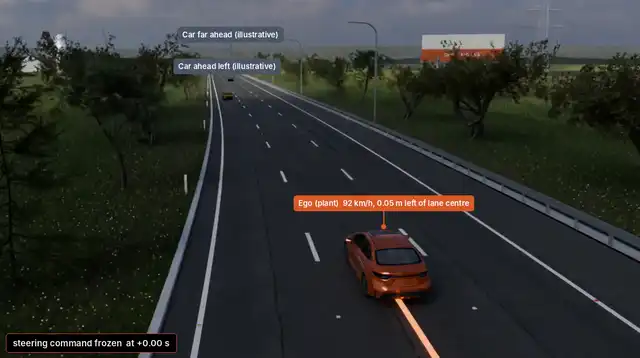](clips/ec-03-frozen-curve-exit.mp4)

**[ec-04-stall-curve-tunnel](clips/ec-04-stall-curve-tunnel.mp4)**

[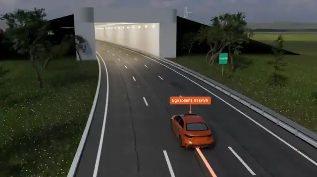](clips/ec-04-stall-curve-tunnel.mp4)

**[ec-11-lane-change-frozen-overshoot](clips/ec-11-lane-change-frozen-overshoot.mp4)**

[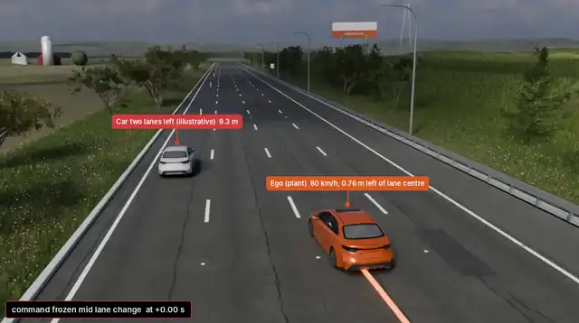](clips/ec-11-lane-change-frozen-overshoot.mp4)

**[ec-12-lane-change-stall-exit](clips/ec-12-lane-change-stall-exit.mp4)**

[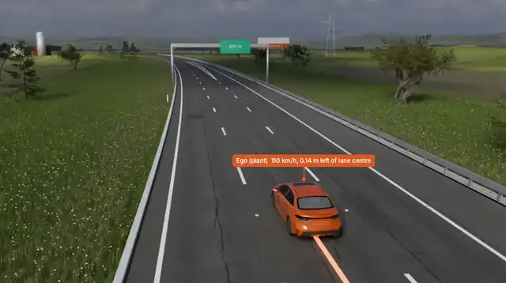](clips/ec-12-lane-change-stall-exit.mp4)

**[ec-18-wrong-direction-correction](clips/ec-18-wrong-direction-correction.mp4)**

[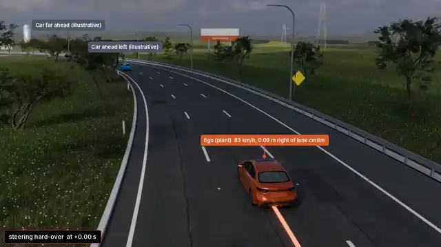](clips/ec-18-wrong-direction-correction.mp4)

**[ec-20-brakes-instead-of-steering](clips/ec-20-brakes-instead-of-steering.mp4)**

[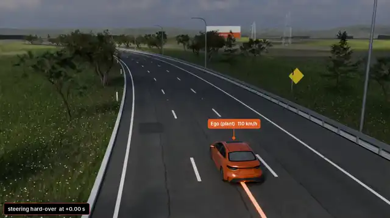](clips/ec-20-brakes-instead-of-steering.mp4)

**[ec-24-silent-stall-r-odd](clips/ec-24-silent-stall-r-odd.mp4)**

[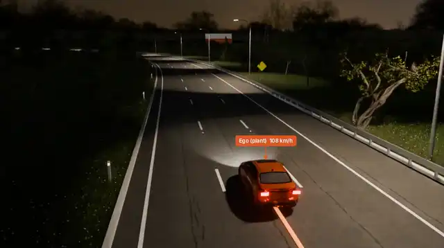](clips/ec-24-silent-stall-r-odd.mp4)

**[ec-26-narrow-lane-truck-hardover](clips/ec-26-narrow-lane-truck-hardover.mp4)**

[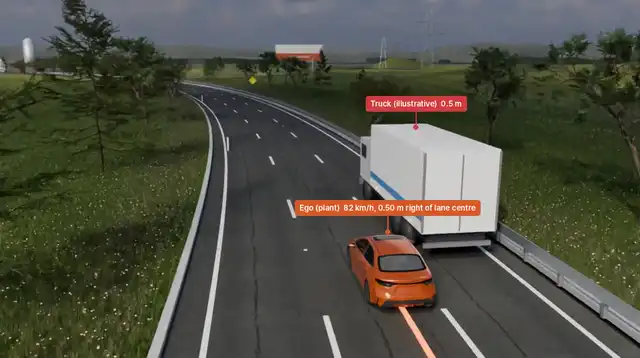](clips/ec-26-narrow-lane-truck-hardover.mp4)

**[ec-27-crosswind-hardover-left](clips/ec-27-crosswind-hardover-left.mp4)**

[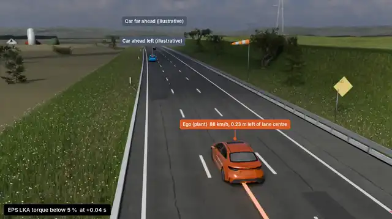](clips/ec-27-crosswind-hardover-left.mp4)

**[ec-28-lead-brakes-decel-lost](clips/ec-28-lead-brakes-decel-lost.mp4)**

[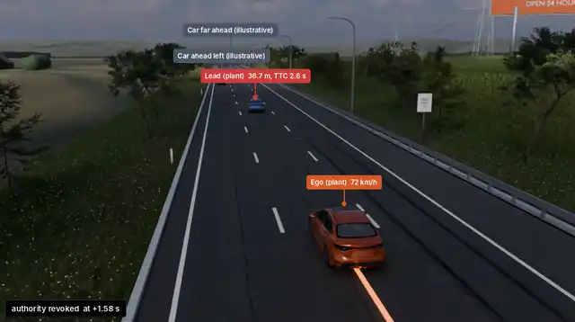](clips/ec-28-lead-brakes-decel-lost.mp4)

**[ec-29-lead-brakes-soc-stall](clips/ec-29-lead-brakes-soc-stall.mp4)**

[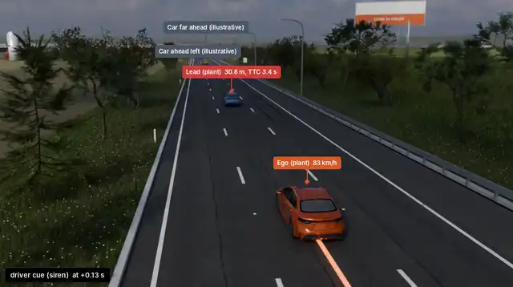](clips/ec-29-lead-brakes-soc-stall.mp4)

**[ec-34-step-decel-close-follower](clips/ec-34-step-decel-close-follower.mp4)**

[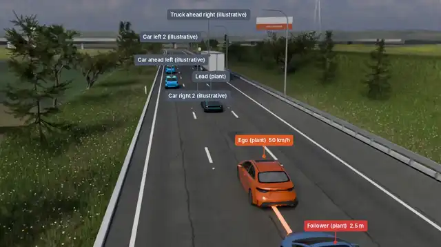](clips/ec-34-step-decel-close-follower.mp4)

**[ec-36-soft-disable-close-follower](clips/ec-36-soft-disable-close-follower.mp4)**

[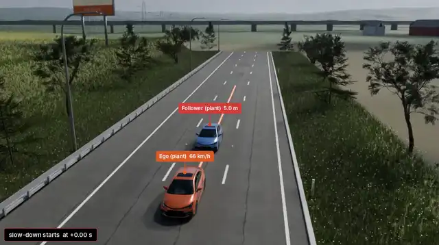](clips/ec-36-soft-disable-close-follower.mp4)

**[he-01-1-rural-hardover-oncoming](clips/he-01-1-rural-hardover-oncoming.mp4)**

[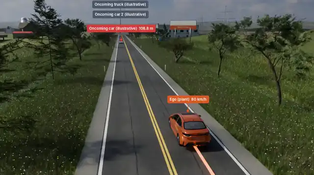](clips/he-01-1-rural-hardover-oncoming.mp4)

**[he-01-2-hardover-adjacent](clips/he-01-2-hardover-adjacent.mp4)**

[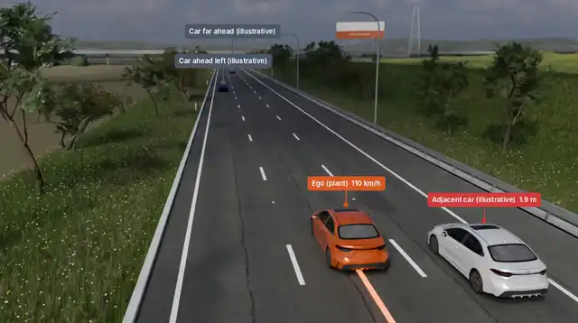](clips/he-01-2-hardover-adjacent.mp4)

**[he-01-3-urban-hardover-cyclist](clips/he-01-3-urban-hardover-cyclist.mp4)**

[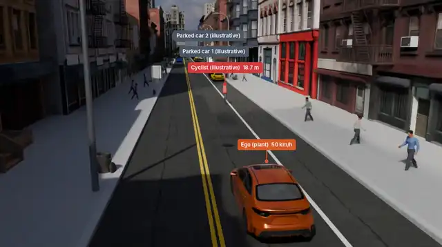](clips/he-01-3-urban-hardover-cyclist.mp4)

**[he-01-4-not-engaged-torque](clips/he-01-4-not-engaged-torque.mp4)**

[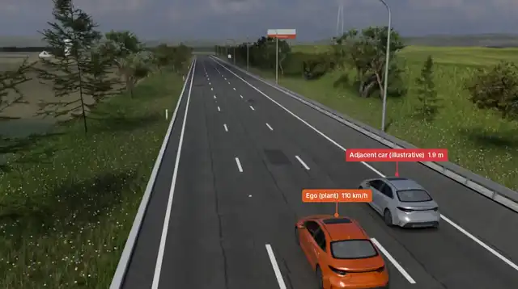](clips/he-01-4-not-engaged-torque.mp4)

**[he-02-1-eps-loss-curve](clips/he-02-1-eps-loss-curve.mp4)**

[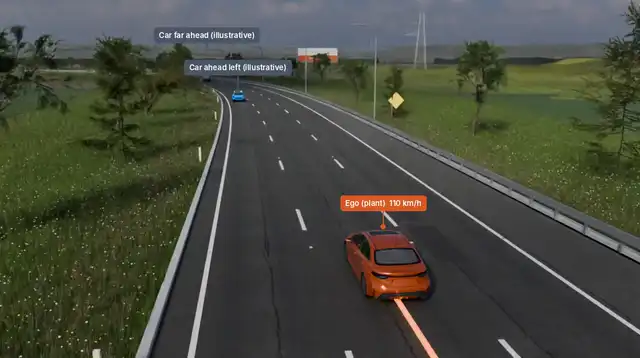](clips/he-02-1-eps-loss-curve.mp4)

**[he-02-2-rural-curve-oncoming](clips/he-02-2-rural-curve-oncoming.mp4)**

[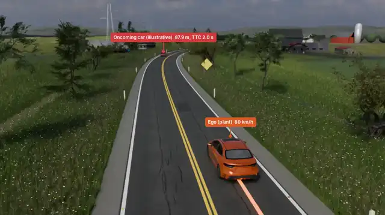](clips/he-02-2-rural-curve-oncoming.mp4)

**[he-03-3-accel-toward-slower-lead](clips/he-03-3-accel-toward-slower-lead.mp4)**

[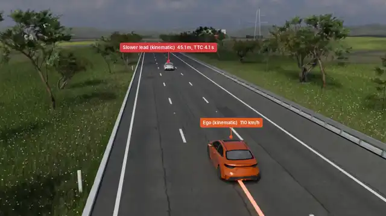](clips/he-03-3-accel-toward-slower-lead.mp4)

**[he-06-1-stationary-decel-lost](clips/he-06-1-stationary-decel-lost.mp4)**

[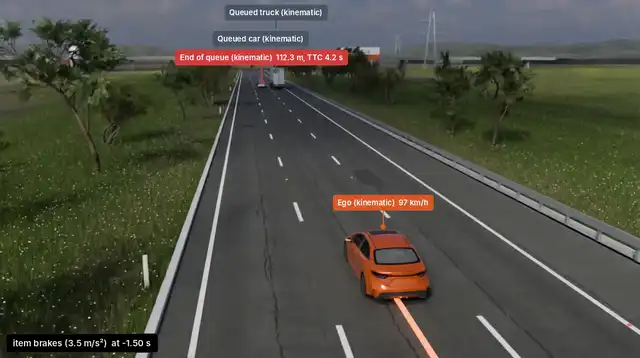](clips/he-06-1-stationary-decel-lost.mp4)

**[he-07-1-mode-confusion-curve](clips/he-07-1-mode-confusion-curve.mp4)**

[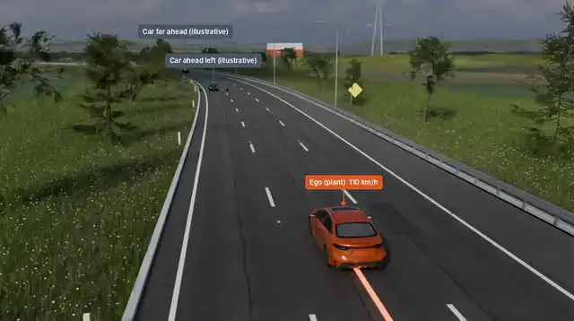](clips/he-07-1-mode-confusion-curve.mp4)

**[he-07-3-believes-acc-active](clips/he-07-3-believes-acc-active.mp4)**

[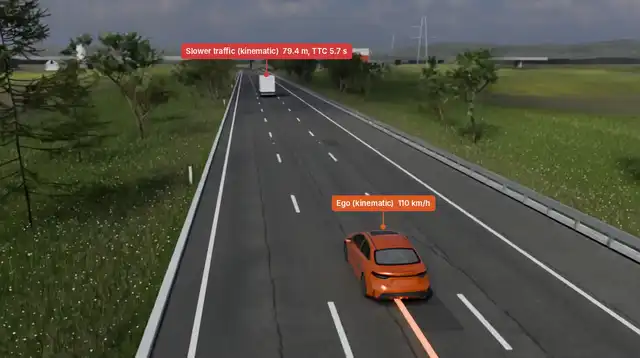](clips/he-07-3-believes-acc-active.mp4)

**[sh-01-ghost-line](clips/sh-01-ghost-line.mp4)**

[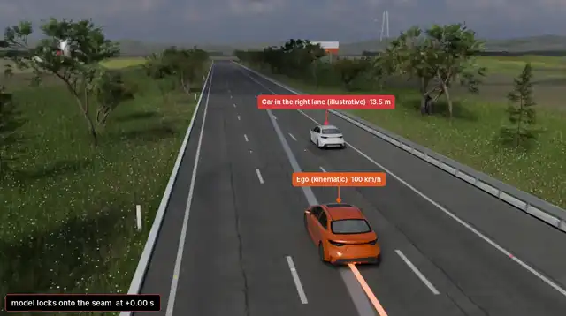](clips/sh-01-ghost-line.mp4)

**[sh-02-curve-beyond-capability](clips/sh-02-curve-beyond-capability.mp4)**

[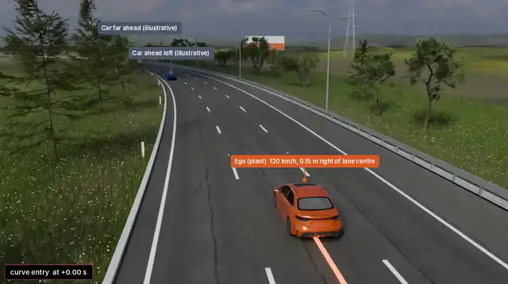](clips/sh-02-curve-beyond-capability.mp4)

**[sh-03-lead-lost-accel](clips/sh-03-lead-lost-accel.mp4)**

[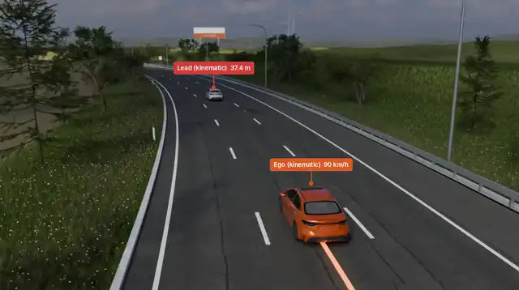](clips/sh-03-lead-lost-accel.mp4)

**[sh-06-stationary-not-lead](clips/sh-06-stationary-not-lead.mp4)**

[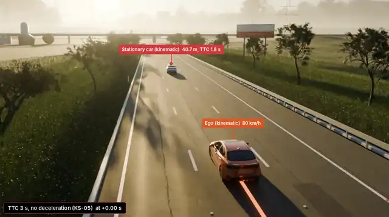](clips/sh-06-stationary-not-lead.mp4)

**[sh-09-red-light](clips/sh-09-red-light.mp4)**

[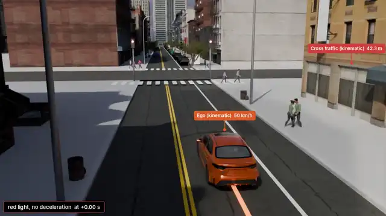](clips/sh-09-red-light.mp4)

**[sh-10-lane-change-blind-spot](clips/sh-10-lane-change-blind-spot.mp4)**

[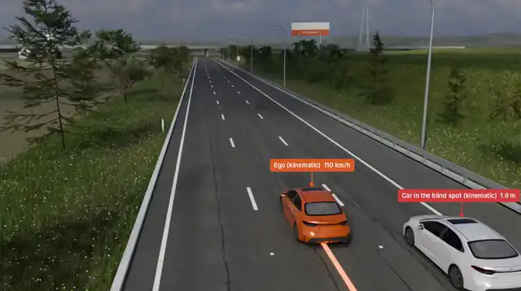](clips/sh-10-lane-change-blind-spot.mp4)

**[sh-11-pedestrian-occluded](clips/sh-11-pedestrian-occluded.mp4)**

[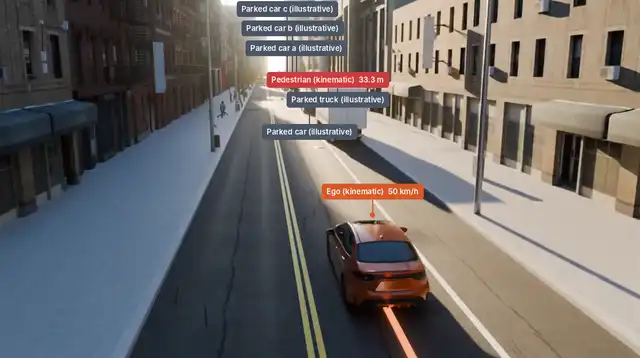](clips/sh-11-pedestrian-occluded.mp4)

**[sh-13-construction-zone](clips/sh-13-construction-zone.mp4)**

[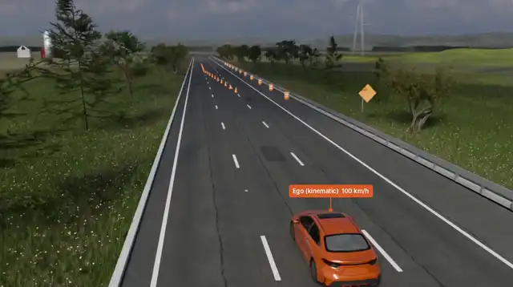](clips/sh-13-construction-zone.mp4)

## Credits

The streets, farmsteads and traffic use these models from Sketchfab, each under [CC-BY 4.0](https://creativecommons.org/licenses/by/4.0/) ([`../library/`](../library/README.md) section 5). The pedestrians are CC0 (Quaternius); the ego is the purchased Corolla mesh.

- [Truck Trailer FREE](https://sketchfab.com/3d-models/575958a53e3d4e9f8bcfb1ee2cef67bf) by NLM-Group, CC-BY 4.0
- [Generic passenger car pack](https://sketchfab.com/3d-models/20f9af9b8a404d5cb022ac6fe87f21f5) by comrade1280, CC-BY 4.0
- [Brownstone Building Set - Low poly model](https://sketchfab.com/3d-models/b15e6344acd844eabc823e1cc8332574) by DanielZhabotinsky, CC-BY 4.0
- [Realistic chicago buildings](https://sketchfab.com/3d-models/c4a3993ef1e84e6d9d5a15c78da88aae) by 99.Miles, CC-BY 4.0
- [Downtown Buildings Set - Low Poly model](https://sketchfab.com/3d-models/7378e7fb9c914c39880d9913a6f4e1d6) by DanielZhabotinsky, CC-BY 4.0
- [Generic civil service vehicles pack](https://sketchfab.com/3d-models/8ff2a13f30914932a70c7950cfa58465) by comrade1280, CC-BY 4.0
- [Panola Grain Bins](https://sketchfab.com/3d-models/342892c5b0ff4519a2327d05316e266c) by frankmcmains, CC-BY 4.0
- [Rural Buildings Set - Low Poly models](https://sketchfab.com/3d-models/51ab7e74bac347a89725f1d22b928edf) by DanielZhabotinsky, CC-BY 4.0
