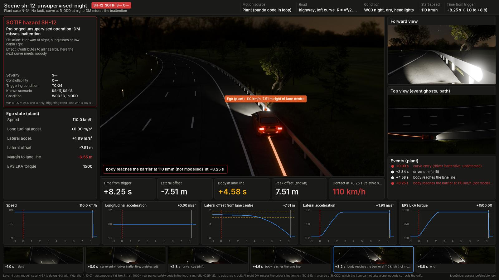

# Scene library

The parts the hazardous-event scenes are built from ([`../scenes.yaml`](../scenes.yaml), [`../README.md`](../README.md)).
A scene is **environment + condition + traffic + motion source**, so one hazardous event can be drawn under every
weather or lighting code it is rated for. Pictures only: synthetic (DSR-12), no evidence credit.

| File | Holds | Used by |
|---|---|---|
| [`environments.yaml`](environments.yaml) | 10 static worlds: cross-section, geometry, scenery, road furniture, the operational situations (OS-) they represent, the conditions each allows | `export_scene.py` |
| [`conditions.yaml`](conditions.yaml) | W01 to W06 of the HARA and the TC-01 low-sun preset: exposure, ODD, what the HARA model changes, and the look | `export_scene.py`, `hazard_scene.py` |
| [`traffic.yaml`](traffic.yaml) | Illustrative traffic presets placed relative to the ego | `export_scene.py` |
| [`assets.yaml`](assets.yaml) | CC0 sky HDRIs, ground textures, scanned plants and street furniture (Poly Haven, ambientCG) with candidate IDs and a search fallback | `fetch_assets.py`, `hazard_scene.py` |
| [`people/`](people/README.md) | Two CC0 pedestrian figures (Quaternius) with a walk cycle, built by `people/build_people.py` and committed | `hazard_scene.py` |
| `assets.lock.json` | The asset IDs and SHA-256 sums `fetch_assets.py` chose; committed once it has run (section 4) | `fetch_assets.py --locked`, `hazard_scene.py` |




*The same library under two conditions of §2: W02 wet road ([HE-04.2](../dashboards/he-04-2-wet-curve-braking.jpg)) and W03 night ([SH-12](../dashboards/sh-12-unsupervised-night.jpg)). Synthetic, no evidence credit.*

## 1. How a scene uses it

```yaml
- id: he-02-4-silent-loss-truck
  environment: highway-free-flow     # road, scenery, props; must allow the condition
  conditions: W01                    # the default
  traffic: free-flow                 # optional; illustrative road users around the ego
  variants: [W02, W03, W04, W05]     # also render he-02-4-silent-loss-truck--w02 ... --w05
  actors: [...]                      # the scene's own road users, added after the preset's
```

The scene's own `road:` fields override the environment's (for example `geometry: "curve@1.5"`). Its `props:`,
`env:` and `actors:` are added to the environment's, the condition's and the preset's. `test_scenes.py` checks that:

- every scene names an environment;
- each scene and variant uses a condition its environment allows;
- a plant case drives the geometry its environment has;
- the W-codes match `hara_model.py` (exposure and ODD);
- traffic is never the critical road user or the contact;
- every variant has its base scene's motion, events and contact.

## 2. Conditions

A condition changes the picture only. The plant's tyre model is linear with no friction limit, and the kinematic
scenes use their stated accelerations, so the motion is the same under every condition. The dashboard and the
gallery say so.

| Code | Condition | Exposure | ODD | Drawn as |
|---|---|---|---|---|
| W01 | Dry, daylight | E4 | in | Clear sky, sun at 30° behind |
| W02 | Wet road or light rain | E3 | in | Overcast, wet glossy asphalt with puddles, light rain, haze (1.5 km) |
| W03 | Night, dry, headlights | E3 | in | Moonlit sky, headlights and tail lamps, street and road lighting where the environment has it, glare |
| W04 | Moderate or heavy rain | E2 | outside | Dark overcast, standing water, heavy rain, visibility 350 m, lights on |
| W05 | Snow or ice | E2 | outside | Overcast, snow on verges and trees, slush between the wheel tracks, icy tracks, snowfall, visibility 600 m |
| W06 | Fog below the ODD bound | E1 | outside | Fog at 120 m visibility (the ODD bound is 200 m, WP-C-02 §3), lights on |
| TC-01 | Low sun in the camera's view | — (SOTIF) | in | Sun 5° above the horizon ahead (12° where buildings would hide it), bloom |

Fog and haze are a volume over the scene with extinction 3 / visibility per metre (Koschmieder: 5 % contrast at the
stated visibility).

## 3. Environments and traffic

| Environment | Situations | Conditions |
|---|---|---|
| `highway-free-flow` | OS-01, 05, 07, 08, 09, 10, 12, 13, 17, 18 | all |
| `highway-curve` | OS-02 (curve near R_ODD) | all |
| `highway-interchange` | OS-01, OS-08 (overpass, gantry, lighting) | all |
| `highway-queue` | OS-06, OS-07 | all |
| `highway-worn-markings` | OS-01 with TC-05 | all but W05 (snow hides the markings the scene is about) |
| `highway-construction` | OS-14 with TC-06 (cone taper, drums) | all but W05 |
| `rural-undivided` | OS-03 | all |
| `rural-curve` | OS-16 | all |
| `urban-arterial` | OS-04, OS-06 | all |
| `urban-intersection` | OS-15 | all |

Traffic presets: `none`, `free-flow`, `dense`, `adjacent-truck`, `close-follower`, `cut-in`, `oncoming`, `parked`.
A variant moves each preset road user by up to the preset's `jitter_m` along the road (seeded by the variant's ID),
so the same event under another condition does not look copied.

## 4. CC0 assets

```sh
python3 assurance/sim/blender/fetch_assets.py --check-hosts   # api.polyhaven.com, dl.polyhaven.org, ambientcg.com
python3 assurance/sim/blender/fetch_assets.py                 # resolve, download, write assets.lock.json
python3 assurance/sim/blender/fetch_assets.py --locked        # the locked files only, SHA-256 checked
```

Each slot tries its candidate IDs in order. When none resolves, it searches the source's API and takes the most
downloaded match. Files go under `assurance/sim/assets/library/<slot>/`, which is git-ignored. Every asset on both
sites is CC0 1.0. `hazard_scene.py` uses a slot only when all its files are on disk. Otherwise it falls back to the
procedural look: noise-varied asphalt with grain, stones, bump and polished wheel tracks; varied grass with dry
patches; voronoi gravel; concrete slabs; a Nishita or overcast sky; lumpy-crowned trees and stacked-cone conifers,
with no verge grass. The wet, snow and ice layers apply to both.
Road surfaces carry UVs in metres (u lateral, v along the road), so a texture follows the road round a curve and
its tangent-space normal map is correct.

**Fetched (2026-10-18)**, all CC0 1.0; `assets.lock.json` holds the files and their
SHA-256. Tile sizes are the ones each source publishes.

| Slot | Asset | Tile |
|---|---|---|
| `hdri_clear` | Poly Haven [`kloofendal_48d_partly_cloudy_puresky`](https://polyhaven.com/a/kloofendal_48d_partly_cloudy_puresky) | 2k HDR |
| `hdri_overcast` | Poly Haven [`overcast_soil_puresky`](https://polyhaven.com/a/overcast_soil_puresky) | 2k HDR |
| `hdri_low_sun` | Poly Haven [`spruit_sunrise`](https://polyhaven.com/a/spruit_sunrise) | 2k HDR |
| `hdri_night` | Poly Haven [`dikhololo_night`](https://polyhaven.com/a/dikhololo_night) | 2k HDR |
| `asphalt` | Poly Haven [`asphalt_02`](https://polyhaven.com/a/asphalt_02) | 3 m, 2k |
| `grass` | ambientCG [`Grass004`](https://ambientcg.com/view?id=Grass004) | 1.4 m, 1K |
| `gravel` | Poly Haven [`gravel_floor_02`](https://polyhaven.com/a/gravel_floor_02) | 2 m, 1k |
| `concrete` | ambientCG [`Concrete034`](https://ambientcg.com/view?id=Concrete034) | 1.1 × 0.55 m, 1K |
| `snow` | Poly Haven [`snow_02`](https://polyhaven.com/a/snow_02) | 2 m, 1k |

The offline picks were checked against the sites' previews before locking. Three were replaced:
`aerial_grass_rock` (a 15 m aerial of mostly bare earth) by `Grass004`, `gravelly_sand` (orange desert sand) by
`gravel_floor_02`, and `concrete_floor_02` (a stained floor) by `Concrete034`; after a test render, `moonless_golf`
(floodlights on its horizon, which drew as a glowing patch in the sky) by `dikhololo_night`. Test renders then showed the asphalt scan about
2.5 times brighter than fresh asphalt and the grass scan glossy enough to shine at grazing angles, so the slots
carry a `tint` (asphalt 0.5, gravel 0.45) and a `roughness_min` (grass 0.8), which `fetch_assets.py` copies into the
lock.

**Plants (2026-10-18).** The `model` slots are scanned Poly Haven plants, fetched as glTF with their 1k textures
(`textures/` beside the `.gltf`, as the glTF expects). Each mesh in a glTF is a variant; it is imported once, kept out
of the scene, and every instance shares its mesh data, as the road users share the Corolla mesh.

| Slot | Asset | Use |
|---|---|---|
| `tree_broadleaf_a` | Poly Haven [`island_tree_02`](https://polyhaven.com/a/island_tree_02) | Broadleaf trees, 6 to 8.4 m |
| `tree_broadleaf_b` | Poly Haven [`tree_small_02`](https://polyhaven.com/a/tree_small_02) | Broadleaf trees, 6 to 8.4 m |
| `tree_conifer` | Poly Haven [`fir_sapling_medium`](https://polyhaven.com/a/fir_sapling_medium) (3 variants) | Conifers, 6.4 to 9 m |
| `shrub` | Poly Haven [`shrub_02`](https://polyhaven.com/a/shrub_02) (4 variants) | Under the trees of a tree-lined road |
| `verge_short` | Poly Haven [`grass_bermuda_01`](https://polyhaven.com/a/grass_bermuda_01) (17 clumps) | First metre of a rural or highway verge |
| `verge_meadow` | Poly Haven [`grass_medium_02`](https://polyhaven.com/a/grass_medium_02) (5 clumps) | 0.5 to 6.5 m beyond the road edge, thinning out into the field |

A scanned tree stands exactly where the procedural tree would, so switching between the two looks does not move
anything in a scene. Where a role's slot is missing, that role falls back to the procedural look on its own. Verge
grass is scattered by geometry nodes on rural and highway verges. It is left out under snow, which would cover it,
and on urban streets, which have pavements. Under snow the plants' own materials get snow on their upward-facing
parts. With the `grass` texture, the fields also get 50 to 100 m dry patches and faint mowing rows beyond the verge.

Cost, measured on 1280 × 720 chase stills at 16 samples on 4 CPU cores: Poly Haven ships only the full-detail mesh,
0.4 to 2 million triangles a tree. Peak memory goes from about 1.5 GB to 4.4 GB for each Blender process, and a still
takes about 12 to 20 s longer (23 to 37–42 s; 47 to 65 s with snowfall). Building a scene takes about 14 s longer, once
per scene. Leave the plant slots unfetched, or delete their folders, to render with the procedural trees.

**Street furniture (2026-10-18).** Urban pavements are laid out by [`../street_layout.py`](../street_layout.py), which
is plain Python, so CI checks every urban scene (`test_scenes.py`). Each side gets street trees in kerbside pits about
every 36 m, the two sides staggered (the scanned broadleaf trees at 0.75 of their height, or the procedural tree). It
also gets lamp columns every 30 m with a bin by most of them, benches facing the carriageway, hydrants at the kerb,
street cabinets against the buildings, and a bus stop 45 m (left) and 95 m (right) ahead of the ego's start, then
every 180 m. Nothing stands within 6 m of any pedestrian or cyclist pose, across an intersection (plus 6 m), within
3 m of a traffic light or within 6 m of a crosswalk. Furniture must not hide a road user the scene does not already
hide.

| Slot | Asset | Use |
|---|---|---|
| `bin` | Poly Haven [`metal_trash_can`](https://polyhaven.com/a/metal_trash_can) (clean and rusted) | By the lamp columns |
| `bench` | Poly Haven [`modular_street_seating`](https://polyhaven.com/a/modular_street_seating) (the bench with a back) | Facing the carriageway |
| `hydrant` | Poly Haven [`fire_hydrant`](https://polyhaven.com/a/fire_hydrant) | At the kerb |
| `utility_box` | Poly Haven [`utility_box_01`](https://polyhaven.com/a/utility_box_01) | Against the buildings |

The lamp columns (8 m, with a 1.6 m arm over the carriageway and a point light at night) and the glass bus shelters
(with a bench, a lit advert and the stop sign) are procedural. Poly Haven has only 3.9 m heritage lamp posts and no
shelter. The furniture models are small (4,000 to 75,000 triangles), so render time and memory do not change.
