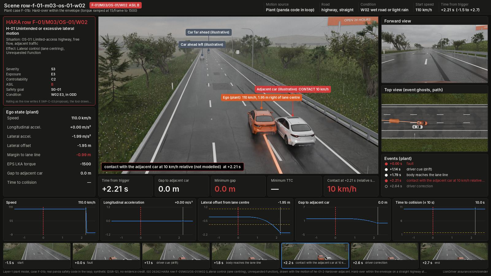

# Hazard Scene Studio (risk-scene renderer)

| Field | Value |
|---|---|
| Scope | Turn a row of a risk assessment into the scene dashboard the [Blender pipeline](../blender/README.md) draws, and write the outcome back into the row. The demo of [render-tool-plan.md](../render-tool-plan.md) §5: a spreadsheet on our own machine, the ISO 26262 HARA adapter, stills only |
| Version | 0.1 (2026-10-22): template, HARA adapter, prefill, row to scene, run and write-back, tests; the demo sheet rendered |
| Status | Demo. AI-drafted (Claude, AI assistant; I0 under WP-M-02 §3.3); not reviewed |
| Credit | None. Every picture is synthetic (DSR-12) and earns no evidence credit. The tool draws a row's rating; it never rates |



*The demo row, drawn from [examples/demo.xlsx](examples/demo.xlsx). The card on the left is the row as the HARA writes it.*

## 1. Use it

1. Copy [`template.xlsx`](template.xlsx), or let `prefill.py` start a sheet. Open the sheet of your method (today:
   **ISO 26262 HARA**).
2. Fill one row per event from row 4 down, picking from the dropdowns. The **Lists** sheet says what each value is.
3. Run it. Each row comes back with a status, a dashboard, the contact, the smallest gap and TTC, and the motion
   source.

```sh
python3 assurance/sim/render-tool/prefill.py my.xlsx F-01/M03/OS-01/W02     # fill a row from its HARA key
python3 assurance/sim/render-tool/run_sheet.py my.xlsx --no-render          # outcome only, about a second a row
python3 assurance/sim/render-tool/run_sheet.py my.xlsx                      # and the dashboards, in my-dashboards/
python3 assurance/sim/render-tool/test_render_tool.py                       # CI: no Blender needed
python3 assurance/sim/render-tool/template.py                               # regenerate template.xlsx (CI: --check)
```

Rendering needs Blender: `blender` on the PATH, a Python with `pip install bpy` (5.x), or `LIONDRIVER_BLENDER` set to
a command that runs a script (`"blender -b -P"`, `/opt/bpy/bin/python`). The plant needs the opendbc and panda
submodules and `assurance/sim/requirements.txt`, as for `export_scene.py`. A still dashboard takes 3 to 12 min of
CPU; rows with the same picture share one render (the Render key column).

## 2. The columns

| Kind | Columns | Rule |
|---|---|---|
| Row | Row ID, Title | Row ID unique in the sheet |
| Scene | Environment | the road and its cross-section (lanes, barrier), so **it can change the outcome**; a change from the preset's environment is noted in the status |
| Look | Condition, Traffic | the picture only: the same motion, events, contact, gap and TTC under every one (tested) |
| Motion | Motion preset, Speed km/h | the motion of a gallery scene (`scenes.yaml`): a plant run with the real panda safety code, or a kinematic motion under stated assumptions. The speed is the one change a row can make. There is no column for positions or paths |
| Rating | the adapter's columns ([`adapters/`](adapters/)) | shown on the card as the row writes them |
| Result | Status, Dashboard, Contact, Smallest gap m, Smallest TTC s, Motion source, Render key | written by `run_sheet.py` |

A row the library cannot draw comes back with the reason in **Status** ("cannot draw: no library environment draws
OS-19 yet"). Of the HARA's 21 situations, OS-19 (roundabout), OS-20 (road works) and OS-21 (no lane markings) have no
environment yet.

## 3. How a row becomes a scene

[`row_to_scene.py`](row_to_scene.py) copies the preset scene's motion (its plant case and overrides, assumptions,
road users, window, road fields and props), sets the row's environment, condition and traffic, puts the row's own
card on it, and hands it to `export_scene.py`'s own `resolve` and `build`. Nothing in the motion is the tool's: the
demo row's `scene.json` matches the gallery scene `he-01-2-hardover-adjacent--w02` in every motion, event, contact,
gap, TTC and pose (`test_render_tool.py`). [`run_sheet.py`](run_sheet.py) renders the stills once per render key
(`out/renders/`, git-ignored) and composes each row's dashboard over them with its own card.

Two small hooks in the Blender pipeline serve it, neither changing a gallery scene: `export_scene.card` takes a
scene's own `card`, and `traffic_actors` takes a `jitter_seed` so a row with a gallery variant's look gets that
variant's illustrative traffic; `compose.py` prints a card's own `heading`.

## 4. The demo sheet

[`examples/demo.xlsx`](examples/demo.xlsx), rendered with the purchased Corolla mesh and the locked CC0 assets:

| Row | What it shows | Outcome |
|---|---|---|
| F-01/M03/OS-01/W02 | the demo row, pre-filled from its HARA key | contact with the adjacent car at +2.21 s |
| … at night | the same row under W03: a look change | the same contact |
| … at 90 km/h | the same row at 90 km/h: a motion change | the body reaches the barrier instead |
| F-01/M01/OS-19/W01 | a roundabout row | cannot draw: no library environment draws OS-19 yet |
