# Known scenarios as data

| Field | Value |
|---|---|
| Scope | Layer 2 of the [simulation track](../README.md) (roadmap phase S2): the [WP-V-03](../../06-validation/WP-V-03-sotif-known-scenarios.md) known scenarios that simulation can represent, as ASAM OpenSCENARIO 1.3 (`xosc/`) and OpenDRIVE 1.5 (`xodr/`) files named by scenario ID |
| Version | 0.5 (§1.1: a top view per scenario file, fig_sim_ks.py, Kenney Racing Pack sprites (CC0); 2026-10-19). 0.4 (KS-25 crosses the 110 km/h ODD-H bound, DQ-260 A, instead of 120 km/h; 2026-10-19). 0.3 (KS-27 at 400 m and 600 m, the barrier on the lane edge, as WP-V-03 v0.9 asks: files KS-27-R400 and KS-27-R600, reveal gaps measured about 77 m and 94 m; 2026-10-19). 0.2 (KS-27 written: a lead hidden by a wall on the inside of a ramp curve while the ego accelerates to the set speed, TC-35; 2026-10-19). 0.1 (2026-10-16) |
| Status | Draft. AI-drafted (Claude, AI assistant; I0 under WP-M-02 §3.3); not reviewed. Synthetic scenarios (DSR-12); **no evidence credit** |

The files fix the road and the other road users of each scenario. The ego vehicle is the item under test: a file gives
it only a start position and speed (and, in KS-14, KS-25 and KS-27, the driver's or the item's own action), and the harness drives it. The
fault-injection plant model (layer 1) reads the scenario roads directly ([`../plant/roads.py`](../plant/roads.py)
`from_xodr`; case F-07-KS01) and takes the KS-08 time gap for its longitudinal cases from `KS-08.xosc`; MetaDrive
(layer 3) and the unknown-scenario search (layer 4) are to use the same files.



*Where these files sit: layer 2 of the simulation track ([Figure r2](../README.md), generated by [`fig_sim_readme.py`](../figures/fig_sim_readme.py)).*

Highway only (ODD-H; DQ-023 answered B): three lanes, OpenDRIVE lane IDs −1 (left) to −3 (right), the ego in lane −2
unless stated. KS-27 is the exception: TC-35 happens on ramps and interchanges, so its road is a one-lane ramp (lane
−1) with a 2 m wall on the inside of the curve, in three files for the radii 250, 400 and 600 m. WP-V-03 parameters are scenario parameters: their defaults are in the file, their sweep values below.

```sh
python3 assurance/sim/scenarios/generate.py           # write the files (scenariogeneration, MPL-2.0)
python3 assurance/sim/scenarios/generate.py --check   # CI: committed files equal a fresh generation
python3 assurance/sim/scenarios/replay.py --check     # CI: replay headless in esmini v3.9.0, check, compare the table
python3 assurance/sim/scenarios/test_scenarios.py
```

## 1. Scenarios written as files

| ID | Scenario | Files | Parameters: default (sweep) | What the replay checks |
|---|---|---|---|---|
| KS-01 | Curve at or beyond the lateral capability | [`KS-01.xosc`](xosc/KS-01.xosc), [`KS-01.xodr`](xodr/KS-01.xodr) | `EgoSpeed` 27.386 (24.495, 27.386, 30, 32.404) m/s | ego stays in lane -2; steady-state lateral acceleration v²/R equals the parameter's within 5 % |
| KS-05 | Stationary vehicle in lane at highway approach | [`KS-05.xosc`](xosc/KS-05.xosc), [`KS-05.xodr`](xodr/KS-05.xodr) | `EgoSpeed` 22.222 (11.111, 16.667, 22.222, 33.333) m/s; `TargetS` 500 (500) m; `TargetOffset` 0 (-0.5, 0, 0.5) m | stationary vehicle stays at speed 0 in lane -2 at its offset |
| KS-06 | Narrow lane with an adjacent truck | [`KS-06.xosc`](xosc/KS-06.xosc), [`KS-06.xodr`](xodr/KS-06.xodr) | `EgoSpeed` 27.778 (25, 27.778, 33.333) m/s | truck stays in lane -3 alongside the ego; lane width 3.3 m |
| KS-07 | Close cut-in | [`KS-07.xosc`](xosc/KS-07.xosc), [`KS-07.xodr`](xodr/KS-07.xodr) | `EgoSpeed` 27.778 (27.778, 33.333) m/s; `CutInDistance` 15 (10, 15, 20) m; `ClosingSpeed` 1.389 (0, 1.389, 2.778) m/s; `LaneChangeTime` 2 (2) s | cut-in car is in lane -2 after the lane change; gap at the start of the lane change equals CutInDistance within 0.5 m |
| KS-08 | Lead decelerating hard | [`KS-08.xosc`](xosc/KS-08.xosc), [`KS-08.xodr`](xodr/KS-08.xodr) | `EgoSpeed` 22.222 (13.889, 22.222) m/s; `TimeGap` 1.5 (1.5) s; `LeadDecel` 5 (3, 5, 7) m/s² | lead decelerates at LeadDecel within 5 % and stops in lane -2 |
| KS-09 | Cut-out revealing a stopped vehicle | [`KS-09.xosc`](xosc/KS-09.xosc), [`KS-09.xodr`](xodr/KS-09.xodr) | `EgoSpeed` 13.889 (13.889) m/s; `CutOutDistance` 45 (30, 45, 60) m | lead is in lane -1 after the cut-out; stopped vehicle stays at speed 0 in lane -2 |
| KS-14 | Driver-initiated lane change | [`KS-14.xosc`](xosc/KS-14.xosc), [`KS-14.xodr`](xodr/KS-14.xodr) | `EgoSpeed` 27.778 (27.778) m/s; `TargetGap` 2.5 (2, 2.5, 3, 20) s | ego is in lane -3 after the lane change (scripted here: in a closed loop the driver's nudge starts it) |
| KS-23 | Stop-and-go queue and resume | [`KS-23.xosc`](xosc/KS-23.xosc), [`KS-23.xodr`](xodr/KS-23.xodr) | `StandTime` 5 (3, 5) s | lead leaves at 1.5 m/s² after StandTime; ego starts at standstill |
| KS-25 | Speed above the ODD bound | [`KS-25.xosc`](xosc/KS-25.xosc), [`KS-25.xodr`](xodr/KS-25.xodr) | `StartSpeed` 29.167 (29.167) m/s; `EndSpeed` 33.333 (33.333) m/s | ego speed crosses 110 km/h, the ODD-H bound (DQ-260 A) |
| KS-27 | Lead hidden in a ramp curve while accelerating to the set speed | [`KS-27.xosc`](xosc/KS-27.xosc), [`KS-27.xodr`](xodr/KS-27.xodr) (R 250 m); [`KS-27-R400.xosc`](xosc/KS-27-R400.xosc), [`KS-27-R400.xodr`](xodr/KS-27-R400.xodr); [`KS-27-R600.xosc`](xosc/KS-27-R600.xosc), [`KS-27-R600.xodr`](xodr/KS-27-R600.xodr) | `EgoSpeed` 19.444 (13.889, 19.444, 25) m/s; `SetSpeedDelta` 6.944 (5.556, 6.944, 8.333) m/s; `LeadSpeed` 0 (0, 8.333) m/s; `LeadS` 360 (360) m | the inside wall hides the lead until the gap along the lane is 40–80 m at 250 and 400 m (geometry: about 66 and 77 m) and 80–100 m at 600 m (about 94 m); ego accelerates to EgoSpeed + SetSpeedDelta (scripted here: in a closed loop the item does it); lead keeps LeadSpeed in lane -1 |

KS-01 is the one scenario whose sweep goes past the ODD curve bound on purpose (3.0 and 3.5 m/s² at R = 300 m):
WP-V-03 asks for behaviour at and beyond the lateral capability. KS-25 crosses the 110 km/h ODD-H speed bound (DQ-260 A) on
purpose, from 105 to 120 km/h; until 0.4 it crossed 120 km/h, the bound before DQ-260.

KS-27 builds the occlusion into the road. The sight line from the ego's lane centre to the lead's clears an
inside wall only within about √(8·Rp·m) along the lane (Rp the lane-centre radius, m the clearance from the lane
centre to the wall's centreline). The three files share the scenario and its parameters and differ in the road:

| File | Radius | Wall centreline | m | Reveal gap (geometry) | WP-V-03 band |
|---|---|---|---|---|---|
| `KS-27` | 250 m | 0.3 m outside the lane edge | 2.15 m | about 66 m | 40–80 m |
| `KS-27-R400` | 400 m | on the lane edge | 1.85 m | about 77 m | 40–80 m |
| `KS-27-R600` | 600 m | on the lane edge | 1.85 m | about 94 m | about 95 m: the closest a barrier at the lane edge allows (WP-V-03 v0.9); the replay accepts 80–100 m |

The replay measures the gap at which the line first clears the wall from esmini's recorded positions. Whether a camera
actually loses the lead behind the wall is for the harness that renders it (MetaDrive, layer 3); esmini only plays the
motion.

### 1.1 Top views

One looping top view per file, drawn by [`../figures/fig_sim_ks.py`](../figures/fig_sim_ks.py) from the esmini replay at
the parameter defaults (CI: `fig_sim_ks.py --check`): the road straightened with the ego held in place, the other road
users where the replay puts them, the scenario's key quantity with a moving cursor, and the events lighting up as they
happen. Layer 2 fixes the road and the other road users; the ego only holds its start speed (KS-14 and KS-25 script its
lane change and acceleration), so the loops with a slower or stopped vehicle ahead end before the bodies overlap. KS-06
is a still: nothing in it changes over time. Cars are drawn at least 45 px long and some panels are stretched sideways;
each panel says so. Cars: Kenney Racing Pack (CC0 1.0), pinned in
[`../figures/assets/kenney-racing/sources.yaml`](../figures/assets/kenney-racing/sources.yaml). KS-27 is drawn at
R = 250 m only.

















## 2. Scenarios not written as files

| ID | Why not |
|---|---|
| KS-02 | bank and crosswind: OpenSCENARIO 1.x has no wind, and esmini does not use superelevation; plant model (layer 1) later |
| KS-03 | lane-marking visibility is a perception condition: recorded data and the closed course (M3, M8) |
| KS-04 | lane split and merge: representable with a junction or a lane-width polynomial; deferred (SIM-OI-5) |
| KS-10 | overpass and shadow false braking is a perception condition (M3, M9) |
| KS-11 | radar clutter and metal plates are perception conditions (M3, M8, M9) |
| KS-12 | sun, headlights, tunnels are perception conditions (M3, M9) |
| KS-13 | work zones are outside the ODD; procedure check (M3, M8, M9) |
| KS-15 | rain and wet-road reflections are perception conditions (M3, M9) |
| KS-16 | camera obstruction and calibration are perception conditions (M3, M8) |
| KS-17 | driver-monitoring conditions (VS-ML-06, M8) |
| KS-18 | driver-monitoring conditions (VS-ML-06, M8) |
| KS-19 | driver override forces: plant model fidelity level L2 (Modelica steering), then M8 |
| KS-20 | stock PCS: plant model cases P-01…P-03 for the forwarding path; the braking itself only on the car (M8) |
| KS-21 | internal degradation: plant model fault cases (layer 1) and M1/M8 |
| KS-22 | pedestrians and cyclists at the lane edge are outside the highway-only ODD (DQ-023 answered B) |
| KS-24 | inspection |
| KS-26 | PCM cruise after disengagement: HIL and closed course (M1, M8) |
| KS-28 | emergency vehicles: beacons and sirens are perception conditions and the driver's response is a closed-course trial (M8); the Blender scenes sh-14-* picture the motion |

## 3. Replay

[`replay.py`](replay.py) runs each file headless in esmini v3.9.0 (MPL-2.0; fetched and checked against its SHA-256
by [`fetch_esmini.py`](fetch_esmini.py)) with a fixed 50 ms step, at the defaults and at each sweep value of one
parameter at a time, and checks from esmini's recording that the scenario happened as specified: lanes, gaps,
decelerations, speeds. esmini 3.9 has no command-line parameter override, so the replay writes a temporary copy with
the parameter defaults changed. esmini's default controller drives the ego, so the replay says nothing about
LionDriver: it only shows that the files are unambiguous and executable. Result: [`../results/scenario-replay.md`](../results/scenario-replay.md).

The files are not validated against the ASAM XML schemas: scenariogeneration's wheel does not ship them and their
redistribution terms are not checked here. esmini's parser loads every file without an error, which the replay
requires.

