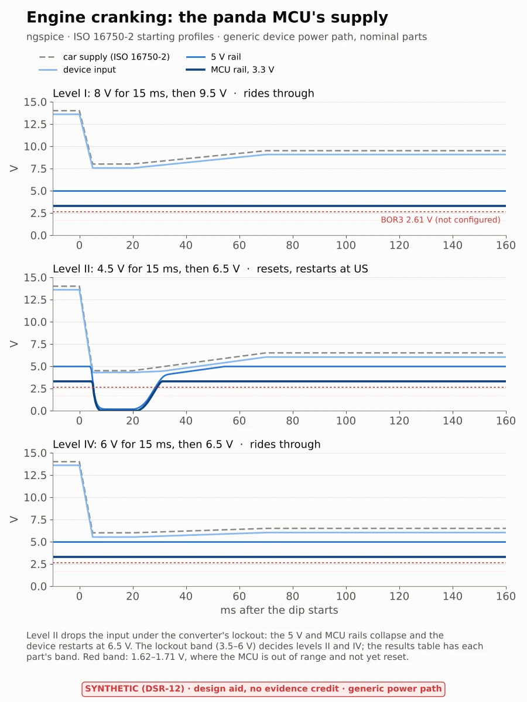

# 12 V supply: the cranking dip

> **Synthetic data (DSR-12). Design aid, no evidence credit (DQ-413).** The device's power path is not published, so
> the circuit is generic, with a band on each part in [`params.yaml`](params.yaml), until a schematic or a bench
> measurement replaces it. Physics plan study 8 ([`physics-plan.md`](../physics-plan.md) §4).

**Question.** When the engine cranks, the car's 12 V supply dips. Does the panda MCU's supply stay in range, or does it
brown out? TSR-505 asks for a brown-out reset (BOR) and a programmable voltage detector (PVD); neither is configured
today (HWSR-505, HWSR-505a). HWSR-505b asks for a threshold on the device's input voltage.

**Method.** [`crank.py`](crank.py) builds a netlist and runs it in ngspice 41 (tool TL-58):
- **The car's supply** follows the ISO 16750-2 starting profile, levels I, II and IV. The numbers are as TI reproduces
  them (TIC10024-Q1 datasheet SCPS268A, Table 10-5): from 14 V down to US6 for 15 ms, then up to US.
- **The device**: the harness, a Schottky reverse-polarity diode, hold-up capacitance, then a buck to 5 V. The buck
  regulates, falls into dropout, or stops below its under-voltage lockout (3.5–6 V). Its 5 V loads draw constant power.
  The MCU's 3.3 V regulator hangs off the 5 V rail.
- **The MCU's thresholds** (DS13311 Table 20, falling): the power-down reset at 1.62 V; BOR1–3 at 2.00, 2.31 and
  2.61 V; and 1.71 V, below which the part is not specified with its internal reset on.

**Result** ([`results/crank-dip.md`](../results/crank-dip.md)):
- **Level I** (8 V): the generic device rides through. Its input falls to 7.5 V and the converter stays in regulation.
- **Level II** (4.5 V): the input falls to 4.3 V, under the nominal lockout, so the device resets and restarts at
  6.5 V. The hold-up capacitance hardly helps: at about 8 W it lasts a few milliseconds, not 15. With a 3.5 V lockout
  the device rides through.
- **Level IV** (6 V): it rides through, unless the lockout is at the top of its band.
- **On the way down,** the MCU's rail falls from the BOR3 level to the power-down reset in 0.3–0.5 ms. For part of
  that it is under 1.71 V, out of range with nothing resetting it. The window is short, but a brown-out reset closes it.
- **For HWSR-505b:** the input dips to 7.5 V (level I) and 4.3 V (level II). A safe-state threshold above the dip
  trips on each such start. While engaged that matters only with engine stop-start (T1: does the reference car have it?).



*Figure 1. The panda MCU's supply through ISO 16750-2 starting profiles, nominal parts.*

**Limits.** The circuit is generic: the 3X's converter, its lockout and its hold-up are not published. The profile's
ripple is left out (TI does not give it). The MCU's own consumption is a resistor.

## Checks

[`test_supply.py`](test_supply.py) runs in CI (job "simulation 12 V supply"):

| Check | Catches |
|---|---|
| C1 ngspice against the closed form: a capacitor discharging into a resistor, within 0.5 % | a wrong solver set-up or reading of its output |
| C2 On a slow ramp the buck holds 5 V, follows the input less its headroom in dropout, stops below its lockout; the LDO holds 3.3 V or the 5 V rail less 0.3 V | a wrong behavioural source |
| C3 Before the dip the input power is the loads over the buck's efficiency, within 2 % | power from nowhere |
| C4 The profile equals TI's table (transcribed independently in the test), and the supply node follows it | a mistyped level |

`crank.py --check` reruns every case and fails if a number moves by more than 1 % (or 1 mV) from the committed JSON.

```sh
micromamba create -p <env> --file assurance/sim/supply/supply-linux-64.lock
<env>/bin/python assurance/sim/supply/test_supply.py
<env>/bin/python assurance/sim/supply/crank.py --figures     # about 10 s
```

## Files

| File | What |
|---|---|
| [`params.yaml`](params.yaml) | Every input with its source and status |
| [`crank.py`](crank.py) | The netlist, the runs and the results |
| [`fig_supply.py`](fig_supply.py) | The figure |
| [`test_supply.py`](test_supply.py) | Checks C1–C4 |
| [`supply-linux-64.lock`](supply-linux-64.lock) | The environment (ngspice 41, Python 3.12), every package by URL and md5 |
