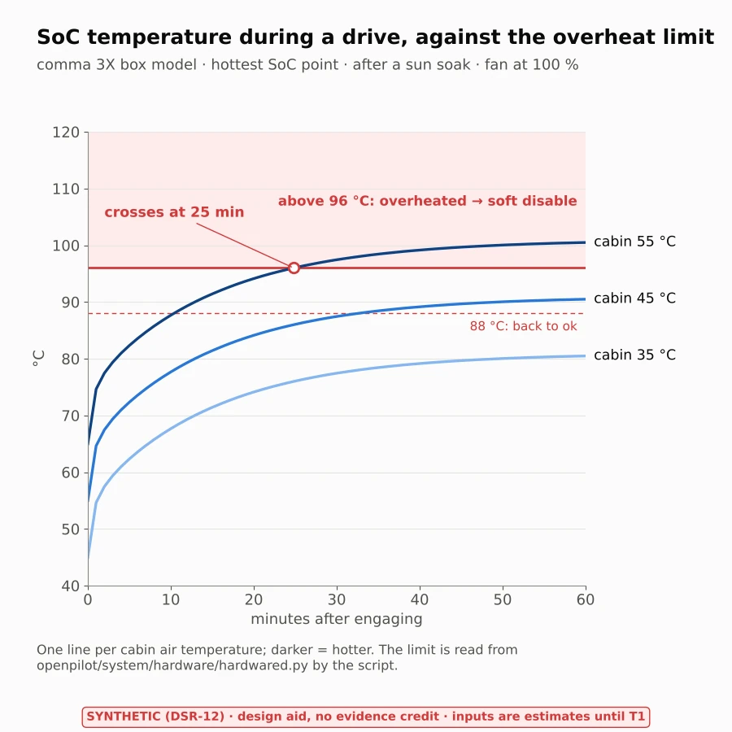
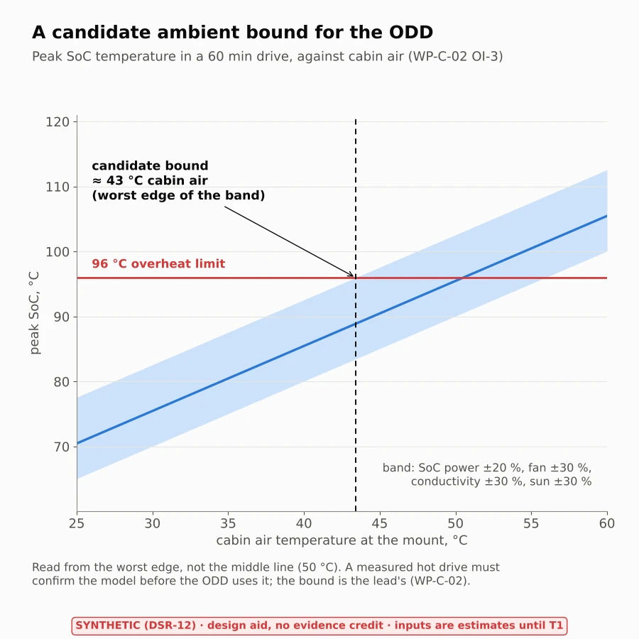
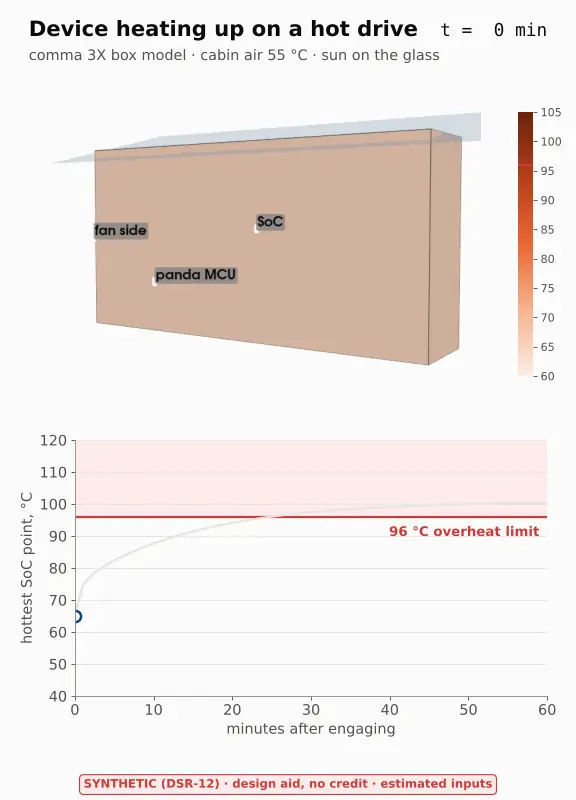
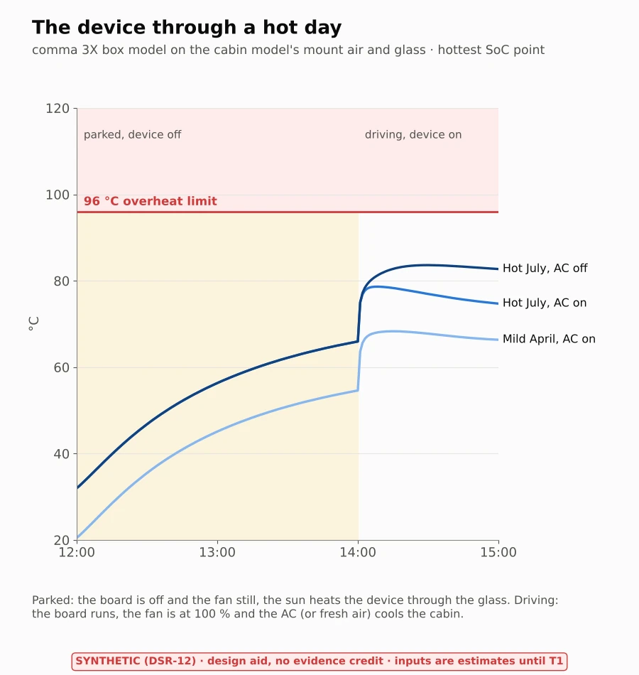

# Device heat model (TE-04 pilot)

> **Synthetic data (DSR-12). Design aid, no evidence credit (DQ-412).** Every input in
> [`params.yaml`](params.yaml) is an **estimate until step T1** (the device measured, its power and temperatures read
> from its own logs). The numbers show what the model does, not what the device does.

Does the comma device overheat behind a sun-loaded windshield before the drive ends, and at what cabin temperature? The
model proposes a candidate for the ODD's ambient bound (WP-C-02 OI-3, still TBD) and a number for the common cause
DFI-04 (SoC heat warming the panda MCU, WP-A-03). The lead decided on 2026-10-21: go (DQ-409 A), a cabin-air logger for
validation (DQ-411 A), design aid with credit revisited at G2 (DQ-412 A). Scope and tool choice:
[TE-04](../../07-supporting/tool-evaluations/TE-04-physics-field-model.md).


*Figure 1. The field after a 60 min drive at 45 °C cabin air, outside and cut through the SoC (FEniCSx, rendered off-screen with PyVista).*

## 1. The model

A box the size of the device, homogenised (one effective conductivity and heat capacity), with the SoC and the panda
MCU as heat sources and the rest of the board's power spread through the box:

    rho_c dT/dt = div(k grad T) + q        -k dT/dn = h (T - T_ref)  on each face

| Face | Exchanges heat with | Why |
|---|---|---|
| Rear (screen), left, bottom | cabin air, natural convection | open to the cabin |
| Fan side | cabin air, through one conductance for fan and fins | the fan at 100 % |
| Top (mount) | the windshield, which the sun heats above cabin air | pressed to the glass |
| Front (camera) | the windshield across an air gap, plus the sun through the glass | faces the road |

A drive starts from a sun-soaked device and runs 60 min in 60 s backward Euler steps. The "SoC temperature" is the
hottest point of the SoC region, as `hardwared` takes the hottest sensor. The overheat limit is read from
`openpilot/system/hardware/hardwared.py` by the script: 96 °C on the comma 3X (back to ok below 88 °C), 100 °C on the
comma four. What a homogenised box cannot show: the board, the spreader and the fan duct. It shows where the heat goes,
not the exact hot spot, and the hot-spot offset is one of the things step T4 calibrates.

## 2. Results (estimated inputs)

[`results/thermal-pilot.md`](../results/thermal-pilot.md) has the tables (generated). With the estimates of
`params.yaml`, the hottest SoC point reaches 96 °C at about **50 °C cabin air** on the nominal line, and at about
**43 °C** on the worst edge of the band. The band comes from one-at-a-time variations: SoC power ±20 %, fan ±30 %,
conductivity ±30 %, sun ±30 %. Because the model is linear, each variation shifts the whole line; the conductivity
(how well the spreader moves heat away from the SoC) and the SoC power move it most, about 7 and 5 K at −30 % and
+20 %, against about 2 K for the fan.



*Figure 2. Drives at three cabin temperatures against the limit the code applies.*



*Figure 3. The candidate ambient bound, read from the worst edge of the band. The bound itself is the lead's (WP-C-02).*



*Figure 4. The 55 °C drive as a loop (animated WebP).*

### 2.1 On the cabin's own temperatures

The sweep holds the mount air at one temperature for an hour. [`cabin_drive.py`](cabin_drive.py) runs the same device
on the cabin heat soak's mount air and windshield temperatures minute by minute
([`../weather/cabin_soak.py`](../weather/README.md#3-cabin-heat-soak-oi-3-tc-21)): two hours parked in the sun with
the board off and the fan still, then an hour's drive with the board on. On a hot July day the SoC reaches 66 °C
parked. While driving it peaks at 79 °C with the AC on and 84 °C with it off, below the 96 °C limit in both. Results:
[`results/cabin-device.md`](../results/cabin-device.md).



*Figure 5. The device on the cabin's own temperatures.*

## 3. Checks

[`test_thermal.py`](test_thermal.py) runs in CI. Each check is meant to catch a different error:

| Check | Catches | Result at the baseline |
|---|---|---|
| V1 Analytic slab, FEniCSx and FiPy each against the exact solution | a wrong weak form, Robin term or source | FEniCSx exact to 1e-8 K (P1 is nodally exact in 1D); FiPy within 1e-3 K |
| V2 Lumped transient: a well-mixed box against the exact exponential | a wrong heat capacity or time stepping | within 1 % of the rise |
| V3 FEniCSx against FiPy on a 2D section of the device (no shared code) | a solver or set-up error in either | SoC region 0.11 K apart, mean 0.001 K; with the sun's sign flipped in one of them they differ by 13 K, so the check bites |
| V4 Energy balance on the device model | lost or doubled heat | closes to 3e-12 of the heat in (the check fails above 1e-8) |
| V5 Mesh study (48×24×10, 72×36×15, 96×48×20 hexahedra) | a mesh too coarse for the hot spot | 90.97, 91.38, 91.18 °C steady at 45 °C: the pilot's mesh within 0.4 K of the finest |
| V6 Limits from the code | a moved band in `hardwared.py` | 96/88 °C (comma 3X), 100/92 °C (comma four) |
| V7 The cabin-driven runner (phases, references changing every step) against the pilot's runner when nothing changes | an error in the time-varying path | equal to 1e-9 K |

The pilot's own `--check` reruns every drive and fails if any number moves by more than 0.05 K from the committed
JSON. Figures render in CI, but their pixels are not compared, because software rendering differs slightly between
machines.

## 4. Run it

```sh
# environment: FEniCSx 0.10.0, FiPy 4.0.3, PyVista 0.49.1, VTK 9.7.0, Mesa 26.2.5 (explicit lock, every package by md5)
micromamba create -p <env> --file assurance/sim/thermal/thermal-linux-64.lock
<env>/bin/python assurance/sim/thermal/test_thermal.py              # checks V1–V6, about 2 min
<env>/bin/python assurance/sim/thermal/thermal_pilot.py --figures   # results and figures, about 4 min
<env>/bin/python assurance/sim/thermal/thermal_pilot.py --check     # CI: a fresh run against the committed JSON
<env>/bin/python assurance/sim/thermal/cabin_drive.py --check      # the device on the cabin model's temperatures
```

Figures render with no screen and no GPU through Mesa's software EGL (`figures.py` sets it up, TE-04 OI-2). They are
WebP because PNG and GIF go to the repository's read-only LFS store.

## 5. Next steps

| Step | Work | Needs |
|---|---|---|
| T1 Inputs | Measure the device and mount; read `powerDrawW`, `somPowerDrawW`, the SoC and PMIC temperatures, `intakeTempC`, `exhaustTempC` and the fan from local logs of drives already on the car (no uploads, DQ-084); replace the estimates | Calipers and a few local logs from the lead |
| T4 Validate | Logger at the mount on hot drives; compare the predicted SoC temperature with the logged one; set the band from the misfit | The logger (DQ-411) |
| T5 Hand over | Candidate bound and band to the WP-C-02 owner (OI-3), MCU temperature to WP-A-03 (DFI-04), labelled synthetic | T1 and T4 |

## 6. Files

| File | What |
|---|---|
| [`params.yaml`](params.yaml) | Every input with its source and status |
| [`heat.py`](heat.py) | Solver core (FEniCSx): 1D, 2D or 3D heat conduction with Robin faces, steady and transient |
| [`section_fipy.py`](section_fipy.py) | The independent FiPy solver for the cross-check |
| [`thermal_pilot.py`](thermal_pilot.py) | The device model, drives, sweep and bound; writes the results |
| [`cabin_drive.py`](cabin_drive.py) | The device on the cabin heat soak's temperatures (§2.1) |
| [`figures.py`](figures.py) | The five figures (PyVista off-screen, matplotlib) |
| [`test_thermal.py`](test_thermal.py) | Checks V1–V6 |
| [`thermal-linux-64.lock`](thermal-linux-64.lock) | The environment, every package by URL and md5 |
