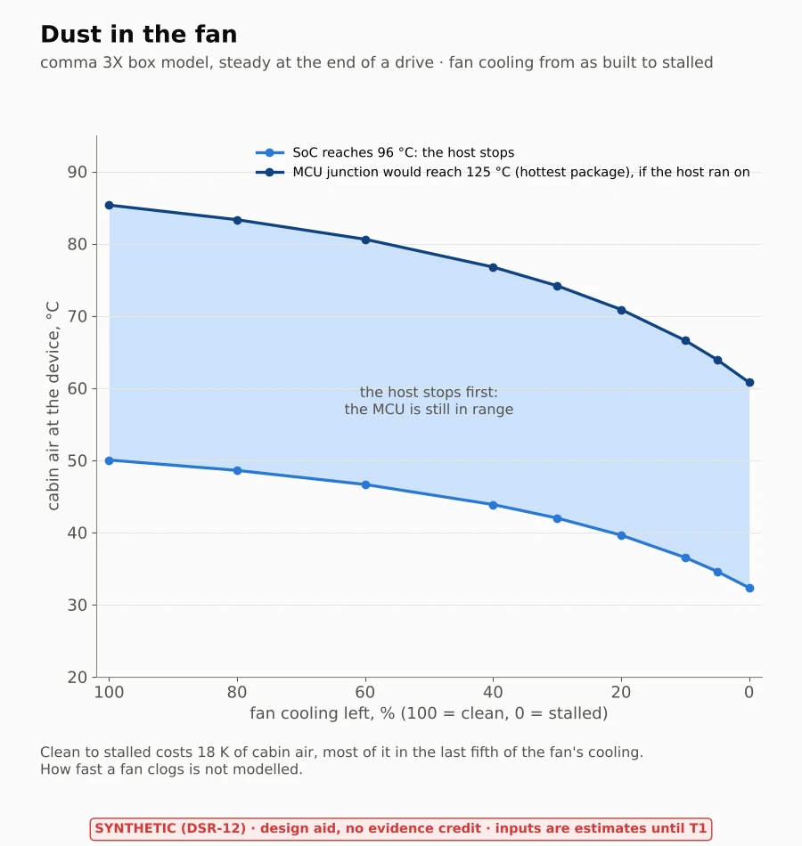

# Device heat model (TE-04 pilot)

> **Synthetic data (DSR-12). Design aid, no evidence credit (DQ-413).** Every input in
> [`params.yaml`](params.yaml) is an **estimate until step T1** (the device measured, its power and temperatures read
> from its own logs). The numbers show what the model does, not what the device does.

Does the comma device overheat behind a sun-loaded windshield before the drive ends, and at what cabin temperature? The
model proposes a candidate for the ODD's ambient bound (WP-C-02 OI-3, still TBD) and a number for the common cause
DFI-04 (SoC heat warming the panda MCU, WP-A-03). The lead decided on 2026-10-21: go (DQ-410 A), a cabin-air logger for
validation (DQ-412 A), design aid with credit revisited at G2 (DQ-413 A). Scope and tool choice:
[TE-04](../../07-supporting/tool-evaluations/TE-04-physics-field-model.md).


*Figure 1. The field after a 60 min drive at 45 °C cabin air, outside and cut through the SoC (FEniCSx, rendered off-screen with PyVista).*

## 1. The model

A box the size of the device, homogenised (one effective conductivity and heat capacity), with the SoC and the panda
MCU as heat sources and the rest of the board's power spread through the box:

    rho_c dT/dt = div(k grad T) + q        -k dT/dn = h (T - T_ref)  on each face

| Face | Exchanges heat with | Why |
|---|---|---|
| Rear (screen), left, bottom | cabin air, natural convection | open to the cabin |
| Fan side | cabin air, through one conductance for fan and fins | the fan at 100 % |
| Top (mount) | the windshield, which the sun heats above cabin air | pressed to the glass |
| Front (camera) | the windshield across an air gap, plus the sun through the glass | faces the road |

A drive starts from a sun-soaked device and runs 60 min in 60 s backward Euler steps. The "SoC temperature" is the
hottest point of the SoC region, as `hardwared` takes the hottest sensor. The overheat limit is read from
`openpilot/system/hardware/hardwared.py` by the script: 96 °C on the comma 3X (back to ok below 88 °C), 100 °C on the
comma four. What a homogenised box cannot show: the board, the spreader and the fan duct. It shows where the heat goes,
not the exact hot spot, and the hot-spot offset is one of the things step T4 calibrates.

## 2. Results (estimated inputs)

[`results/thermal-pilot.md`](../results/thermal-pilot.md) has the tables (generated). With the estimates of
`params.yaml`, the hottest SoC point reaches 96 °C at about **50 °C cabin air** on the nominal line, and at about
**43 °C** on the worst edge of the band. The band comes from one-at-a-time variations: SoC power ±20 %, fan ±30 %,
conductivity ±30 %, sun ±30 %. Because the model is linear, each variation shifts the whole line; the conductivity
(how well the spreader moves heat away from the SoC) and the SoC power move it most, about 7 and 5 K at −30 % and
+20 %, against about 2 K for the fan.


*Figure 2. Drives at three cabin temperatures against the limit the code applies.*


*Figure 3. The candidate ambient bound, read from the worst edge of the band. The bound itself is the lead's (WP-C-02).*


*Figure 4. The 55 °C drive as a loop (animated WebP).*

### 2.1 On the cabin's own temperatures

The sweep holds the mount air at one temperature for an hour. [`cabin_drive.py`](cabin_drive.py) runs the same device
on the cabin heat soak's mount air and windshield temperatures minute by minute
([`../weather/cabin_soak.py`](../weather/README.md#3-cabin-heat-soak-oi-3-tc-21)): two hours parked in the sun with
the board off and the fan still, then an hour's drive with the board on. On a hot July day the SoC reaches 66 °C
parked. While driving it peaks at 79 °C with the AC on and 84 °C with it off, below the 96 °C limit in both. Results:
[`results/cabin-device.md`](../results/cabin-device.md).


*Figure 5. The device on the cabin's own temperatures.*

### 2.2 The safety MCU next to the SoC (DFI-04, TSR-509)

WP-A-03 DFI-04 names a dependent failure: SoC heat in the sun-loaded enclosure raises the panda MCU's temperature, so
both could leave their range together. [`mcu_heat.py`](mcu_heat.py) runs the device model steady against the cabin
air in three set-ups: as built, with the SoC's heat taken away, and with the fan stalled. The MCU's junction is its
block in the model plus its own power through the package to the board. The part is an STM32H725 (`panda/SConscript`);
its limits come from datasheet DS13311:
- junction 125 °C (industrial grade) or 140 °C (extended grade);
- the DTS reads −7 to +2 K off, and ±1 K more for the supply;
- junction to board 5.6–29.1 °C/W, depending on the package.

Results on estimated inputs ([`results/mcu-heat.md`](../results/mcu-heat.md)):
- **The SoC's heat** lifts the MCU by about 12 K, 44 % of its rise above the cabin air.
- **When the SoC reaches 96 °C**, where the host stops, the MCU's junction is at 79–90 °C as built and 86–97 °C with
  the fan stalled. While the host runs its thermal policy, the MCU is still in range.
- **Without the host's policy** (a hung host still drawing power), the MCU would reach 125 °C only at about 85 °C
  cabin air as built. With the fan stalled it would reach it at 61 °C, close to the 62 °C mount air of a parked hot
  July day. That takes two faults together, but it is the case TSR-509 is for.
- **A TSR-509 trip** at a DTS reading of at most 117 °C (industrial part) acts before the junction leaves its range.
  It keeps 35 K from the hottest reading a drive inside the ODD could give.

This is a candidate for the HWSR-509 owner. The part's suffix and package (T1) and the device's own `temperature_pkt`
logs settle it.


*Figure 6. The safety MCU's junction against the cabin air.*

The same results drive an interactive 3D page, [`interactive/comma3x.html`](../interactive/README.md): the device under the
windshield, which you can cut open, take apart and run with the fan stalled.

### 2.3 The mount's vibration modes (TC-19, KS-16, WP-H-07 QE-08)

Physics plan study 7, in the same environment. [`mount_modes.py`](mount_modes.py) solves linear elasticity in FEniCSx
(quadratic hexahedra) on the foam pad, the mount and the device as blocks (`params.yaml`, `vibration:`), fixed at the
glass. SLEPc finds the six lowest modes. The road shakes the body through the suspension: ISO 8608 roads of class A
and B at 110 km/h through a quarter-car. Their vertical motion, tilted onto the glass's rake, drives the modes. The
device's turn, through the road camera's focal length (2648 px, `camera.py`), gives the jitter in pixels.

- **First mode 91 Hz,** the device nodding on the pad; 56–117 Hz over the pad's stiffness band, the least known input.
  Then a twist at 92 Hz and a side-to-side rock at 146 Hz.
- **Away from the wheel and idle orders** (3.4 and 5.7 times above), but **inside the engine's cruise order** (second
  order at 60–85 Hz) over the soft end of the pad's band. A log at cruise should look for it.
- **The road's own jitter is far below a pixel**: 0.03 px RMS (class A) to 0.06 px (class B). Most of it is the pad
  giving under the body's slow bounce, so the damping hardly matters.
- **Not modelled:** a mount that is not sound (a soft or failing pad, play in the hinge), the glass's own modes, the
  engine's shaking (only its frequencies), and the device's real hang (it stands square to the glass here).

Results: [`results/mount-modes.md`](../results/mount-modes.md).


*Figure 7. The mount's vibration modes and the road-driven jitter.*

### 2.4 Dust in the fan (TC-21, HWSR-509a)

Physics plan round 3, study 15. [`fan_dust.py`](fan_dust.py) runs the MCU study's steady set-up with the fan face's
cooling stepped from as built (100 %) to stalled (0 %, natural convection), for the cabin air at which the SoC
reaches the host's 96 °C limit and at which the MCU's junction would reach its 125 °C.

- **Clean to stalled costs {fd['soc_limit_air_lost_k']:.0f} K of cabin air:** the SoC reaches its limit at
  {fd['steps'][0]['air_at_soc_limit']:.0f} °C clean and {fd['steps'][-1]['air_at_soc_limit']:.0f} °C stalled.
- **Most of it comes late:** half is lost only once {100 * fd['half_of_loss_by']:.0f} % of the cooling is gone, so a fan
  that still turns keeps most of its value and the stalled-fan check of HWSR-509a catches what matters most.
- **The host still stops first** at every step; the MCU stays in range while the host runs its thermal policy.
- How fast a fan clogs is not modelled.

Results: [`results/fan-dust.md`](../results/fan-dust.md).



*Figure 8. Dust in the fan.*

## 3. Checks

[`test_thermal.py`](test_thermal.py) runs in CI. Each check is meant to catch a different error:

| Check | Catches | Result at the baseline |
|---|---|---|
| V1 Analytic slab, FEniCSx and FiPy each against the exact solution | a wrong weak form, Robin term or source | FEniCSx exact to 1e-8 K (P1 is nodally exact in 1D); FiPy within 1e-3 K |
| V2 Lumped transient: a well-mixed box against the exact exponential | a wrong heat capacity or time stepping | within 1 % of the rise |
| V3 FEniCSx against FiPy on a 2D section of the device (no shared code) | a solver or set-up error in either | SoC region 0.11 K apart, mean 0.001 K; with the sun's sign flipped in one of them they differ by 13 K, so the check bites |
| V4 Energy balance on the device model | lost or doubled heat | closes to 3e-12 of the heat in (the check fails above 1e-8) |
| V5 Mesh study (48×24×10, 72×36×15, 96×48×20 hexahedra) | a mesh too coarse for the hot spot | 90.97, 91.38, 91.18 °C steady at 45 °C: the pilot's mesh within 0.4 K of the finest |
| V6 Limits from the code | a moved band in `hardwared.py` | 96/88 °C (comma 3X), 100/92 °C (comma four) |
| V7 The cabin-driven runner (phases, references changing every step) against the pilot's runner when nothing changes | an error in the time-varying path | equal to 1e-9 K |
| V8 MCU study: linear in the cabin air; taking the SoC's heat away cools the MCU, a stalled fan heats it; the part is the panda build's; the trip follows the DTS error | a set-up or arithmetic error in the MCU study | the second difference is under 1e-6 K |
| V9 Mount modes: a steel cantilever in the same elasticity and eigen code against Euler–Bernoulli's first bending frequency | a wrong weak form, mass matrix or eigen set-up | both bending planes within 1 % |
| V10 Mount modes, mesh study (55,731, 183,141 and 348,075 unknowns) | a mesh too coarse for the pad | 92.39, 91.62, 91.31 Hz: the finest two 0.3 % apart |
| V11 Mount modes: the effective masses add to at most the whole mass and to at least 90 % along each axis; slow road waves pass the suspension unchanged | a wrong participation factor or road input | 100 / 99 / 100 % of the mass in six modes |
| V12 Dust in the fan: the clean and stalled ends equal the MCU study's results; the limits fall monotonically as the fan clogs | a set-up that drifted from the MCU study | equal within 0.1 K |

The pilot's own `--check` reruns every drive and fails if any number moves by more than 0.05 K from the committed
JSON; the mount study's, if any number moves by more than 1 %. Figures render in CI, but their pixels are not compared, because software rendering differs slightly between
machines.

## 4. Run it

```sh
# environment: FEniCSx 0.10.0, FiPy 4.0.3, PyVista 0.49.1, VTK 9.7.0, Mesa 26.2.5 (explicit lock, every package by md5)
micromamba create -p <env> --file assurance/sim/thermal/thermal-linux-64.lock
<env>/bin/python assurance/sim/thermal/test_thermal.py              # checks V1–V12, about 2 min
<env>/bin/python assurance/sim/thermal/thermal_pilot.py --figures   # results and figures, about 4 min
<env>/bin/python assurance/sim/thermal/thermal_pilot.py --check     # CI: a fresh run against the committed JSON
<env>/bin/python assurance/sim/thermal/cabin_drive.py --check      # the device on the cabin model's temperatures
<env>/bin/python assurance/sim/thermal/mcu_heat.py --figures        # the safety MCU (§2.2), about 30 s
<env>/bin/python assurance/sim/thermal/mount_modes.py --figures     # the mount's modes (§2.3), about 2 min
<env>/bin/python assurance/sim/thermal/fan_dust.py --figures        # dust in the fan (§2.4), about 1 min
```

Figures render with no screen and no GPU through Mesa's software EGL (`figures.py` sets it up, TE-04 OI-2). They are
WebP because PNG and GIF go to the repository's read-only LFS store.

## 5. Next steps

| Step | Work | Needs |
|---|---|---|
| T1 Inputs | Measure the device and mount; read `powerDrawW`, `somPowerDrawW`, the SoC and PMIC temperatures, `intakeTempC`, `exhaustTempC` and the fan from local logs of drives already on the car (no uploads, DQ-084); replace the estimates | Calipers and a few local logs from the lead |
| T4 Validate | Logger at the mount on hot drives; compare the predicted SoC temperature with the logged one; set the band from the misfit | The logger (DQ-412) |
| T5 Hand over | Candidate bound and band to the WP-C-02 owner (OI-3); the MCU study (§2.2) to WP-A-03 (DFI-04) and a candidate trip point to the HWSR-509 owner, labelled synthetic | T1 (also the MCU's suffix and package) and T4 |

## 6. Files

| File | What |
|---|---|
| [`params.yaml`](params.yaml) | Every input with its source and status |
| [`heat.py`](heat.py) | Solver core (FEniCSx): 1D, 2D or 3D heat conduction with Robin faces, steady and transient |
| [`section_fipy.py`](section_fipy.py) | The independent FiPy solver for the cross-check |
| [`thermal_pilot.py`](thermal_pilot.py) | The device model, drives, sweep and bound; writes the results |
| [`cabin_drive.py`](cabin_drive.py) | The device on the cabin heat soak's temperatures (§2.1) |
| [`mcu_heat.py`](mcu_heat.py) | The safety MCU next to the SoC (§2.2) |
| [`mount_modes.py`](mount_modes.py) | The mount's vibration modes and the road camera's jitter (§2.3) |
| [`fan_dust.py`](fan_dust.py) | Dust in the fan (§2.4) |
| [`figures.py`](figures.py) | The eight figures (PyVista off-screen, matplotlib) |
| [`test_thermal.py`](test_thermal.py) | Checks V1–V12 |
| [`thermal-linux-64.lock`](thermal-linux-64.lock) | The environment, every package by URL and md5 |
