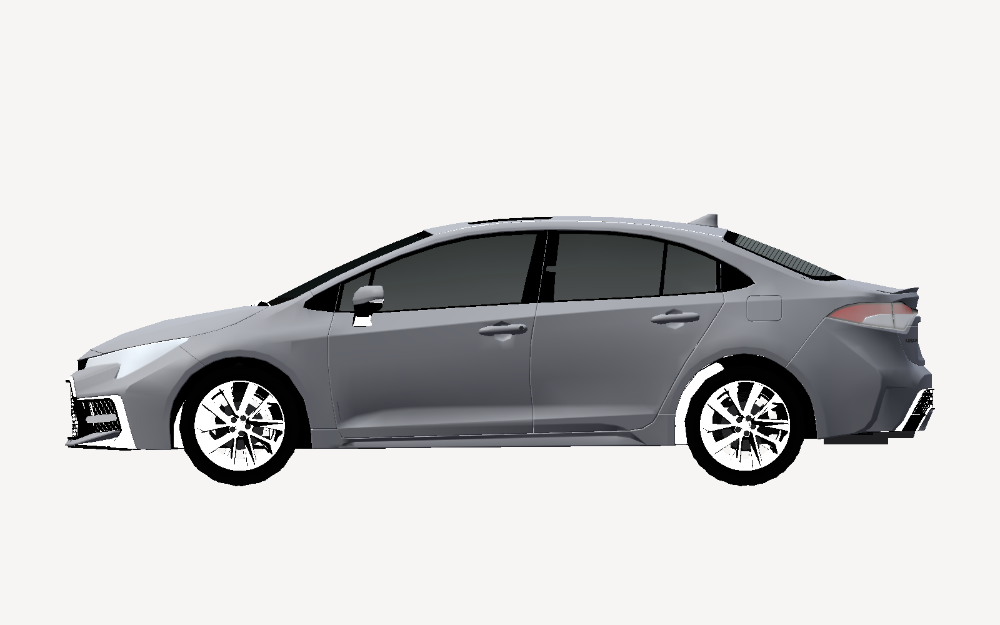
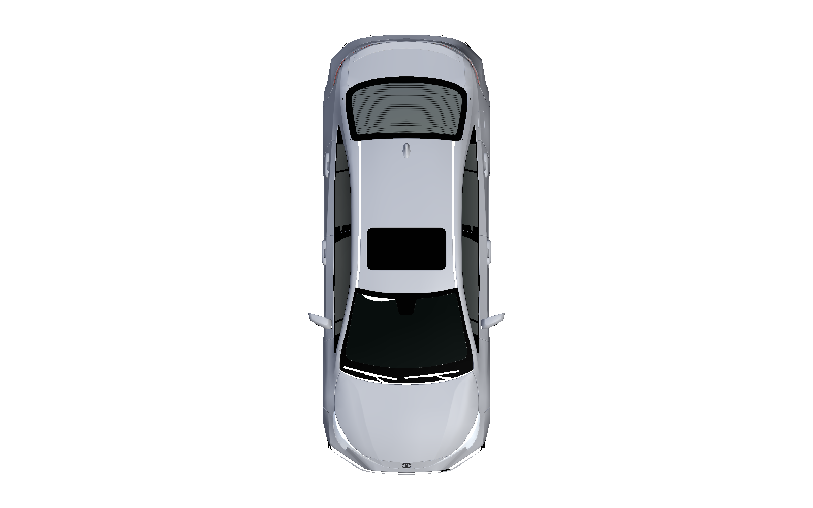

# Vehicle 3D model for the simulation track

| Field | Value |
|---|---|
| Scope | A 3D mesh of the reference car (Corolla E210, CFG-001) for simulation layer 3 (MetaDrive) renders and for figures. Procurement comparison, what the mesh does and does not change, and the handover for whoever picks this up next |
| Version | 0.6 (§1: the lead's choice recorded, DQ-368 A, 2026-10-23). 0.5 (pure-Python glTF export, load-tested in Panda3D, 2026-10-17). 0.4 (Blender export script, MetaDrive vehicle class and bridge hook, 2026-10-17). 0.3 (renders, use, mock-ups, target results, 2026-10-17). 0.2 (receipt check, 2026-10-17). 0.1 (2026-10-17) |
| Status | Draft. AI-drafted (Claude, AI assistant; I0 under WP-M-02 §3.3); not reviewed. DQ-368 answered A (bought 2026-10-17, Standard licence) |
| Feeds | [README](README.md) §2 layer 3; the WP-V-02/WP-V-03 figures that show the reference car; nothing in the safety case |

## 1. What a mesh is for here, and what it is not for

**For AI assistants and anyone new to the thread: read this section before spending time on car models.**

LionDriver's simulation is not a game engine. Layer 1 is a Python single-track plant with the real panda safety code in
the loop ([`plant/`](plant/)), layer 2 is OpenSCENARIO files replayed in esmini, layer 3 is openpilot's own MetaDrive
bridge (`openpilot/tools/sim`), layer 4 is a numerical search over layer 1. None of them reads a 3D mesh for physics.

| Question | Answer |
|---|---|
| Does the mesh change any simulation result? | **No.** Mass, wheelbase, centre of gravity, steering ratio, actuator lags and body width come from the opendbc `TOYOTA_COROLLA_TSS2` CarParams and the vehicle register ([`plant/corolla.py`](plant/corolla.py), [`vehicles.yaml`](../../docs/liondriver/vehicles/vehicles.yaml)). A mesh is drawn around those numbers; it never feeds them |
| Does openpilot see the mesh in layer 3? | **No.** The bridge spawns the ego with `render_vehicle: False` ([`metadrive_bridge.py`](../../openpilot/tools/sim/bridge/metadrive/metadrive_bridge.py) `spawn_world`), so the ego body is not in the road-camera image openpilot consumes. Only third-person and top-down views, used for videos and figures, would show it |
| Is a marketplace mesh a source for vehicle facts? | **No.** The register's width 1,781 mm is marked *to confirm*; a purchased mesh is an artist's model and does not confirm it. Only Toyota's data or a measurement on the reference car does (WP-S-04 M-01) |
| Is it evidence? | **No.** It is a presentation asset. Treat it like the figure colour tokens |
| Should the car be rigged in Unreal Engine or another game engine? | **No.** UE4/UE5 Chaos Vehicles, Rigacar and similar rigs were considered in the originating chat and dropped: the track has no Unreal in its toolchain, and MetaDrive (Panda3D) takes a plain glTF with wheels as separate nodes. A game-engine car rig would be a separate visualisation project with no owner |

So the value is cosmetic: layer-3 clips and WP-V figures show a Corolla instead of MetaDrive's stock car, and the body
shape helps camera-height and blind-zone drawings. The cost is $99 plus a decimation pass. The lead chose option A, bought on 2026-10-17 (DQ-368).

## 2. How MetaDrive takes a vehicle mesh

MetaDrive vehicle classes (`metadrive/component/vehicle/vehicle_type.py`) each name a glTF file with a scale, an
offset and a heading-pitch-roll, and declare `DEFAULT_LENGTH`, `DEFAULT_WIDTH`, `DEFAULT_HEIGHT` in metres. For
example `DefaultVehicle` uses `ferra/vehicle.gltf` at 4.515 × 1.852 × 1.19 m. Read on 2026-10-17 in
`base_vehicle.py` (upstream `main` and the `commaai/metadrive@minimal` branch openpilot pins), the loader works
like this, and the export script and class in §6 follow it:

- `vehicle.gltf` is the **body only**. The wheels are **not** nodes inside it: `_add_wheel` loads
  `right_tire_front.gltf` and `right_tire_back.gltf` from the same folder, one wheel per file with its origin at the
  hub, and draws the left wheels as the same files mirrored (`set_scale(-1)`).
- The vehicle node's frame is Panda3D's: **+Y forward, X lateral, Z up**. The wheels sit at
  `(±LATERAL_TIRE_TO_CENTER, +FRONT_WHEELBASE / −REAR_WHEELBASE, TIRE_RADIUS − CHASSIS_TO_WHEEL_AXIS)` and the body
  model at `Z = −(TIRE_RADIUS + CHASSIS_TO_WHEEL_AXIS)`, so the body file's origin belongs on the ground plane under
  the body centre, and the class's wheelbase constants must match where the mesh's arches are.
- `AssetLoader.file_path("models", path)` joins with `pathlib`, so an absolute path wins over MetaDrive's asset root:
  the class can point at a folder outside the MetaDrive package, which keeps the licensed files out of both
  repositories' code.
- `vehicle_config["vehicle_model"]` picks the class by key from the module-level `vehicle_type` dict
  (`agent_manager.py`), so a new class is registered by inserting it there in the MetaDrive process.

So the rig is the body file plus the two right-wheel files; §6 says what exists.

Dimensions to use for the class (sedan, not hatchback; the register is authoritative where it has a value):

| Quantity | Value | Source |
|---|---|---|
| Length | 4,630 mm | listings for the E210 sedan (CFG-001); to confirm |
| Width | 1,781 mm | vehicle register CFG-001 (*to confirm*) |
| Height | 1,435 mm | listings; to confirm |
| Wheelbase | opendbc CarSpecs | `plant/corolla.py` reads it; do not retype |
| Tyre | 205/55R16 | L/LE/XLE trims of CFG-001; the 2.0 L SE/XSE run 225/40R18 and are excluded from CFG-001 |

## 3. Procurement comparison (checked 2026-10-17)

No free, game-ready mesh of the Corolla E210 (CFG-001) exists. Every real E210 model is a paid render asset under an editorial-use licence
(Toyota owns the design), which is fine for this project and would not cover a commercial product. Prices and details
were read from the listing pages on the date above; confirm before buying.

**Recommended (option A of DQ-368):** Toyota Corolla 2020 Simple Interior, seller 3d_molier International,
[TurboSquid 1450755](https://www.turbosquid.com/3d-models/3d-toyota-corolla-2020-simple-model-1450755), $99.

- 214,054 polygons / 220,561 vertices, quads and tris, PBR, non-overlapping UVs
- Formats: glTF, USD, FBX, OBJ, Blender 2.7, 3ds Max 2012, Maya 2011, Cinema 4D R14, 3DS; textures and materials
  mapped in every format (11 PNG at 4096²)
- Doors open (so doors are separate objects); objects logically named; units cm, correctly scaled
- Not stated: trim and wheel size, and whether the wheels are separate nodes. Check both on receipt; TurboSquid
  accepts returns
- Needs a decimation pass in Blender to roughly 50–80k polygons before MetaDrive

**Low-cost alternative (option B):** Toyota Corolla low poly 3D model, seller RoyFld,
[TurboSquid 1664213](https://www.turbosquid.com/3d-models/toyota-corolla-model-1664213), $2.50. 5,550 polygons,
Blender 2.82 / FBX / OBJ / STL, real-life dimensions, flat materials, no textures. Enough for a recognisable silhouette
in top-down and third-person views; also a cheap way to test the MetaDrive vehicle class before the hero mesh arrives.

**Same seller, fuller cabin:** Detailed Interior, [TurboSquid 1450753](https://www.turbosquid.com/3d-models/toyota-corolla-2020-3d-1450753),
$129, 253,967 polygons, same formats. Only for in-car camera shots, which layer 3 does not need.

**Compared and not recommended**

| Model | Seller, site | Price | Polygons | Formats | Why not |
|---|---|---|---|---|---|
| Corolla 2020 Rigged | 3d_molier, [TurboSquid 1450756](https://www.turbosquid.com/3d-models/3d-model-toyota-corolla-2020-rigged-1450756) | $149 | 253,967 | 3ds Max, glTF, USD | The rig is 3ds Max helper objects; it does not export. MetaDrive needs no rig |
| Corolla 2020 | Swan3D Studios, [RenderHub](https://www.renderhub.com/swan3dstudios/toyota-corolla-2020) | $100 | 161k–630k (hi/lo per format) | 3ds, blend, c4d, fbx, max, mb, obj, skp | Wheels grouped separately, real scale in mm, but materials only in the Max file; basic interior. Usable backup |
| Corolla 2020 XSE | 3DStarving, [RenderHub](https://www.renderhub.com/3dstarving/toyota-corolla-2020) and [Free3D](https://free3d.com/3d-model/toyota-corolla-2020-1174.html) | $149 | 227,519 unsmoothed | max, 3ds, fbx, obj | XSE trim (18-inch wheels, excluded from CFG-001); FBX/OBJ ship without materials; Free3D listing is not free |
| Corolla sedan regular 2020 | Squir, [TurboSquid 1369466](https://www.turbosquid.com/3d-models/3d-model-toyota-corolla-sedan-1369466) | $129 | 500,000 | max, c4d, 3ds, fbx, obj, glTF, USD | Highest quality, 3ds Max-centric, heavy; overkill for a cosmetic asset |
| Corolla XSE 2020 | Podshyvalov, [RenderHub](https://www.renderhub.com/podshyvalov/toyota-corolla-xse-2020) | $60 | 320,147 | fbx, max, obj | XSE trim; scale and part separation not stated |
| Corolla Hybrid 2020 | Swan3D Studios, [RenderHub](https://www.renderhub.com/swan3dstudios/toyota-corolla-hybrid-2020) | $100 | as Swan3D above | as above | Hybrid badging; Hybrid is excluded from CFG-001 |
| Corolla Sport Hatchback 2020–2023 HQ Interior | Davidson, [RenderHub](https://www.renderhub.com/davidson/toyota-corolla-hatchback-2020-and-gr-corolla) | $29.90 | not stated | 3ds Max only | Hatchback, excluded from CFG-001 |

Not inspected: [CGTrader](https://www.cgtrader.com/3d-models/car/car/toyota-corolla-2020-88963874-e96d-4b79-ad87-0a3b105f95d3)
and [two](https://www.cgtrader.com/3d-models/car/car/2020-toyota-corolla) [more](https://www.cgtrader.com/3d-models/car/car/toyota-corolla-sedan-regular-2020)
CGTrader listings (the site refused automated reads); Sketchfab had no downloadable E210.

Checklist before buying any model: wheels as separate objects with pivots at the hub centres; real-world scale stated;
materials present in the glTF or FBX, not only in the native file; sedan, 1.8 L trim with 16-inch wheels; a polygon
count you can afford to decimate.

## 4. Receipt check (2026-10-17)

The 3d_molier model was bought on 2026-10-17 (DQ-368 option A, Standard licence) and the delivered GLB was read with a
header parser (no asset code executed). Files delivered: GLB and glTF+bin (full), a Draco/KTX2-compressed GLB, USDZ, 3ds
Max, and RAR archives for 3DS, Blender, Cinema 4D, FBX and OBJ.

| Check | Result |
|---|---|
| Scale and units | Centimetres, real scale. Length 465.6, body width 176.8, height 146.2 cm (register: width 178.1 *to confirm*; listings 463.0 / 143.5). Wheelbase from the tyre centres 270.9 cm (opendbc 270.0) |
| Track | 150.4 cm front and rear from the wheel centres (sedan 153.5 / 156.0): a 2–4 % artist error, irrelevant for renders |
| Separate parts | 61 meshes, named: body, chassis, four doors, windows, mirrors, steering wheel, wipers, lights, brake discs, wheels and tyres |
| Wheels | **The mesh names are the wrong way round: the separate meshes (`wheel_1`, `wheel_2`, `tire_1`, `tire_2`, `brake_discs_1/2`, at y = −140.4 cm) are the front wheels, at the headlight end with the shorter overhang; the fused pair named `wheels_forward` / `tires_forward` / `brake_discs_3` (y = +130.5 cm) is the rear, at the tail-lamp end.** Found on 2026-10-17 when the export put the hubs on the wrong side; tools now tell front from rear by the tail lamps, never by name. No node carries a transform, so no wheel has a pivot at its hub. Before MetaDrive: split the fused pair by connectivity, parent each tyre, rim and disc to one node at the hub centre (±75.2, −140.4 front / +130.5 rear, 31.3 cm) |
| Trim | **Rim outer diameter 48.5 cm, tyre 64.9 cm: an 18-inch wheel, so the mesh depicts the 2.0 L SE/XSE sport trim, not the 16-inch L/LE/XLE of CFG-001.** Cosmetic; the body is the same. A 16-inch wheel can replace it in Blender if a figure needs it; the caption of any figure that shows the wheels says "sport-trim wheels" until then |
| Polygons | 426,796 triangles (full GLB), 199,999 (Draco GLB). Decimate the full GLB to about 50–80k for MetaDrive; glass and interior carry most of the excess |
| Materials | 16 PBR materials, 18 textures (base, normal, ORM, transmission, clearcoat); the body coat uses `KHR_materials_clearcoat`, glass uses `KHR_materials_transmission` and `_volume`. Panda3D will approximate or ignore these three extensions; the Draco/KTX2 GLB also needs `KHR_draco_mesh_compression` and `KHR_texture_basisu`, which panda3d-gltf is not confirmed to support, so use the full GLB |
| Licence | Standard (royalty-free), editorial uses only. Files stay out of this repository (`assets/` is ignored, see [`assets/README.md`](assets/README.md)) |

## 5. What the model looks like

Documentation renders made offscreen with Panda3D and panda3d-gltf by [`assets/tools/render_views.py`](assets/tools/render_views.py)
from the delivered GLB. The paint is recoloured from the model's black to a neutral grey and the glass made translucent so
the shape reads; nothing else is changed. Rendered images are permitted output under the licence; the model files are not.


| Side (orthographic) | Top (orthographic) |
|---|---|
|  |  |

The 18-inch rims are visible in all three: the sport-trim look noted in §4.

## 6. How the mesh is used

Three uses, in the order they pay off. None of them touches the plant, the panda code or any result.

| Use | What the mesh provides | Tool | State |
|---|---|---|---|
| **Silhouettes for the flat figures** (layers 1 and 4, HARA and SOTIF scenario drawings) | A top-down outline (body, and body with mirrors) and a side outline, sampled from the mesh at 2 cm along the car and stored as [`figures/corolla-e210-silhouette.json`](figures/corolla-e210-silhouette.json). Figure generators draw the outline where they draw the ego rectangle today | [`assets/tools/vehicle_figures.py`](assets/tools/vehicle_figures.py) extracts it when the GLB is present and reads the JSON otherwise, so CI never needs the model | Built; the mock-ups in §7 use it, and `plant/report.py` draws it in every layer-1 figure (0.3, 2026-10-17), falling back to the rectangle with a warning if the JSON is absent |
| **Camera and blind-zone geometry** (WP-C-01 item boundary, WP-C-06 triggering conditions, WP-S-05 HSI) | The side outline with the windshield line, for the device's field of view, hood occlusion and following-vehicle sight lines | the same generator, mock-up 3 | Mock-up only; the device position and angles are measurement items |
| **Layer-3 renders** (MetaDrive clips and frames for WP-V-03 scenarios) | A decimated body glTF plus one glTF per right wheel with the origin at the hub (§2), loaded by `CorollaE210Vehicle` and drawn in third-person and top-down views. The camera path keeps `render_vehicle: False`, so openpilot's input is unchanged | [`assets/tools/corolla_e210_gltf_export.py`](assets/tools/corolla_e210_gltf_export.py) (pure Python, no decimation) or [`corolla_e210_metadrive_export.py`](assets/tools/corolla_e210_metadrive_export.py) (headless Blender 4.x, decimating) writes `assets/corolla_e210/` (ignored); [`corolla_vehicle.py`](../../openpilot/tools/sim/bridge/metadrive/corolla_vehicle.py) builds the class when `LIONDRIVER_VEHICLE_ASSETS` names that folder, and the bridge passes it as `vehicle_model`; [`test_corolla_vehicle.py`](../../openpilot/tools/sim/tests/test_corolla_vehicle.py) checks the class without MetaDrive | Exported by the pure-Python tool and load-tested in Panda3D (2026-10-17, unreviewed; not decimated); the Blender script is unrun; **class not yet loaded in MetaDrive**; see §9 |

How the layer-3 pieces fit, and what each changes:

| Piece | What it does | What it changes |
|---|---|---|
| Python exporter | Reads the GLB as data, finds the rear by the tail lamps, splits the fused rear pair by connectivity, measures the hubs from the tyres, puts the ground at Z = 0 and the body centre at X = Y = 0, drops the interior and the underbody detail (`chassis*`), writes the same files as the Blender script plus the untouched textures. No decimation: 199,914 body triangles | Nothing outside `assets/corolla_e210/` |
| Blender export script (unrun) | Imports the full GLB, bakes the root transform (the file is cm, Z up, with a 0.01 root scale: in Blender it is metres already), turns the car to face +Y, splits `wheels_forward`, `tires_forward`, `brake_discs_3` by loose parts into left and right (**as the front pair, which §4 shows is wrong: fix before running**), measures the four hub centres from the tyres, puts the ground at Z = 0 and the body centre at X = Y = 0, drops `interier`, `interier_glass`, `felt`, `steering_wheel`, decimates to about 70 k triangles (parts under 400 triangles untouched), resizes textures to 2048², and writes `vehicle.gltf`, `right_tire_front.gltf`, `right_tire_back.gltf`, `vehicle_full.gltf` (all four wheels on hub empties, for figures), `geometry.json` (hubs, tyre radius, body box, counts, source checksum) and `SHA256SUMS` | Nothing outside `assets/corolla_e210/` |
| `CorollaE210Vehicle` | Subclass of MetaDrive's `DefaultVehicle` (itself a `BaseVehicle`): length 4.63, width 1.781, height 1.435 m (§2 table), body file from the asset folder, wheel positions and tyre radius from `geometry.json` (fallback: the §4 receipt-check hubs, ±0.752 / +1.305 / −1.404 m, tyre radius 0.3245 m) | In MetaDrive only: the chassis collision box takes the E210 dimensions, and the Bullet wheels move to the mesh's hubs (wheelbase 2.709 m against opendbc's 2.700). Mass, suspension, steering and tyre friction stay `DefaultVehicle`'s. Nothing in layer 1, the plant parameters or any result |
| Bridge hook | `metadrive_bridge.py` sets `vehicle_config["vehicle_model"] = "corolla_e210"` only when `LIONDRIVER_VEHICLE_ASSETS` is set, after checking the folder and failing with a message that says where the files come from; `metadrive_process.py` registers the class in the MetaDrive process before the environment is built. `render_vehicle` stays `False` | Nothing when the variable is unset: the bridge is byte-for-byte the old behaviour |

Caveats to check on the first MetaDrive load (none of them can be checked without Blender and MetaDrive):

- Wheel side: the files are the **+X** wheels of a car facing +Y. MetaDrive's `_create_wheel` labels the +X
  position `left` while loading `right_tire_*`; if the rims face inward in the render, flip `TIRE_MODEL_CORRECT`
  to −1 in the class (that is what MetaDrive's `XLVehicle` does), not the mesh.
- Height: MetaDrive places the body at `−(TIRE_RADIUS + CHASSIS_TO_WHEEL_AXIS)`; if the tyres float or sink, adjust
  the Z of the class's `path` offset (third tuple), not the mesh.
- Materials: panda3d-gltf ignores `KHR_materials_clearcoat`, `_transmission` and `_volume`, so the paint loses its
  clearcoat and the glass may render opaque; cosmetic.
- Mirror meshes: Blender's loose-part split may leave more than two parts per fused mesh (caps, bolts); the script
  groups parts by the sign of X and joins them, and stops with a message if every part lands on one side.

What the mesh is **not** used for: any vehicle parameter (those come from opendbc and the vehicle register), any Octave model
(the Octave envelope and transmit-rate models are parametric and read no geometry), and any evidence. Figures that show the
mesh say so in their caption, and the figures that are mock-ups say "mock-up" in their title, description and footer.

Regenerate everything with:

```sh
python3 assurance/sim/assets/tools/vehicle_figures.py            # silhouette JSON (if the GLB is present) and the three mock-ups
python3 assurance/sim/assets/tools/vehicle_figures.py --check    # for CI: fail if the committed SVGs differ
python3 assurance/sim/assets/tools/render_views.py assurance/sim/assets/1450755-gltf-extended.glb assurance/sim/figures
```

## 7. Mock-ups of the planned outputs

Each figure below is a **mock-up**: it fixes the layout and the quantities a future figure will carry, with illustrative
numbers, so that the reader, the reviewer and the next session agree on what "done" looks like before any run is credited.
They are generated, not drawn by hand, from the same silhouette the real figures will use.


*Mock-up 1: the layer-1 fault-injection figure once `plant/report.py` draws the mesh outline instead of a rectangle. The
trajectory is illustrative; the real figure takes it from the plant results.*


*Mock-up 2: what one frame of a layer-3 clip carries. The lead vehicle is a plain box on purpose; only the ego uses the
licensed mesh.*


*Mock-up 3: the camera-geometry figure for WP-C-01 / WP-C-06 / WP-S-05. Every number on it is a placeholder until the device
position is measured on the reference car.*

## 8. Results we are looking for

The mesh changes none of these; it makes the figures that report them show the reference car. The quantities, thresholds and
owning work products are the ones the track already uses; this table collects them in one place so a reader can tell, per
layer, what a "good" and a "bad" result look like.

| Layer | Quantity the figure reports | What we look for | Threshold or criterion | Owner |
|---|---|---|---|---|
| 1 fault injection | Lateral deviation of the body edge at the 0.5 s SG-01 FTTI | Body edge still inside the lane line for every fault the panda is meant to catch | 0.61 m (3.0 m lane) and 0.96 m (3.7 m lane) from `plant/report.py`; FTTI from WP-S-04 §3 | WP-V-05 cases; WP-S-04 timing |
| 1 fault injection | Panda reaction time, EPS torque below 5 %, siren, driver cue and correction times | The chain of events happens in the order and inside the times WP-S-04 budgets; which assumptions decide the outcome (sensitivity runs) | Per-case rows in `results/plant-results.md`; a run that only passes under an assumed value is reported as such (MD-04) | WP-V-05; WP-S-04 M-02, M-03 |
| 1 longitudinal | Gaps to lead and follower under L-01…L-04 | No closing below the WP-S-04 §3.3/§3.4 gaps during the panda's reaction | §3.3 / §3.4 tables | WP-V-05 |
| 2 scenarios | Each WP-V-03 scenario parses and replays headless; same road and traffic as layers 1 and 3 | 26 of 26 representable scenarios written down unambiguously (9 built on 2026-10-16) | `results/scenario-replay.md` | WP-V-03 |
| 3 MetaDrive | Outcome class per clip (A pass, B degraded, C fail, D excluded), lateral error, lead gap, alert timing | Class A or B on every KS scenario of a family before credit is sought for that family; every C explained | WP-V-03 §4 pass criteria; credit per family only after the WP-V-02 §5.3 fidelity case (DQ-139) | WP-V-02, WP-V-03 |
| 4 search | Parameter regions (speed, curve, lane width, driver reaction, drift cue) where the item departs the lane | A ranked list of where closed-course tests should look first; not a rate | `results/search-curve-assist-loss.md`; robustness = body-edge margin to the lane line | WP-V-04 U-4 |
| camera geometry | Hood-occlusion distance, nearest visible lane-line point, field of view on CFG-001 | Values measured on the reference car, within the HSI mount tolerance | Measurement items (WP-C-01 OI, WP-S-05) | WP-C-06 triggering conditions |

Until the plant is validated against Corolla logs, every number above ranks risks and guides tests; none is evidence
([README](README.md) §4).

## 9. Handover

- **Where things stand.** Bought (option A); receipt check above; files held locally in `assurance/sim/assets/` (ignored) and mirrored, with SHA-256 sums, to the private repository `jherrodthomas/LionDriver-assets` (Git LFS, folder `corolla-e210-3dmolier-1450755/`). Access to that repository is limited to people working on LionDriver, as the licence requires. Purchased files are licensed
  content: keep them out of the repository (add the asset folder to `.gitignore` when one exists) and never push them.
- **Layer 3, exported and load-tested (0.5, 2026-10-17):** [`assets/tools/corolla_e210_gltf_export.py`](assets/tools/corolla_e210_gltf_export.py)
  (pure Python, numpy only) wrote the MetaDrive layout from the delivered GLB in under a second: `vehicle.gltf` (body,
  199,914 triangles, sha256 `4cee6578f03b50a1…`), `right_tire_front.gltf` and `right_tire_back.gltf` (one wheel each, origin at
  the hub), `vehicle_full.gltf` (body plus four wheels on hub nodes), `geometry.json` (front 1.3956 m, rear 1.3135 m,
  lateral 0.7518 m, tyre radius 0.3234 m, width 0.2436 m) and `textures/`. It tells front from rear by the tail lamps,
  splits the fused pair by connectivity, drops the interior and the underbody detail meshes, and does **not** decimate.
  `corolla_vehicle.asset_dir` and `load_geometry` accept the folder; Panda3D 1.10 with panda3d-gltf loaded and rendered
  `vehicle_full.gltf` with the wheels in the arches. The folder is in the private repository as
  `gltf-export-corolla_e210/` with `SHA256SUMS`. **MetaDrive has still not loaded the class** (not installed here).
- **Blender script, not run:** [`corolla_e210_metadrive_export.py`](assets/tools/corolla_e210_metadrive_export.py) is
  the decimating (about 70 k triangles) version for when Blender 4.x is available. Before running it, change its
  front/rear assignment: it treats the fused pair as the front, but the receipt check (§4) shows the fused pair is the
  rear. Its output goes to the private repository as `blender-decimated-corolla_e210/`.
- **Next:** run the bridge with `LIONDRIVER_VEHICLE_ASSETS` pointing at the export folder and `use_render` on, look at
  the third-person view, and work through the §6 caveats (wheel side, body height); the first regenerated layer-3
  figure (mock-up 2); measure the device position and fill mock-up 3. Add `vehicle_figures.py --check` and
  `openpilot/tools/sim/tests/test_corolla_vehicle.py` to the simulation CI job once reviewed. Any figure that uses the
  mesh says so in its caption, as the figures already do for assumed values (MD-04).
- **Do not** re-open the game-engine route (Unreal, Unity) or re-run the marketplace comparison without a new reason;
  cite this note and DQ-368 instead.

## 10. Origin

Written from a Claude Code session on 2026-10-17 that began as "can we use UE4 to create rigging for a car" and ended
at the comparison above once the project's actual simulation stack was read. The repo path for the next session is
`assurance/sim/`; this note is linked from the README's "Where things are" table.
