# Weather physics: sun, rain, heat, wind, fog, road crown, wet braking, gusts, tunnels, headlights, sun on the device, wet curves, crests and a stopped car

> **Synthetic data (DSR-12). Design aid, no evidence credit (DQ-139).** Small physics studies for the SOTIF
> triggering conditions of low sun (TC-01), oncoming headlights (TC-02), rain (TC-03), crown and wind (TC-15),
> tunnels (TC-18), the windshield in front of the camera (TC-19) and heat (TC-21). They answer *when*, *how much* and *how fast*, not whether the item copes: that is
> for the logged drives and the known-scenario tests (KS-02, KS-12, KS-15, KS-16).

## 1. Sun in the road camera (TC-01, KS-12)

**Question.** On the corridor of the test sites (I-85, Atlanta – Greenville – Charlotte), when is the sun inside the
road camera's frame, and for how many hours a year?

**Method.** [`sun_glare.py`](sun_glare.py) takes the sun's position every 5 min of a year from the NREL Solar
Position Algorithm (pvlib 0.16.1, BSD-3; apparent elevation with refraction) and compares it with the road camera's
field of view, read from `openpilot/common/transformations/camera.py`: 1928 × 1208 px at a 2648 px focal length,
**40.0° × 25.7°**, assumed level. It counts every heading from 0° to 355° and the two corridor directions (63° and
243°). Results: [`results/sun-glare.md`](../results/sun-glare.md).

**Result.**
- **Northbound** the sun sits in the frame on April–August mornings, about 158 h a year, up to 75 min on one day.
- **Southbound** it sits there on October–March evenings, about 203 h a year, up to 80 min on one day.
- Within 10° of the frame, where the lens and windshield still flare, the hours double or more.

All of this is an upper bound, because terrain, trees, buildings and clouds are not modelled. The calendar gives the
clock times to schedule the KS-12 low-sun drives.


*Figure 1. When the sun is in the frame, by day and clock time.*

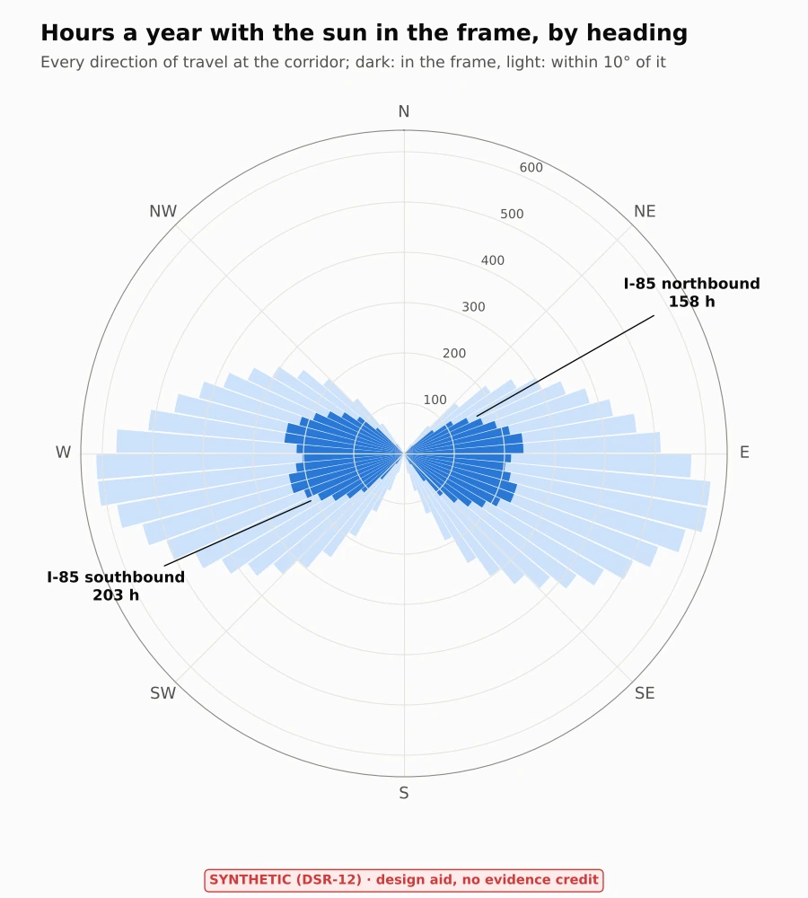

*Figure 2. Every heading at the corridor.*

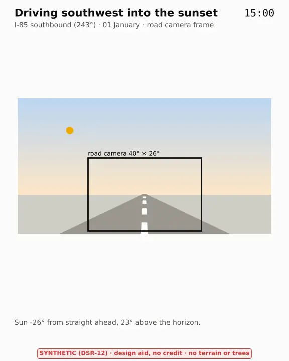

*Figure 3. Driving southwest into the sunset (animated WebP).*

**For the Blender scenes.** The TC-01 preset of the hazard scenes ([`blender/library/conditions.yaml`](../blender/library/conditions.yaml),
owned by the scene session) draws the sun "ahead" at 5° elevation. The study gives corridor values such a scene can
take, for example southbound on 1 January at 16:20: 11° left of straight ahead, 11° up. This is a handover note; the
scene files are not changed here.

## 2. Hydroplaning (TC-03, KS-15)

**Question.** At what speed do the Corolla's tyres lose the road in rain, against the ODD's 110 km/h? The ODD
includes "light rain" and excludes heavier rain, but gives no number (WP-C-02 §3.1).

**Method.** [`hydroplaning.py`](hydroplaning.py) applies two published models:

| Model | What it gives | Source |
|---|---|---|
| Water film | Film depth above the texture from rain intensity, drainage path and slope (metric form: mm, m, mm/h, %) | Gallaway et al. 1979, FHWA-RD-79-31 |
| PAVDRN speed | Hydroplaning speed from the film depth and the texture: two fitted branches, meeting at 2.4 mm (0.095 in) | NCHRP PAVDRN (Anderson et al. 1998), from Gallaway 1979 and Huebner et al. 1986 |
| NASA | Full dynamic hydroplaning where water stands deeper than the tread: V = 10.35 √p mph, p the tyre pressure in psi | Horne and Dreher 1963, NASA TN D-2056 |

**Inputs.** The road is a crowned Interstate (2 % cross slope, 3.66 m lanes, 1–3 lanes draining across, 0–4 %
grade), with 0.8 mm mean texture depth, and tyre pressure 35 psi (assumed; the reference car's door placard
decides). Results: [`results/hydroplaning.md`](../results/hydroplaning.md).

**Result.**
- **Light rain** (below 2.5 mm/h): the texture drains the water on every road here, so there is no film.
- **Rain film**: the hydroplaning speed falls to 110 km/h only from about **25 mm/h** (three lanes draining) to
  **56 mm/h** (one lane). That is 3 to 7 times the top of moderate rain, so only in rain the ODD already excludes.
- **Standing water** deeper than the tread (ruts, puddles, a worn tyre) is the case that matters. NASA gives
  **98 km/h at 35 psi** (91–103 km/h at 30–38 psi), below the ODD's 110 km/h. Excluding heavier rain does not exclude
  water that stands on the road after the rain.


*Figure 4. Hydroplaning speed in rain against the ODD bound.*

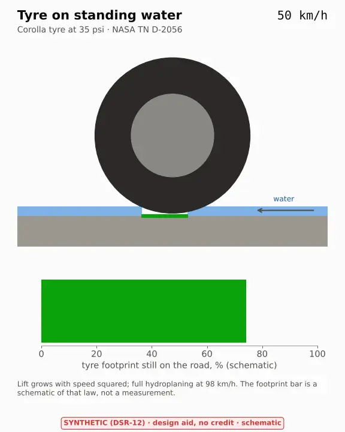

*Figure 5. The mechanism as a loop. The footprint bar follows the speed-squared law of lift and is a schematic, not a
measurement.*

**Limits.**
- All three are empirical fits from trough and track tests of the 1960s–80s, not tests of this car's tyres.
- PAVDRN's two branches meet at 0.095 in only where the texture-free term governs. With coarse texture the
  thick-film branch jumps, by up to about 4 mph at 1.3 mm texture. That is a property of the published fits.
- Tread depth enters only through NASA's condition (water deeper than the tread). A worn tyre lowers the water depth
  at which that condition is met.

## 3. Cabin heat soak (OI-3, TC-21)

**Question.** How hot does the air at the device mount get when the car is parked in the sun, and how fast does it
fall once the car drives? The device heat model ([`../thermal`](../thermal/README.md)) held the cabin at one
temperature for a whole drive. A real hot day starts hot and cools under the AC.

**Method.** [`cabin_soak.py`](cabin_soak.py) is a lumped heat model of the Corolla's cabin with five nodes: air,
windshield, dashboard, interior (seats and trim) and shell (roof, doors and the other glass).
- **Sun:** the sun on each glazed and opaque surface comes from pvlib's clear-sky model (Ineichen) on the tilted
  planes.
- **Outside:** the outside air follows a daily curve, coolest at 06:00 and warmest at 15:00.
- **Parked:** the car parks facing south at noon for two hours.
- **Driving:** it then drives southwest on I-85 at 100 km/h for an hour, with the AC on recirculation or the AC off
  (fan on fresh air).
- **Mount air:** the air at the mount is the cabin air plus 0.4 of the windshield's difference from it. That share is
  an assumption, and the logger at the mount (DQ-412) sets it.
- **Glass and roof:** areas and rakes are measured on the purchased Corolla mesh
  ([`figures/corolla-e210-geometry.json`](../figures/corolla-e210-geometry.json), written by
  [`assets/tools/vehicle_geometry.py`](../assets/tools/vehicle_geometry.py)): windshield 1.15 m² at 25.8° from
  horizontal, rear window 1.04 m² at 22.3°, side glass 0.85 m² a side, metal roof 1.41 m². They are labelled
  mesh-derived; the mesh also has a 0.75 m² glass roof, which is left out until the reference car's trim is confirmed.

Every cabin input is an estimate ([`params.yaml`](params.yaml), `cabin:`). Results:
[`results/cabin-soak.md`](../results/cabin-soak.md).

**Check against measured cars.** McLaren, Null and Quinn (2005, *Pediatrics* 116(1) e109) measured a dark sedan on
16 clear days at 22–36 °C ambient: the cabin air rose about 22 K in 60 min, at the same rate whatever the ambient.
The model gives 25.0 K at both 22 and 36 °C, with no tuning (22.1 K with the estimated glass before the mesh was
measured). It is slower early: 63 % of the rise in the first 30 min, against the 80 % measured. The model's interior holds more heat than a real car's, which the logger will
show.

**Result (hot 15 July, 35 °C afternoon, estimated inputs).**
- **Parked:** after two hours the cabin air is at 69 °C, the dashboard at 93 °C and the mount air at 62 °C.
- **Driving with the AC:** the mount air falls below the device model's worst-edge bound (43 °C) within 2 min and
  ends at 31 °C.
- **Driving without the AC:** it stays above that bound for 44 min and ends at 43 °C.

Fed into the device model ([`../thermal/cabin_drive.py`](../thermal/cabin_drive.py),
[`results/cabin-device.md`](../results/cabin-device.md)): parked with the device off, the SoC reaches 66 °C. While
driving it peaks at 79 °C with the AC on and 84 °C with it off, below the 96 °C limit in both. That comes from the
estimated inputs; T1 and the logger decide it.


*Figure 6. The cabin through a hot day, with the AC on and off.*


*Figure 7. The same day as a loop.*

## 4. Crosswind (TC-15, KS-02)

**Question.** How hard does a side wind push the Corolla, against the 0.5 m/s² margin the ODD's curve bound keeps
for controller error, road crown and wind (WP-C-02 §3.2), and against the controller's 3.0 m/s² limit
(`drive_helpers.py`, read by the script)?

**Method.** [`crosswind.py`](crosswind.py) takes the car's side elevation measured on the 3D model
([`corolla-e210-geometry.json`](../figures/corolla-e210-geometry.json)) and applies two textbook models along its
height profile h(x):
- **Slender-body force:** the car and its mirror image in the road act as a slender wing of span 2h(x). That gives
  side force where the height grows from the nose, and none where it falls (rear window and boot), where the flow is
  separated. Howell and Panigrahi (SAE 2016-01-1620) find notchbacks below slender-wing theory, so the band takes
  0.5–1.0 of it.
- **Crossflow drag** on the side area, with a coefficient of 0.7–1.1.

The force and yaw moment go into the plant's single-track Corolla (opendbc mass and axles, neutral steer). That gives
the **steering-equivalent push**: the lateral acceleration the controller must add to hold a straight line, which is
what the plant's straight-drift study adds. A side force at the centre of gravity alone needs no steering, because the
car crabs into the wind. The push comes from the yaw moment: the centre of pressure sits 0.77 m ahead of the centre
of gravity, near the front axle.

**Checks on the mesh.** Its wheelbase is 2.709 m against opendbc's 2.67 m (1.5 %). Its frontal area is 2.17 m²,
against a published value of about 2.2 m². In the per-degree form that wind-tunnel data use, the nominal model gives
C_Y 0.063 and C_N 0.021. The band's lower edge halves the slender-body part.

**Result (steady wind square to the road).**
- **110 km/h in the KS-02 wind (30 km/h):** the push is **0.86–1.76 m/s²**, beyond the ODD's 0.5 m/s² margin even at
  the band's lower edge.
- **80 km/h in the same wind:** 0.34–0.69 m/s².
- **The margin:** at 110 km/h the upper estimate uses the whole margin from about 8 km/h of wind.
- **The controller limit:** reached at about 49 km/h of wind.
- **In a curve at the ODD's bound:** the curve takes 2.5 m/s² and a 30 km/h wind adds 0.9–1.8 m/s², which together
  exceed the controller's 3.0 m/s².

**Limits.**
- These are textbook models on an artist's mesh, so the result is a band, not a measurement.
- Gusts, which are stronger than the steady wind and arrive within a second, are not modelled. The next step is a
  gust profile through the plant.
- A windy-day log (steering torque on a straight, with the wind from a weather station) would set the real value.

Results: [`results/crosswind.md`](../results/crosswind.md).


*Figure 8. Where the wind pushes: the side force along the car, and its resultant ahead of the centre of gravity.*

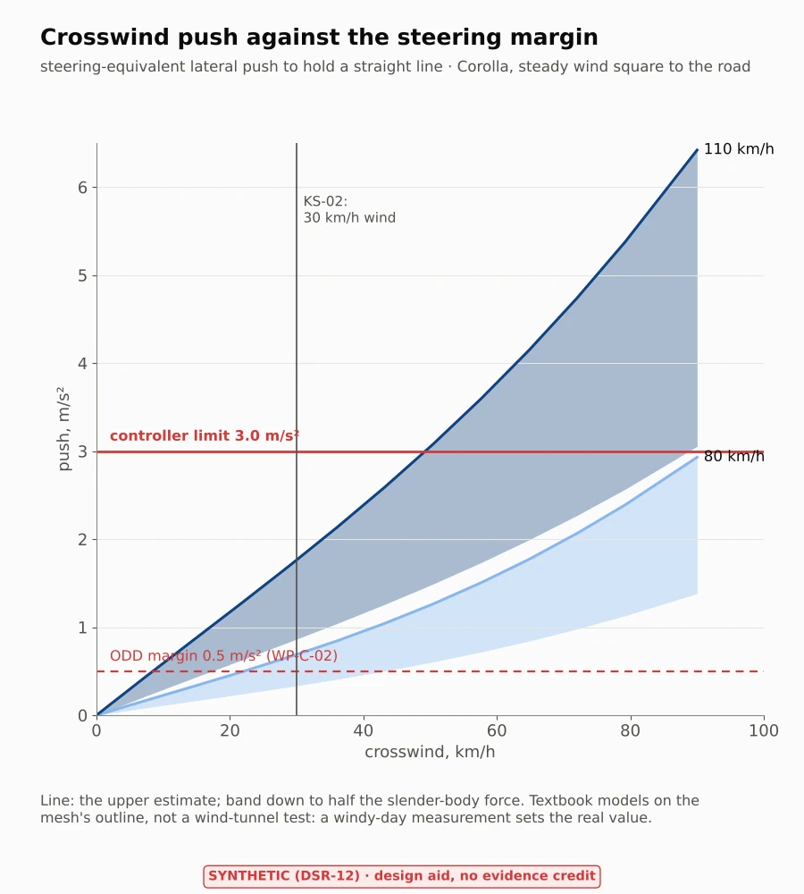

*Figure 9. The push against the ODD's margin and the controller's limit.*

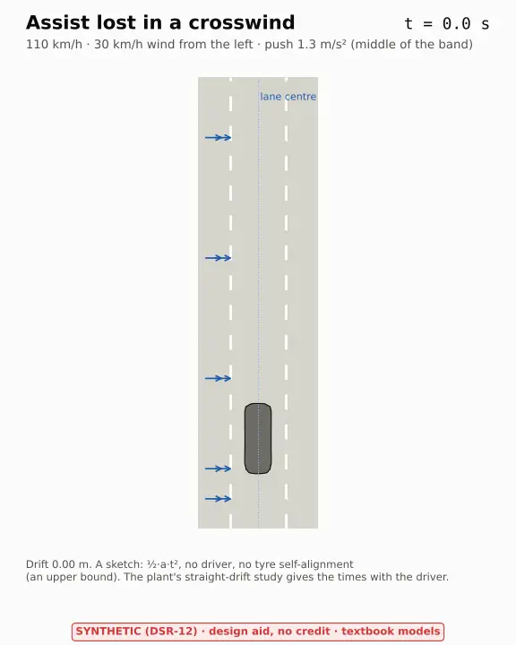

*Figure 10. Assist lost in a 30 km/h crosswind: a kinematic sketch. The plant's straight-drift study gives the times
with the driver.*

## 5. Fog, dew and frost on the windshield (TC-19, KS-16)

**Question.** How often is there water on the glass in front of the road camera, and how long does the defroster
take to clear it? The camera looks through the top of the windshield, under the mount.

**Method.** [`windshield_fog.py`](windshield_fog.py) solves the glass's outer and inner face temperatures in steady
state: outside convection and long-wave exchange with the sky, conduction through the laminated glass, and inside
convection and long-wave exchange with the cabin. Water forms on a face that is colder than the dew point of the air
touching it (over ice below 0 °C; Magnus, Alduchov and Eskridge 1996).
- **The climate** is NOAA's 1991–2020 hourly normals for Greenville-Spartanburg airport, reduced to month × hour in
  [`climate-gsp.csv`](climate-gsp.csv) by [`climate.py`](climate.py). It gives temperature, dew point, the shares
  of the five sky-cover classes, and wind and calm. Each cell mixes the sky classes and calm against windy hours by
  their shares.
- **The sky** is Berdahl and Martin's clear-sky emissivity from the dew point, raised by cloud. The windshield's rake
  (25.8°, measured on the mesh) sets how much of the sky it sees.
- **Inside**, the cabin's dew point is the outside air's plus the occupants' breath (45 g/h each, ASHRAE) in the
  air flow. The ventilation is fresh air, recirculation (only the body's leaks exchange air), or automatic climate
  control (the air conditioning dries the air above 4 °C).
- **The defroster** heats each strip of the glass up from the vents. Its jet weakens with height, the heater warms up
  from a cold engine, and the frost on a strip melts once the strip reaches 0 °C. The frost itself is laid down
  overnight by mass transfer (Chilton–Colburn), on January's normal clear, calm night or on a humid one.

**Result (normal year; car inputs estimated).**
- **Parked outside:** dew forms for about **680 hours a year**, mostly on humid summer and autumn nights. The wipers
  clear it. Frost forms for about **71 hours**, in winter, and needs the defroster.
- **The camera's view clears last.** On a humid January night about 200 g/m² of frost forms. Half the glass is clear
  after about 6 min and the camera's view after about 8 min. After a normal night (8 g/m²) the camera's view is
  clear in 3–6 min.
- **Driving at 110 km/h:** the outside air holds the glass close to its own temperature. With fresh air or automatic
  climate control the inside does not fog.
- **Recirculation without air conditioning** fogs the inside of the glass within the hour for about **3350 hours of
  the year**, from October to May. The count rests on how leaky the body is (65–4850 h).

**Limits.**
- A normal year understates frost, because the frosty nights are the clear, calm, colder ones.
- The sun on the glass, which only dries it, is left out.
- The defroster's jet and its warm-up are estimates.

Results: [`results/windshield-fog.md`](../results/windshield-fog.md).


*Figure 11. Water on the windshield by month and hour, normal year.*

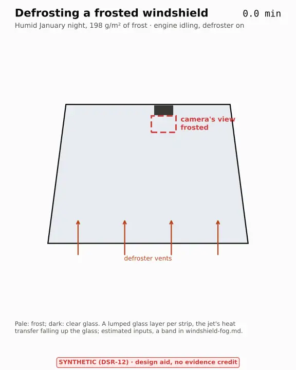

*Figure 12. Defrosting a frosted windshield: the camera's view at the top clears last.*

## 6. Road crown and bank while engaged (TC-15, KS-02)

**Question.** A cross slope pushes the car downhill by g·sin θ; openpilot subtracts its roll estimate times g from
what it commands (`latcontrol_torque.py`). What is left, against the 0.5 m/s² curve margin of WP-C-02 §3.2?

**Method.** [`road_crown.py`](road_crown.py) reads the roll path from the code: paramsd's Kalman filter
(`paramsd.py`, `car_kf.py`: 20 Hz, process noise 1°/√s, the localizer's roll noise doubled, zero roll with 10° noise
when the localizer is invalid), and calibration's zero roll (`calibrationd.py`). It derives the filter's time
constant from the steady-state gain and follows a lane change across a crown line. It adds four more terms:
- the device's mount roll, which calibration takes as zero;
- body roll, which the fitted torque gain absorbs because torqued fits on the same roll (`torqued.py`), leaving only
  this car's difference from the fit;
- the fallback when the roll estimate is invalid;
- for comparison, the crosswind study's push.

**Result (110 km/h).**
- **Crown and bank:** a 1.5–2.5 % crown pushes 0.15–0.24 m/s², and a 2–6 % bank 0.20–0.59 m/s². With a valid roll
  estimate the compensation removes it.
- **The filter's lag** is small: a time constant of 0.05–0.45 s and a peak error of up to 0.11 m/s² at a crown
  change.
- **Body roll** left over is under 0.02 m/s².
- **The device's mount roll is the largest term:** 0.17 m/s² per degree of tilt, a third of the margin at 1°, until
  torqued learns `latAccelOffset`. It starts from its default after a fresh install or a reset.
- **When the roll estimate is invalid**, the estimate decays to zero within about 7 s and the whole push returns:
  0.59 m/s² on a 6 % bank, more than the margin.

**What follows (tasks).**
- Measure the device's roll at installation with a level (T1, an INS check).
- Count from local logs how often roll is invalid on the highway.
- WP-C-02 OI-5 already asks for the 6 % banking bound to be confirmed by test.

Results: [`results/road-crown.md`](../results/road-crown.md).


*Figure 13. What is left of the road's cross slope after roll compensation.*

## 7. Stopping on a wet road (TC-03, TC-33)

**Question.** Does a wet road give the friction that the item's braking bound (−3.5 m/s², opendbc `ACCEL_MIN`)
needs? That is 0.36 on a level road and 0.40 on a 4 % downhill.

**Method.** [`wet_braking.py`](wet_braking.py) interpolates the Bosch Automotive Handbook's table of peak tyre-road
friction (4th ed., p. 335; read from a reproduction, to confirm against the book). The table covers 50, 90 and
130 km/h, water depths of 0, 0.2, 1 and 2 mm, and new tyres and tyres worn to 1.6 mm. The water depth in rain comes
from the hydroplaning study's Gallaway film on its worst drainage row, and is at least the table's 0.2 mm "wet".

**Result (110 km/h).**
- **New tyres:** about 5.6 m/s² in light rain, above the item's 3.5.
- **Tyres worn to the legal minimum:** about **2.0 m/s²** on any wet road. A stop at the item's rate from 110 km/h
  takes about 253 m instead of 149 m, and the item asks for more than the tyres hold. This is put to the lead as
  "Should the ODD ask for more tyre tread than the legal minimum?" in the register.
- **Heavier rain:** friction falls quickly with deeper water. At 2 mm the handbook meets NASA's hydroplaning speed.
- **TC-33:** with good tyres the rain does not close the gap of a lead braking harder than the item.

**Limits.**
- A handbook table of typical tyres, not this car's tyres.
- The mapping from the rain's water film to the table's water depth is an assumption.

Results: [`results/wet-braking.md`](../results/wet-braking.md).

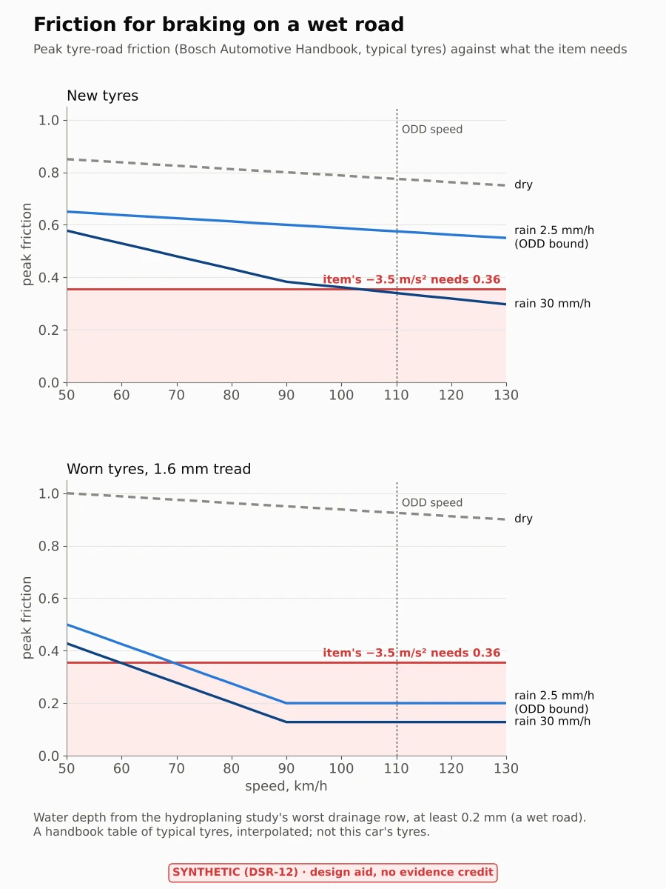

*Figure 14. Peak friction against what the item's braking needs.*

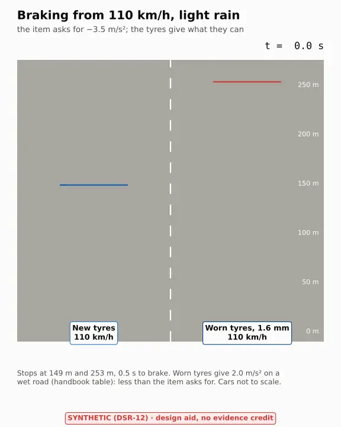

*Figure 15. Braking from 110 km/h in light rain, new and worn tyres.*

## 8. A gust through the car and its lane keeping (TC-15, KS-02)

**Question.** The crosswind study gave the steady push of a side wind (§4). How far does the car move when the wind
changes in time, against the room to the lane line?

**Method.** [`gust.py`](gust.py):
- **The wind:** the crosswind study's loads on the measured outline, quasi-steady, rising to the KS-02 wind of
  30 km/h. Two shapes: a step (leaving a cutting or a bridge, the wind reaching the whole car while it drives its own
  length) and one-minus-cosine gusts of 0.5–8 s.
- **The car:** a linear single-track Corolla (opendbc mass, axles, inertia).
- **The steering:** 100 Hz frames through opendbc's own torque limiter. The function is executed from
  `opendbc/car/lateral.py`, with the Corolla's limits from `toyota/values.py`. The EPS follows with the
  `steerActuatorDelay` lag.
- **The lane keeping, two versions:**
  - *ideal steering* adds the gust's push at once, a bound on what any lane keeping can do with this steering;
  - *the plant's stand-in* uses its law alone, read from `plant/simulate.py`.

**Result (110 km/h).**
- **Gusts of 0.5–8 s:** with ideal steering the car moves at most 26 cm, against 96 cm of room in a 3.7 m lane.
- **A step at the lower load band:** 18 cm.
- **A step at the upper load band: about 2.4 m, out of the lane even with ideal steering.** The steady push
  (1.76 m/s²) takes 89 % of the steering the Corolla's full torque gives (1.99 m/s²), so too little is left to bring
  the car back.
- **What the windy-day log should look for (WP-C-02 OI-10):** how much steering a 30 km/h wind leaves, not only how
  hard it pushes.
- **The plant's stand-in** moves further on long gusts. It has no integral action, so its steady offset belongs to
  the stand-in, not to openpilot.

**Limits.**
- Perfect perception, no driver, no planner.
- Quasi-steady loads, on the safe side for short gusts.
- The crosswind study's load band carries over.

Results: [`results/gust.md`](../results/gust.md).

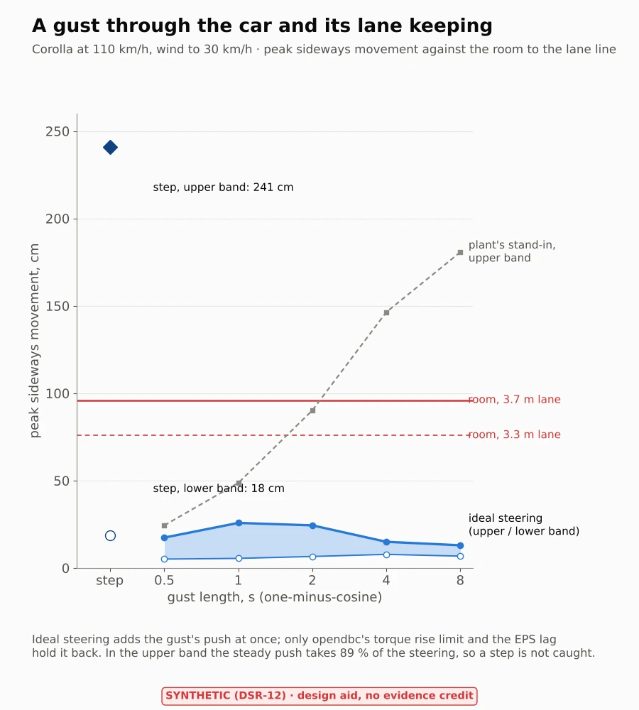

*Figure 16. Peak sideways movement against gust length.*

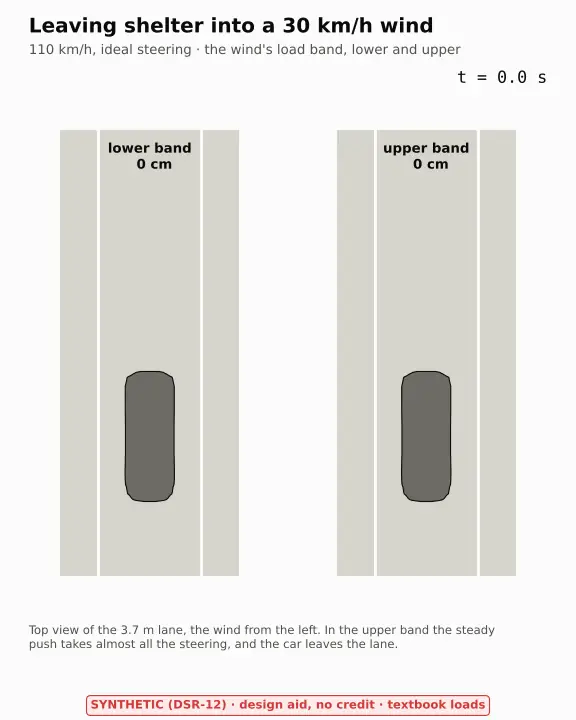

*Figure 17. Leaving shelter into a 30 km/h wind, lower and upper load band.*

## 9. Tunnel entry and exit (TC-18, KS-12)

**Question.** At a tunnel portal the road ahead dims by a factor of hundreds, and brightens again at the exit. How
long is openpilot's road camera badly exposed?

**Method.** [`camera_ae.py`](camera_ae.py) ports camerad's `set_camera_exposure` line by line:
- **Source:** the road camera's loop with the comma 3X's OX03C10 sensor. It covers the target grey that follows the
  exposure, the three-frame latency, the averaging, the brute-force gain and time choice with its score, and the
  always-on conversion gain.
- **Constants:** every one is read from `camera_qcom2.cc` and `ox03c10.cc`. The port stops if a line it follows
  changes.

[`tunnel.py`](tunnel.py) drives it with the median luminance ahead at 110 km/h:
- the sunlit approach, then the threshold zone at 5 % of it for 150 m;
- a transition to 10 cd/m² inside, then the exit into daylight (orders of CIE 88);
- a frame is badly exposed when its grey is more than a stop from the loop's target.

**Result.**
- **Entry:** 4–5 frames (about 0.25 s) too dark, then the loop catches up with a brief overshoot under a stop.
- **Exit:** 19–25 frames (about 1–1.25 s) too bright. An overexposed frame tells the loop little (its grey is near
  the top of the gamma curve), so it steps down slowly.
- **The loop's range:** inside, it settles at about 200 times the daylight exposure, well within the sensor's range.
  On a bright approach it can reach its floor (2 lines at the always-on gain).
- **For a TC-18 validation:** windows of about a second at each portal, the exit the longer.

**Limits.**
- One median luminance per frame, with the gamma curve. HDR merging and the driving model's response are not in it.
- The sensor's sensitivity is an assumption until local logs give the exposure on a sunny road.

Results: [`results/tunnel.md`](../results/tunnel.md).


*Figure 18. The road camera's exposure through a tunnel.*

## 10. Oncoming headlights at night (TC-02, KS-12)

**Question.** What do oncoming headlights do to openpilot's road camera on a divided highway (inside the ODD), and on
an undivided road (outside it, for reference)?

**Method.** [`headlights.py`](headlights.py):
- **The encounter:** the oncoming car closes at twice 110 km/h. Its lamps stay in the camera's frame (field of view
  from `camera.py`) until their bearing passes 20°.
- **The light toward us** is bounded by UN R112: at most 350 cd from a low beam (point B50L, toward an oncoming
  driver's eyes) and 40,500 cd from an undipped driving beam (the class B minimum of Imax). Both are taken in every
  direction, an upper bound.
- **The lamps' own image** covers at most 0.2 % of the exposure rectangle. The loop takes the rectangle's median, so
  those pixels do not move it.
- **Veiling glare:** the lens and the windshield scatter 1–10 % of the light over the image (assumed). That lifts the
  median, the ported exposure loop darkens the frame, and the road loses contrast.

**Result.**
- **Low beams:** at least 88 % of the road's contrast in every case, and at least 97 % across a median.
- **Across a median the lamps leave the frame early:** 21–82 m before the cars pass, so the brightest part of the
  encounter is outside the camera's view.
- **An undipped high beam** is the case that matters, with 10 % scatter:
  - across an 8 m median, 20 % of the contrast left and the road up to 1.2 stops darker;
  - on an undivided road, 6 % left and 1.9 stops darker.
- **For KS-12:** test oncoming undipped high beams across the median, and with a dirty windshield.

**Limits.** No flare data for this camera; a measurement of its veiling glare would turn the band into a line.

Results: [`results/headlights.md`](../results/headlights.md).

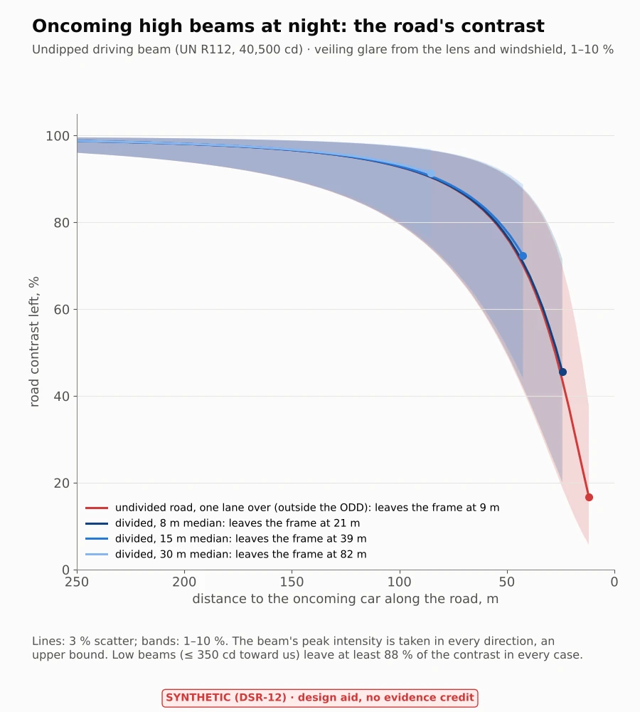

*Figure 19. Oncoming high beams: the road's contrast in the camera's image.*

## 11. Sun on the device through the car (TC-21, DFI-04)

**Question.** How much sun reaches the comma device through the Corolla, face by face, against the heat model's
constant of 320 W/m² on its windshield-side face?

**Method.** [`device_sun.py`](device_sun.py), on a ray cast through the licensed mesh:
- **The ray cast** ([`assets/tools/device_shading.py`](../assets/tools/device_shading.py)) runs where the mesh is,
  never in CI. From points on each face of the device, it casts rays toward every sun direction in the car's frame
  (2.5° by 5°). A ray that hits an opaque part is shaded; one that passes glass reaches the face, and the glass is
  recorded. The table ([`corolla-e210-device-shading.json`](../figures/corolla-e210-device-shading.json), derived
  numbers only) is committed; the mesh is not. The mesh has a glass roof panel, so a second table treats it as metal.
- **The device** hangs 0.15 m down the glass from its top edge, on the centre line, upright (an estimate until T1).
- **The sun:** clear sky (pvlib, Ineichen) every 10 minutes of a year at the corridor's middle. The car is either
  heading along I-85 or parked facing any of 12 ways.
- **Each face** takes the beam (cosine on the face, glass transmittance with pvlib's angle loss) and the sky's diffuse
  light through the glass it sees.

**Result.**
- **The windshield side is never shaded by the car.** Every direction in front of it and above the horizon is
  windshield; only the A-pillars cut grazing sun. What limits it is the angle: upright, it meets the sun squarely only
  when the sun is low ahead. At most 305 W/m², on a winter day.
- **The screen side takes sun from behind,** through the rear window and the roof panel: up to 1.22 W (0.96 W with
  a metal roof) when the sun is low behind the car. The windshield side is dark then, so the box's total stays under
  its peak.
- **Into the whole box**, the year's most is 2.32 W, the model's 2.30 W, but in winter. In June–August it is at most
  1.89 W, 0.82 of the model's: the hot-day bound has margin on the sun.
- **For the heat model (TE-04 T1):** its input stays until T1 measures the mount; then the summer value can replace it.

**Limits.** No light reflected off the dashboard, the hood or the ground. The stock camera housing behind the mirror
and the windshield's frit are not in the mesh.

Results: [`results/device-sun.md`](../results/device-sun.md).


*Figure 20. Sun on the device through the car.*

## 12. Curves on a wet road (TC-14, TC-03, KS-01)

**Question.** Does the ODD's curve bound (2.5 m/s², WP-C-02 §3.2) leave tyre grip on a wet road with the ODD's 3 mm
of tread, cornering alone and while the item brakes in the curve?

**Method.** [`wet_curves.py`](wet_curves.py): the friction circle (the same grip sideways as lengthways) against the
wet-braking study's friction table in the ODD's light rain. The 3 mm grip is the new tyre's divided by the measured
ratio of wet stopping distances at 3 mm to new: 1.07 in Continental's test and 1.35 in MIRA's. A 6 % bank is a
variant.

**Result.**
- Cornering alone needs 0.26 and braking at the item's rate on a straight 0.36. The 3 mm tyres give at least 0.43:
  both hold at every ODD speed.
- Both together need 0.44. Continental's end holds; MIRA's falls just short at speed, leaving 3.4 m/s² of braking at
  110 km/h instead of 3.5.
- At the 1.6 mm legal minimum even cornering alone falls short above about 83 km/h: the reason the ODD asks for 3 mm.
- For WP-C-02 §3.2: a note for the curve bound's rationale, not a reason to move it.

Results: [`results/wet-curves.md`](../results/wet-curves.md).

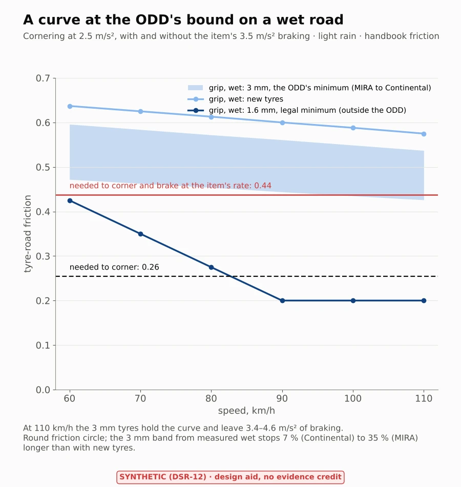

*Figure 21. A curve at the ODD's bound on a wet road.*

## 13. Hill crests (TC-17, KS-27)

**Question.** Over a crest built to the design standard, do the road camera and the radar see a stopped car far
enough ahead to stop?

**Method.** [`crest.py`](crest.py): AASHTO's crest geometry (K from its published table; sight distance
√(200K)(√h1 + √h2)). The camera is at 1.2 m and the radar at 0.5 m (an estimate until T1). The targets are a
stopped car's tail lights, its roof and its radar return. These are set against the distance to stop from 110 km/h.

**Result.**
- On a crest built for 110 km/h the camera sees the tail lights at 228 m,
  a little farther than the driver (221 m). The radar, lowest,
  sees the car only at 172 m.
- That covers a driver stopping in 105 m dry and
  158 m wet with 3 mm of tread, and the item's
  149 m.
- Older crests built for 100 km/h cut the camera's sight to 191 m and
  the radar's to 144 m.

Results: [`results/crest.md`](../results/crest.md).

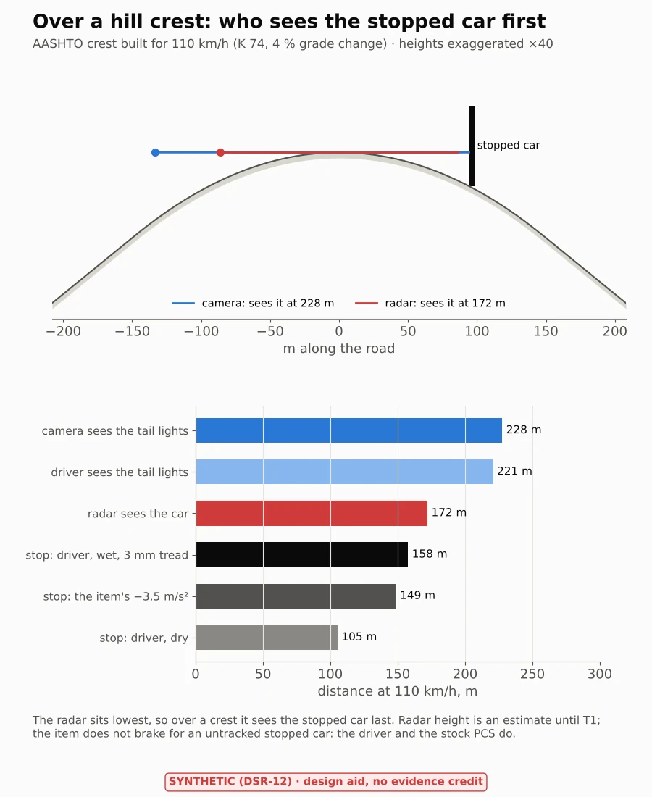

*Figure 22. Over a hill crest.*

## 14. A stopped car ahead (TC-08, KS-05)

**Question.** At highway speed, how big is a stopped car in the driving model's input when the item, or the driver,
has to start braking for it?

**Method.** [`stopped_car.py`](stopped_car.py): at highway speed openpilot takes a lead only from the driving model.
radard pairs a radar track with the model's lead when its probability passes 0.5, and uses radar alone only below
4 m/s and within 25 m (`radard.py`, read and pinned). The car's width in the model's input frames (910 and 455 px
focal length, `model.py`) is set against the distances to stop.

**Result.**
- For the item to stop on its own at −3.5 m/s², the model must take the car as a lead by
  149 m, where it is **11 px wide** in the narrow frame. That is
  far under the 32 px below which MS COCO counts an object as small.
- The car reaches 32 px only at 51 m, closer than every stopping distance.
- An unwarned driver needs 138 m dry and 188 m wet.
- **For KS-05:** start the stopped car from 200 m and more. Logs of `radarState` and `modelV2` leads show at what
  range the model takes it (T1).

**Limits.** What the model detects at a given size is learned, not geometry.

Results: [`results/stopped-car.md`](../results/stopped-car.md).

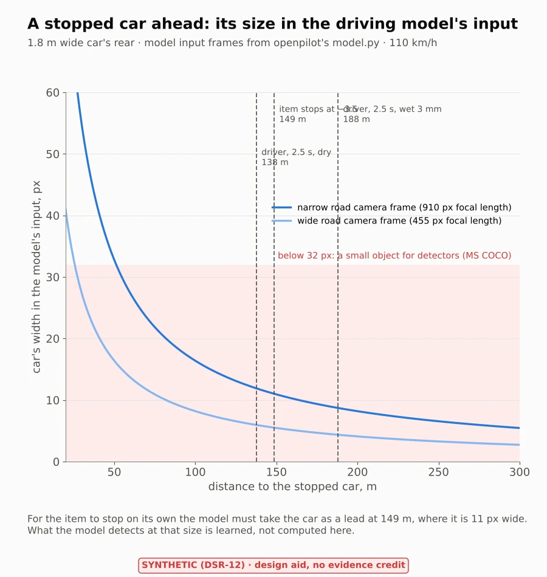

*Figure 23. A stopped car ahead in the model's input.*

## 15. Checks

[`test_weather.py`](test_weather.py) runs in CI:

| Check | Catches |
|---|---|
| S1 pvlib's SPA against the published NREL reference case (zenith 50.11162°, azimuth 194.34024°) | a wrong solar library or call |
| S2 An independent NOAA algorithm, in numpy, against SPA over a year (within 0.05° elevation) | an error in either |
| S3 Field of view read from `camera.py` (40.0° × 25.7°); a sun 20° off-axis counted, 24° not | a wrong camera or frame test |
| S4 Solstice sunrise azimuth 58–64° at the corridor; heading north never sees the sun | a wrong site or time zone |
| W1 Metric film equation against the imperial one after unit conversion | a unit or coefficient error |
| W2 PAVDRN branches meet at 0.095 in where the texture-free term governs | a mistyped constant |
| W3 NASA formula (10.35 √p) | a wrong pressure or unit |
| W4 More rain, a longer path or a flatter slope never raises the speed | a sign or branch error |
| W5 The ODD bound read from WP-C-02 | a moved bound |
| C1 Cabin air rises 22 ± 5 K in 60 min of clear sun, the same at 22 and 36 °C ambient (McLaren et al. 2005) | a model far off measured cars |
| C2 No sun, no AC, constant outside: every node stays at the outside temperature; a clear night sky cools, not below the sky | heat from nowhere, a sign error |
| C3 Outside curve: minimum 06:00, maximum 15:00 | a wrong daily curve |
| C4 Glass and roof areas and rakes equal the mesh measurement in `corolla-e210-geometry.json` | estimates drifting from the measured shape |
| X1 Mesh against published data: wheelbase within 2 % of opendbc, frontal area 2.0–2.4 m² | a mis-scaled or mis-oriented mesh |
| X2 Push mapping against the single-track algebra by hand: force at the CoG needs no steering; a moment N needs v² N (1/Cf + 1/Cr) / L² | an error in the force-to-push step |
| X3 No wind, no push; more wind, more push; band ordered | a sign or branch error |
| F1 Magnus over water and ice against the ASHRAE saturation table, within 0.5 % | a wrong humidity formula |
| F2 Frost at 2 °C air on a clear, calm night (NWS: frost at 33–36 °F), none under overcast; no sky or cabin difference, no glass difference | a sky or sign error |
| F3 Recirculation: the closed-form time to fog against a time-stepped moisture balance | an algebra error |
| F4 Defroster energy balance within 0.1 %; the glass clears from the vents up | heat from nowhere |
| F5 Climate table: 288 rows, sky shares add to 100 %, monthly means within 1 K of NOAA's separate monthly normals | a wrong reduction or unit |
| F6 Two convection correlations agree within 10 % at 110 km/h | a wrong outside heat transfer |
| B1 Friction table equals the handbook at its nodes; interpolation stays between nodes | a mistyped table |
| B2 The item's bound read from opendbc (−3.5 m/s²) equals WP-C-02 F-02 | a moved bound |
| B3 At 2 mm of water above NASA's hydroplaning speed the handbook gives at most 0.05 | the two sources disagreeing |
| B4 Stopping distance algebra (133 m from 110 km/h at 3.5 m/s²) | an algebra error |
| R1 The roll path read from openpilot equals the reviewed one (compensation, zero calibration roll, filter constants) | a code change that moves the result |
| R2 The steady Kalman gain solves the scalar Riccati equation; more noise, a slower filter | a filter error |
| R3 Uncompensated push equals g × slope; no mount roll, no mount error; a near-perfect localizer leaves almost nothing | a sign or unit error |
| G1 The lane-keeping law read from `plant/simulate.py`; the torque limits read from opendbc; the limiter is opendbc's own function | a drift from the plant or opendbc |
| G2 Open loop, a fixed steer angle settles at the neutral-steer yaw rate v·δ/L | a wrong single-track model |
| G3 A wind that rises and stays: ideal steering settles at the crosswind study's push (1 %), the car within 5 cm of the centre | a mismatch with the crosswind study |
| G4 No wind, no movement | motion from nowhere |
| T1 The exposure port's constants are camerad's; the port stops if a line it follows changes | a port drifting from the code |
| T2 The OX03C10 gamma curve runs from 0 to 1 and rises | a mistyped curve |
| T3 A steady scene settles at the target grey (within the whole-line quantisation) with a constant exposure | a loop that does not settle |
| T4 A scene half as bright settles at twice the exposure and the same grey | a wrong loop gain |
| H1 The lamps leave the frame at offset / tan(hfov/2) | a wrong geometry |
| H2 The glare veil scales with intensity and 1 / range² | a wrong photometry |
| H3 No lamps, no change in the road's exposure or contrast | glare from nowhere |
| D1 The ray caster against an analytic shadow: a square above a point hides exactly the rays that meet it | a wrong ray test |
| D2 The sun down the windshield's normal reaches the whole windshield-side face, through the windshield; no face lit from behind | a wrong device place or table |
| D3 The left and right faces see mirror images (the device is on the centre line) | a frame or sign error |
| D4 The beam on the face is absorptance × DNI × cos × transmittance × angle loss; the sky weights give 0.5 for an upright face | a wrong flux or quadrature |
| Q1 Friction needed: a/g cornering, the friction circle with braking, less on a bank | a wrong combination |
| Q2 The 3 mm grip is the new tyre's over the measured stop ratio, between the table's rows | a wrong tread model |
| K1 AASHTO's formula rounds to its published distances and K | a wrong standard |
| K2 The closed-form crest sight distance against a brute-force line of sight (1 %) | a wrong geometry |
| K3 The design eye sees the design object at the design distance | a wrong formula |
| P1 Model focal lengths and radard's lead rules read from openpilot; width = f·W/d | a code change or pixel error |
| P2 Stopping distances as the wet-braking study's | a mismatch between studies |

Each study's `--check` reruns it and fails if any number moves by more than 0.05 from the committed JSON. The crown
study reads openpilot's code, so a change there shows up as a failed R1 or `--check` the next time this job runs.

```sh
python3 -m pip install -r assurance/sim/weather/requirements.txt
python3 assurance/sim/weather/test_weather.py
python3 assurance/sim/weather/sun_glare.py --figures       # about 2 s, figures about 30 s
python3 assurance/sim/weather/hydroplaning.py --figures
python3 assurance/sim/weather/cabin_soak.py --figures      # reads results/thermal-pilot.json for the bound
python3 assurance/sim/weather/crosswind.py --figures       # needs the opendbc submodule (the plant's Corolla)
python3 assurance/sim/weather/windshield_fog.py --figures  # reads climate-gsp.csv
python3 assurance/sim/weather/road_crown.py --figures      # reads the openpilot source and results/crosswind.json
python3 assurance/sim/weather/wet_braking.py --figures     # needs the opendbc submodule (ACCEL_MIN)
python3 assurance/sim/weather/gust.py --figures            # needs the opendbc submodule (torque limiter)
python3 assurance/sim/weather/tunnel.py --figures          # reads the camerad sources
python3 assurance/sim/weather/headlights.py --figures      # reads the camerad sources and camera.py
python3 assurance/sim/weather/device_sun.py --figures      # reads figures/corolla-e210-device-shading.json
python3 assurance/sim/assets/tools/device_shading.py       # only where the licensed mesh is (about 2 min)
python3 assurance/sim/weather/wet_curves.py --figures      # reads the wet-braking table
python3 assurance/sim/weather/crest.py --figures
python3 assurance/sim/weather/stopped_car.py --figures     # reads model.py and radard.py
```
