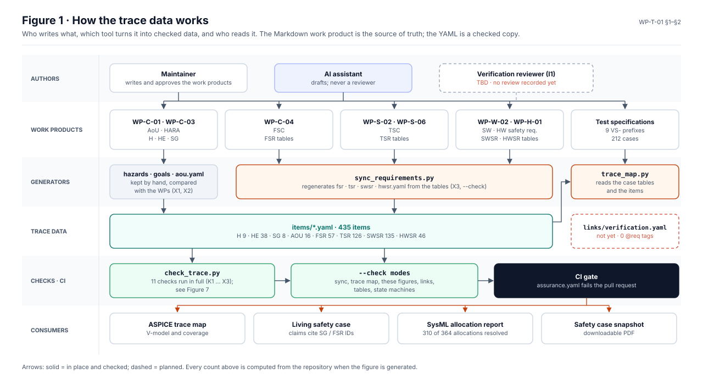
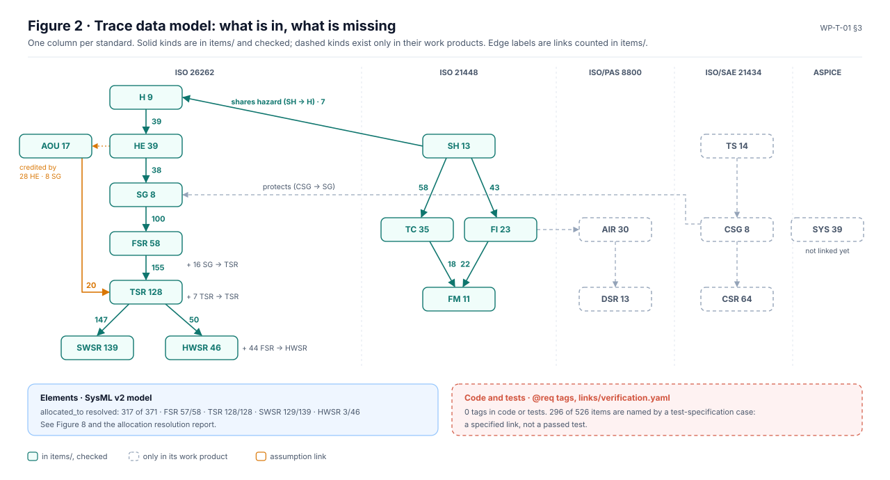
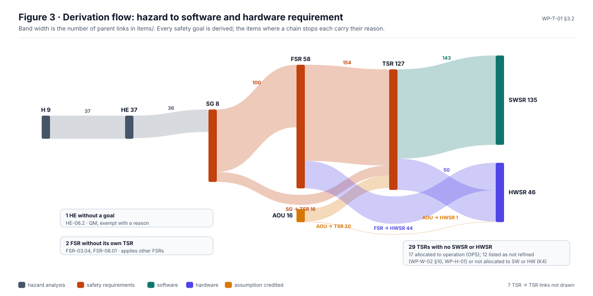
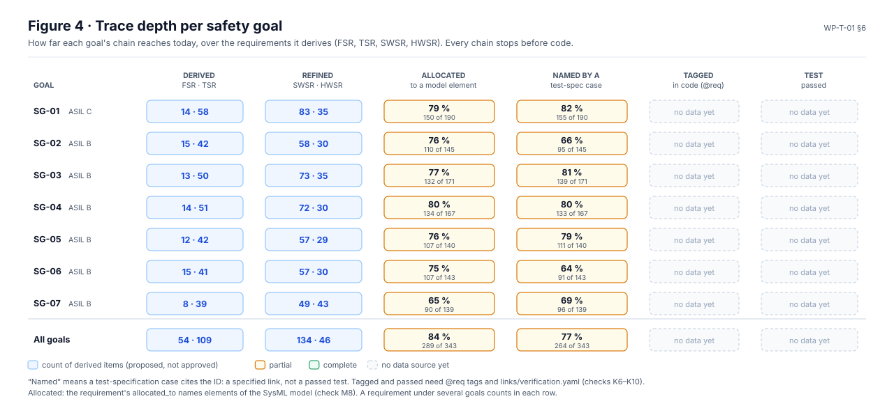
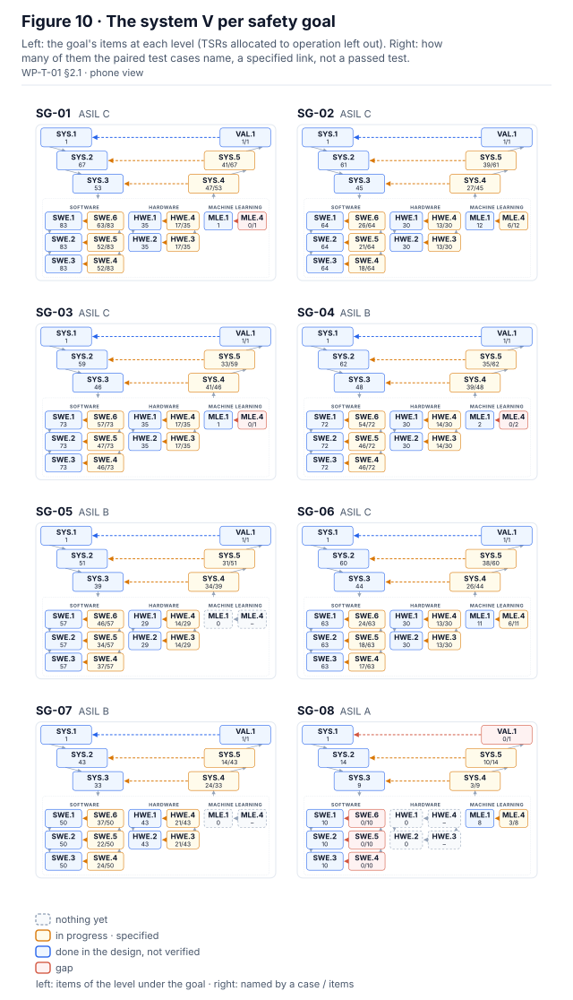
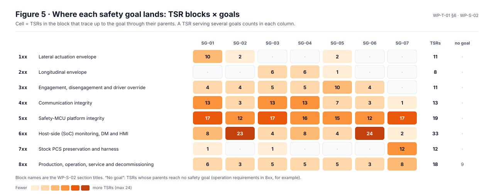
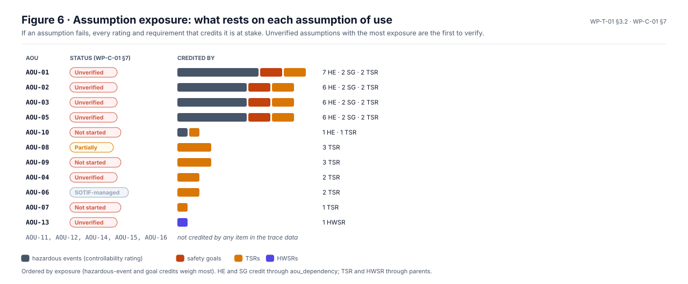
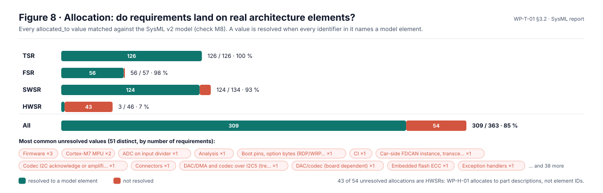
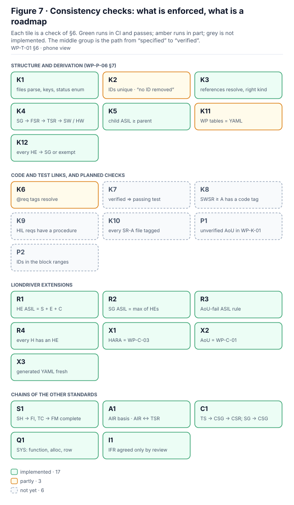

# WP-T-01 Requirements and Traceability Data

| Field | Value |
|---|---|
| Work product | WP-T-01 Requirements and traceability data (machine-readable), consistency evidence |
| Standard reference | ISO 26262-8:2018 §6 (specification and management of safety requirements); ISO/SAE 21434:2021 §10; ASPICE 4.0 traceability and consistency BPs of SYS.2–SYS.5, SWE.1–SWE.6 (consistency evidence) |
| Version | 0.7 (ISO 21448:2022 clause-check register added, 27 obligations; I0, Claude; 2026-10-26). 0.6 (clause-check register pilot added, `clauses/` and `tools/check_clauses.py`, ISO 26262-3:2018 §5–§7; check K5 implemented with a baseline of known findings, `links/k5-known.yaml`; I0, Claude; 2026-10-26). 0.5 (interface items IFR-01…IFR-33 in `items/ifr.yaml` with check I1: an interface is agreed only through a recorded review, DQ-129 A; 2026-10-25). 0.4 (OI-3 closed: the item schema and its pinned jsonschema check, DQ-123 A; 2026-10-22). 0.3 (Figures 9 and 10 added: the system V, status lens and one per safety goal, generated by tools/vmodel.py; Figure 1 of the trace map redrawn with the same component; 2026-10-14). 0.2 (eight generated traceability figures added: Figures 1–2 in §1, 3–6 and 8 in §2.1–§2.3, 7 in §6; AoU count, item total, tools list, CI text and §4.4/§4.5 order corrected; planned checks given IDs P1, P2; K2 marked partly implemented; 2026-10-13). 0.1 initial draft |
| Status | Draft |
| ASIL / scope | All (FuSa, SOTIF, AI, CS) |
| Author | Assurance team (initial draft) |
| Reviewer(s) | TBD (I1) |
| Approver | Safety manager |
| Baseline | `8b8c6ae` |

## 1. Purpose

This folder holds the machine-readable copy of the hazard log, safety goals, assumptions and (later) all requirements and their trace links, plus the checker that keeps them consistent. The procedure that governs it — requirement attributes, quality criteria, trace model, tagging convention and consistency checks — is [WP-P-06](../07-supporting/WP-P-06-requirements-management-traceability.md). This README describes the data as implemented and extends WP-P-06 where WP-P-06 does not yet cover an item kind (hazards, hazardous events, assumptions); those extensions are marked **[ext]** and are proposed for inclusion in WP-P-06 (OI-1).

The Markdown work products remain the documents that are reviewed and approved. The YAML files are copies that tools can check. Where both exist, the work product is the source of truth and the checker reports any difference (checks X1, X2, X3).



*Figure 1.* How the trace data is made and used: the maintainer and the AI assistant write the work products; the YAML is copied by hand (hazards, goals, AoUs) or regenerated from the requirement tables; the checks gate every pull request; the trace map, the safety case, the SysML allocation report and the snapshot read the result. Dashed: planned (independent reviewer, verification links). Source: [`figures/fig-1-trace-workflow.svg`](figures/fig-1-trace-workflow.svg).



*Figure 2.* The trace data model of §3 with today's counts. Solid kinds are in `items/` and checked; dashed kinds are counted from their work products and not yet linked. The footer shows the two link types that are not item kinds: allocation to architecture elements (§2.3) and code and test tags (§5). Source: [`figures/fig-2-trace-data-model.svg`](figures/fig-2-trace-data-model.svg).

All figures in this README are generated by [`tools/trace_figures.py`](tools/trace_figures.py) from `items/`, the test-specification tables, the SysML model and the §6 table; CI fails if a committed figure is stale. Regenerate them with `python3 assurance/trace/tools/trace_figures.py` after changing any of those sources.

## 2. Current content

| File | Content | Source | Items |
|---|---|---|---|
| `items/hazards.yaml` | Hazards H-01…H-09; hazardous events HE-01.1…HE-09.2 with S/E/C/ASIL | [WP-C-03](../02-concept/WP-C-03-hara.md) §4–§5 | 9 + 39 |
| `items/goals.yaml` | Safety goals SG-01…SG-08 with ASIL, safe state, FTTI, source HEs | [WP-C-03](../02-concept/WP-C-03-hara.md) §6 | 8 |
| `items/aou.yaml` | Assumptions of use AOU-01…AOU-18 | [WP-C-01](../02-concept/WP-C-01-item-definition.md) §7 | 18 |
| `items/fsr.yaml` | Functional safety requirements FSR-01.01…FSR-07.05 with ASIL, parent SGs, allocation, verification | [WP-C-04](../02-concept/WP-C-04-functional-safety-concept.md) §5, parents from §9. **Generated** | 58 |
| `items/tsr.yaml` | Technical safety requirements TSR-101…TSR-818 with ASIL, parents, allocation, mechanism, timing, verification | [WP-S-02](../03-system/WP-S-02-technical-safety-requirements.md) §3–§9, [WP-S-06](../03-system/WP-S-06-requirements-production-operation.md) (TSR-8xx). **Generated** | 128 |
| `items/swsr.yaml` | Software safety requirements SWSR-101…SWSR-711a with ASIL, parent TSRs, allocation, verification, acceptance | [WP-W-02](../05-software/WP-W-02-software-safety-requirements.md) §3–§9 and §11. **Generated** | 139 |
| `items/hwsr.yaml` | Hardware safety requirements HWSR-401…HWSR-711a with ASIL, parent FSRs/TSRs, allocation, kind, verification | [WP-H-01](../04-hardware/WP-H-01-hardware-safety-requirements.md) §4. **Generated** | 46 |
| `items/sotif.yaml` | SOTIF hazards SH-01…SH-13 with their shared HARA hazard; functional insufficiencies FI-01…FI-23 with parent SHs; triggering conditions TC-01…TC-35 with the SHs and FIs of their evaluation rows; functional modifications FM-01…FM-11 with the TCs and FIs whose action names them | [WP-C-05](../02-concept/WP-C-05-sotif-hazard-identification.md) §3, [WP-C-06](../02-concept/WP-C-06-sotif-insufficiencies-triggering-conditions.md) §3–§5, [WP-C-07](../02-concept/WP-C-07-sotif-functional-modifications.md) §2. **Generated** | 13 + 23 + 35 + 11 |
| `items/ai.yaml` | AI safety requirements AIR-01…AIR-30 with category, component, parents (SG, FSR, SH, TC, FI, FM, AIR), the TSRs that refine or share them, verification and status; dataset requirements DSR-01…DSR-13 with parent AIRs or DSRs | [WP-C-11](../02-concept/WP-C-11-ai-system-definition-and-safety-requirements.md) §6–§7. **Generated** | 30 + 13 |
| `items/cs.yaml` | Threat scenarios TS-01…TS-14 with STRIDE, assets, damage, risk and treatment; cybersecurity goals CSG-01…CSG-08 with parent TSs, CAL and the safety goals they protect; detailed cybersecurity requirements CSR-011…CSR-162 with parent CSGs, their CSR-C, allocation and the TSRs their safety relation names | [WP-C-09](../02-concept/WP-C-09-tara.md) §4, §8, [WP-C-10](../02-concept/WP-C-10-cybersecurity-goals-and-concept.md) §4, §8, [WP-S-07](../03-system/WP-S-07-cybersecurity-requirements-architecture.md) §4. **Generated** | 14 + 8 + 64 |
| `items/ifr.yaml` | Interface items IFR-01…IFR-33, one per cross-domain interface IX-01…IX-33 of the process model, with the two owning roles, the open item and the review record that agreed it (none yet) | [WP-P-11](../process/README.md) §3, [`process/model/interfaces.yaml`](../process/model/interfaces.yaml); decision register DQ-129 A. Kept by hand | 33 |
| `items/sys.yaml` | System requirements SYS-001…SYS-145 with type, function, target, verification, the TSR / SOTIF / AI items of their traceability row and their allocation to SysML elements | [WP-S-01](../03-system/WP-S-01-system-requirements.md) §2–§10.1. **Generated** | 39 |
| `tools/check_trace.py` | Consistency checker (§6) | — | — |
| `tools/check_links.py` | Relative-link checker for all of `assurance/` (WP-P-04) | — | — |
| `links/verification.yaml` | Test → requirement links (WP-P-06 §5.3): the opendbc safety tests of the reference-configuration class `TestToyotaSafetyTorque`, inherited from the shared `common.py` (§4.1) and added by LionDriver (§4.9), and the LionDriver panda host suites (§4.9), whose requirements come from each suite's module docstring; level, environment and whether WP-W-06 calls the coverage partial. One entry per test. No results | [WP-W-06](../05-software/WP-W-06-software-unit-verification.md) §4.1, §4.9. **Generated** | 103 |
| `tools/verification_links.py` | Regenerates `links/verification.yaml` from WP-W-06 §4.1 and §4.9; `--check` fails if it is stale or a linked method is not on its class or the class's bases (read from the test sources, needs `opendbc_repo` and `panda`) | — | — |
| `tools/check_schema.py`, `schema/item.schema.json` | Every item against the JSON schema of WP-P-06 §5.1, with the pinned jsonschema of `requirements.txt` (DQ-123 A) | — | — |
| `tools/sync_requirements.py` | Regenerates `fsr.yaml`, `tsr.yaml`, `swsr.yaml`, `hwsr.yaml`, `sotif.yaml`, `ai.yaml`, `cs.yaml` and `sys.yaml` from the work products; `--check` reports drift | — | — |
| `tools/trace_map.py` | Generates [`maps/aspice-trace-map.md`](maps/aspice-trace-map.md) and its Figure 1 ([`maps/fig-1-aspice-v-model.svg`](maps/fig-1-aspice-v-model.svg)): the ASPICE 4.0 V-model with the items of each process and the derivation and verification coverage, from the items and the test-specification tables; `--check` fails if the map is stale | — | — |
| `tools/trace_figures.py` | Generates the ten figures of this README in [`figures/`](figures) from the items, the test-specification tables, the SysML model (allocation resolution, check M8), the §6 table and, for Figures 9 and 10, `tools/vmodel.py`; `--check` fails if a figure is stale | — | — |
| `tools/vmodel.py` | The system V as one SVG component (lenses status, trace, V&V, goal, gate; sizes full, card, locator) used by Figure 1 of the trace map, Figures 9 and 10 and the safety case snapshot; levels from `trace_map.py`, status from the WP-M-00 register and the gate records | — | — |
| `tools/check_tables.py` | Every row of every Markdown table under `assurance/` has as many cells as its header (WP-P-04) | — | — |
| `tools/check_clauses.py`, [`clauses/`](clauses/README.md) | Clause-check register (pilot: ISO 26262-3:2018 §5–§7, 21 obligations, and ISO 21448:2022 §4–§13, 27 obligations, in the project's own words, none yet verified against the licensed standard): runs the checks above per obligation and regenerates a coverage page per register ([26262-3](clauses/iso26262-3-2018-coverage.md), [21448](clauses/iso21448-2022-coverage.md)); `--check` fails on a broken register or a stale page (WP-P-07 TL-59) | ISO 26262-3:2018, ISO 21448:2022 (clause numbers only) | 48 |
| `tools/check_state_machines.py` | Checks the state-machine records in `05-software/state-machines/` and generates the WP-W-05 §5 tables from them; `--check` reports drift | — | — |
| `tools/test_trace_map.py`, `tools/test_check_tables.py`, `tools/test_trace_figures.py`, `tools/test_vmodel.py` | Unit tests of the generators and checkers above | — | — |

All items carry `status: proposed`: none of the source work products is approved, and no interface review has been recorded. The HARA ratings are proposals pending the I3 confirmation review (CR-02).

Run the checker from the repository root:

```sh
python3 assurance/trace/tools/check_trace.py          # all checks incl. comparison with WP-C-01/WP-C-03
python3 assurance/trace/tools/check_trace.py --no-source-compare
python3 assurance/trace/tools/check_links.py          # every relative link under assurance/ resolves
python3 assurance/trace/tools/check_schema.py         # every item against schema/item.schema.json (pip install -r assurance/trace/requirements.txt)
python3 assurance/trace/tools/trace_figures.py --check # the figures in this README are current
```

**Traceability map.** [`maps/aspice-trace-map.md`](maps/aspice-trace-map.md) shows the trace data on the ASPICE 4.0 V-model: specification processes (SYS.1–SYS.3, SWE.1–SWE.3, HWE.1/2, MLE.1) on the left, each verification process (SWE.4–SWE.6, HWE.3/4, MLE.4, SYS.4/5, VAL.1) opposite the level it verifies. Every box and arrow carries counts computed from `items/` and from the requirement IDs the test-specification tables name; kinds not yet in `items/` are counted from their work products and drawn dashed. It is generated by `tools/trace_map.py` and checked in CI.

These checks and generators run in CI (`.github/workflows/assurance.yaml`, §6) on pull requests that touch `assurance/` and on pushes to `liondriver-dev`. Any one failing fails the job.

Result at this baseline: `trace: 12 files, 733 items ai-requirement=30, aou=18, cybersecurity-goal=8, cybersecurity-requirement=64, dataset-requirement=13, fsr=58, functional-insufficiency=23, functional-modification=11, hazard=9, hazardous-event=39, hwsr=46, interface-requirement=33, safety-goal=8, sotif-hazard=13, swsr=144, system-requirement=39, threat-scenario=14, triggering-condition=35, tsr=128` — `known: 51 recorded finding(s) with an owner (K5, k5-known.yaml)` — `OK: all implemented checks passed`. The checker needs only the Python standard library. It uses PyYAML when available; PyYAML is **not** a direct dependency of LionDriver (`uv.lock` lists `pyyaml` only as an optional `autogen` extra of tinygrad), so a built-in parser for the YAML subset in §4.1 is used otherwise. Both paths were run and give the same result.

### 2.1 Derivation and depth



*Figure 3.* Every parent link in `items/`, as bands whose width is the number of links (a requirement with two parents counts twice). Skip links (SG → TSR, FSR → HWSR, AOU → HWSR) are routed below the column they skip. The boxes list the items where a chain stops and why. Source: [`figures/fig-3-derivation-flow.svg`](figures/fig-3-derivation-flow.svg).



*Figure 4.* How far each safety goal's chain reaches. "Named by a test-spec case" counts requirements that some VS- case cites: a specified link, never a passed test. "Linked to a test" counts requirements that `links/verification.yaml` links to an existing test; the last column stays empty until test results are recorded (§5; checks K7–K10). Source: [`figures/fig-4-trace-depth-per-goal.svg`](figures/fig-4-trace-depth-per-goal.svg).


*Figure 9.* The system V of ASPICE 4.0, status lens: each box is coloured by the register status of its work products (WP-M-00 §3), and each verification box and bridge gives the cases its test specifications define and how many have run; the band below shows the gate records of WP-M-00 §2. Green is reserved for approved or baselined work products and passed verification, so nothing is green. Drawn from WP-M-00 §2–§3, the gate records and the test-specification tables. Generated by [`tools/vmodel.py`](tools/vmodel.py) through [`tools/trace_figures.py`](tools/trace_figures.py); CI fails if it is stale. Source: [`figures/fig-9-system-v-status.svg`](figures/fig-9-system-v-status.svg).

[](figures/fig-10-v-per-goal.svg)

*Figure 10.* The same V once per safety goal (goal lens): left, the items under the goal at each level, counted over the kinds the level's verification pair measures (§5 of the [trace map](maps/aspice-trace-map.md); TSRs allocated to operation left out); right, how many of them the paired cases name. Blue means every one is named: a specified link, not a passed test. Drawn from `items/` and the test-specification tables. Generated by [`tools/vmodel.py`](tools/vmodel.py) through [`tools/trace_figures.py`](tools/trace_figures.py); CI fails if it is stale. Source: [`figures/fig-10-v-per-goal.svg`](figures/fig-10-v-per-goal.svg).

### 2.2 Coverage by TSR block and by assumption



*Figure 5.* Which TSR blocks of [WP-S-02](../03-system/WP-S-02-technical-safety-requirements.md) carry which safety goal, through the TSRs' parent chains. Block names are the WP-S-02 section titles. Source: [`figures/fig-5-tsr-blocks-by-goal.svg`](figures/fig-5-tsr-blocks-by-goal.svg).



*Figure 6.* What rests on each assumption of use ([WP-C-01](../02-concept/WP-C-01-item-definition.md) §7): hazardous events and goals credit it through `aou_dependency`, TSRs and HWSRs through `parents`. Source: [`figures/fig-6-aou-exposure.svg`](figures/fig-6-aou-exposure.svg).

### 2.3 Allocation to architecture elements

`allocated_to` holds the work-product allocation cell. Since the SysML v2 architecture model ([`models/sysml`](../models/sysml/README.md)) exists, its check M8 matches every value against the model elements and writes the [allocation resolution report](../models/sysml/generated/allocation-resolution.md). Until `elements.yaml` exists (WP-P-06 OI-4) the report is the allocation evidence; it is informational and does not fail CI.



*Figure 8.* Allocation resolution per requirement kind, with the most common unresolved values. Source: [`figures/fig-8-allocation-resolution.svg`](figures/fig-8-allocation-resolution.svg); the data is that of the allocation resolution report.

## 3. Trace data model

### 3.1 Artifact types

| Kind | ID prefix | Defined in | File (target layout, WP-P-06 §5.1) | Present |
|---|---|---|---|---|
| Hazard | `H-` | WP-C-03 | `items/hazards.yaml` | Yes |
| Hazardous event | `HE-` (see §7 note on `HS-`) | WP-C-03 | `items/hazards.yaml` | Yes |
| Safety goal | `SG-` | WP-C-03 | `items/goals.yaml` | Yes |
| Functional safety requirement | `FSR-<SG>.<nn>` | [WP-C-04](../02-concept/WP-C-04-functional-safety-concept.md) | `items/fsr.yaml` | Yes (generated) |
| Technical safety requirement | `TSR-<nnn>` (blocks 1xx…8xx) | [WP-S-02](../03-system/WP-S-02-technical-safety-requirements.md), [WP-S-06](../03-system/WP-S-06-requirements-production-operation.md) | `items/tsr.yaml` | Yes (generated) |
| SW / HW safety requirement | `SWSR-<nnn>[a]`, `HWSR-<nnn>[a]` | [WP-W-02](../05-software/WP-W-02-software-safety-requirements.md), [WP-H-01](../04-hardware/WP-H-01-hardware-safety-requirements.md) | `items/swsr.yaml`, `items/hwsr.yaml` | Yes (generated) |
| SOTIF hazard | `SH-` | [WP-C-05](../02-concept/WP-C-05-sotif-hazard-identification.md) | `items/sotif.yaml` | Yes (generated) |
| Triggering condition / functional insufficiency | `TC-`, `FI-` | [WP-C-06](../02-concept/WP-C-06-sotif-insufficiencies-triggering-conditions.md) | `items/sotif.yaml` | Yes (generated) |
| Functional modification | `FM-` (WP-C-05 usage) / `SOTIF-` (WP-P-06 usage), see §7 | [WP-C-07](../02-concept/WP-C-07-sotif-functional-modifications.md) | `items/sotif.yaml` | Yes (generated) |
| AI safety / dataset requirement | `AIR-`, `DSR-` | [WP-C-11](../02-concept/WP-C-11-ai-system-definition-and-safety-requirements.md), [WP-W-10](../05-software/WP-W-10-ml-engineering.md) | `items/ai.yaml` | Yes (generated from WP-C-11) |
| Threat scenario, CS goal, CS requirement | `TS-`, `CSG-`, `CSR-` | [WP-C-09](../02-concept/WP-C-09-tara.md), [WP-C-10](../02-concept/WP-C-10-cybersecurity-goals-and-concept.md), [WP-S-07](../03-system/WP-S-07-cybersecurity-requirements-architecture.md) | `items/cs.yaml` | Yes (generated); the concept-level CSR-C-nn stay in WP-C-10 and are named in each CSR's `concept_requirement` |
| System requirement (non-safety) | `SYS-` | [WP-S-01](../03-system/WP-S-01-system-requirements.md) | `items/sys.yaml` | Yes (generated) |
| Interface item **[ext]** | `IFR-` | [WP-P-11](../process/README.md) (interfaces `IX-nn`) | `items/ifr.yaml` | Yes (kept by hand) |
| Assumption of use | `AOU-` | WP-C-01, refined in WP-C-04 | `items/aou.yaml` (WP-P-06 name; the coordinator's request used `aous.yaml`) | Yes |
| Element (allocation target) | dotted name, e.g. `panda.safety.toyota` | WP-S-03, WP-W-03 | `elements.yaml` | No (WP-P-06 OI-4); meanwhile `allocated_to` is resolved against the SysML model (§2.3) |
| Test / verification link | test path | code and procedures | `links/verification.yaml` | No |

### 3.2 Link types

All links are stored on the child (or on the item that depends) as a list of IDs; reverse views are generated.

| Link | Stored as | From → to | Meaning |
|---|---|---|---|
| hazard event of | `parents` | HE → H | The hazardous event is a rated instance of the hazard |
| goal source | `parents` | SG → HE | The safety goal covers these hazardous events (ASIL = highest) |
| derives from | `parents` | FSR → SG; TSR → FSR; SWSR/HWSR → TSR | Requirement decomposition (WP-P-06 §4) |
| SOTIF cause | `parents` | TC/FI → SH; FM/SOTIF- → TC/FI | Insufficiency analysis and its treatment |
| AI | `parents` | AIR → SG, FSR, SH, TC, FI, FM, AIR; DSR → AIR, DSR | ML insufficiency treatment and the goals the AI requirements serve |
| AI ↔ TSR **[ext]** | `related_tsr` | AIR → TSR | TSRs that refine an AIR or share its FSR; never a parent, because AIRs sit at the FSR level |
| CS | `parents` | CSG → TS; CSR → CSG | TARA-derived goals and requirements |
| CS ↔ safety | `protects` **[ext]** | CSG → SG | Attack that causes a safety hazard is covered by the CS goal (WP-C-10 §8) |
| CS ↔ TSR **[ext]** | `related_tsr` | CSR → TSR | TSRs the CSR's Safety relation cell names |
| SYS ↔ safety **[ext]** | `related_tsr`, `related_items` | SYS → TSR; SYS → SH, AIR | The TSRs, SOTIF hazards and AI requirements of the requirement's WP-S-01 §10 row; system requirements have no parent item, they refine the item functions (`functions`) |
| SOTIF ↔ HARA | `shares_event` **[ext]** | SH → HE/H | One hazard log (WP-M-01 §6) |
| interface of **[ext]** | `interface` | IFR → IX | The process-model interface the item stands for; the model's IX record names the item back in `ifr` |
| agreed by **[ext]** | `review_ref` | IFR → REV | The accepted review record ([`case/reviews/reviews.yaml`](../case-records/reviews/reviews.yaml)) that agreed the interface |
| assumption credited | `aou_dependency` **[ext]** | HE, SG, FSR, TSR → AOU | The rating or requirement depends on the assumption |
| allocation | `allocated_to` | requirement → element | WP-P-06 §2 |
| implementation | `@req` tag in code | code → requirement | WP-P-06 §6 |
| verification | `@req` tag in tests or `links/verification.yaml` | test → requirement | WP-P-06 §5.3, §6 |

The chains requested by the safety case are therefore: `H → HE → SG → FSR → TSR → SWSR/HWSR → code / test`; `SH → TC/FI → FM`; `TS → CSG → CSR`; `AOU ← HE / SG / FSR` (assumption credited by).

## 4. Field schema

### 4.1 YAML subset

Each file is a top-level list of flat mappings. To keep the files readable by the built-in parser and diff-friendly:

- every item starts with `- id: <ID>`; other keys are indented two spaces;
- values are one of: double-quoted single-line string (escape `"` as `\"`), bare word, integer, `true`/`false`, `null`, or a flow list of bare words `[A, B]`;
- no block scalars, no nested mappings, no inline comments after values; full-line `#` comments allowed.

Requirement items (FSR, TSR, SWSR, …) use exactly the attributes and keys of [WP-P-06 §2](../07-supporting/WP-P-06-requirements-management-traceability.md#2-requirement-attributes). WP-P-06 §5.2 shows `text`, `rationale` and `implemented_in` as YAML block scalars and block lists; in this folder they are written as quoted single-line strings and flow lists (e.g. `implemented_in: [opendbc_repo/opendbc/safety/modes/toyota.h:173, opendbc_repo/opendbc/safety/lateral.h:60-151]`). The built-in parser splits flow lists on commas, so list elements must not contain commas.

Keys common to all kinds: `id`, `kind`, `status` (WP-P-06 enum), `source` (work product ID), optional `notes`.

### 4.2 Hazard and hazardous event **[ext]**

| Key | Kind | Content |
|---|---|---|
| `title` | hazard | Hazard name as in WP-C-03 §4 |
| `functions` | hazard | Item functions (F-nn) whose malfunction leads to it |
| `parents` | hazardous-event | `[H-nn]` |
| `situation`, `effect` | hazardous-event | Verbatim from WP-C-03 §5 |
| `s`, `e`, `c` | hazardous-event | Integers 0–3 / 0–4 / 0–3 |
| `asil` | hazardous-event | `QM`, `A`…`D`; must equal the risk graph of S+E+C (R1) |
| `aou_flag` | hazardous-event | `true` where WP-C-03 marks the rating ⚠ |
| `aou_dependency` | hazardous-event | AOUs the controllability rating credits |
| `asil_if_aou_fails` | hazardous-event | Alternative ASIL stated in WP-C-03, else `null` |
| `sg_exempt_reason` | hazardous-event | Required if no SG lists this HE (e.g. QM) |

### 4.3 Safety goal

| Key | Content |
|---|---|
| `text` | Verbatim goal statement |
| `type` | `constraint` |
| `asil`, `asil_if_aou_fails`, `aou_dependency` | As WP-C-03 §6 (e.g. SG-01: C, D if AOU-01/02 fail) |
| `parents` | Source HEs |
| `safe_state` | Verbatim |
| `ftti_ms`, `ftti_text` | Preliminary FTTI in ms (`null` for "Continuous") and the original text |

### 4.4 Assumption of use **[ext]**

| Key | Content |
|---|---|
| `text`, `credited_in`, `verification_approach` | Verbatim from WP-C-01 §7 |
| `aou_status` | WP-C-01 status column (`Unverified`, `Assumption (SOTIF-managed)`, `Not started`, `Partially (calibration check exists)`, `Design constraint`). Kept separate from `status`, which is the lifecycle status of the item itself |

### 4.5 Safety requirements (FSR, TSR, SWSR, HWSR)

`fsr.yaml`, `tsr.yaml`, `swsr.yaml` and `hwsr.yaml` are **generated** by `tools/sync_requirements.py` from the requirement tables of WP-C-04, WP-S-02, WP-S-06, WP-W-02 and WP-H-01; never edit them by hand. Each value is copied verbatim from its table cell, so the keys follow the work-product columns rather than the full WP-P-06 §2 attribute list (see §7 #7).

| Key | Kind | Content |
|---|---|---|
| `text` | fsr, tsr | Requirement statement, verbatim |
| `asil` | fsr, tsr | ASIL cell verbatim, including the WP-S-02 §2.1 notations (`B‡`, `QM (B-sup: TSR-…)`, `ext`) |
| `parents` | fsr | Safety goals from the WP-C-04 §9 FSR → SG matrix |
| `parents` | tsr | Item IDs from the Parent cell, expanded (`FSR-07.01, 07.03`, `SG-01…07`, `AOU-01…05, 09`); FSR, TSR, SG, AOU or GAP |
| `parent_text`, `other_parents` | tsr | The Parent cell verbatim; `true` when it also names something that is not an item (a standard clause, a tailoring ID, a WP) |
| `allocated_to` | fsr, tsr | Allocation cell verbatim (`E-03`, `P-SW`, `SoC`, …); element IDs come with `elements.yaml` (WP-P-06 OI-4). TSR-8xx: `OPS` |
| `mechanism`, `timing` | tsr | Safety-mechanism type and detect/react timing (WP-S-02 §2.2); empty for TSR-8xx |
| `verification` | fsr, tsr | Verification-method cell verbatim |
| `baseline_impl` | fsr, tsr, swsr, hwsr | Baseline column verbatim: what the code does at `8b8c6ae`, or at a later pin or in the reference build where the cell names one (WP-W-02 §2.2); not verification evidence |
| `text`, `asil`, `allocated_to`, `verification` | swsr, hwsr | As for tsr, from the WP-W-02 / WP-H-01 columns (Allocation or Alloc, Verif) |
| `parents`, `parent_text`, `other_parents` | swsr, hwsr | As for tsr. Parenthetical notes are dropped and `FSR … / TSR …` is read as a list (`TSR-307(a)` → TSR-307). SWSR parents are TSRs; HWSR parents are TSRs, FSRs or AoUs |
| `acceptance` | swsr | Acceptance criterion cell verbatim (§11 rows included since WP-W-02 v0.14) |
| `applies_to` | swsr | Configuration applicability from WP-W-02 §2.4; `CFG-001` unless the §2.4 table narrows it (WP-M-14 §7) |
| `proposed_by` | swsr | Drafting origin from WP-W-02 §2.4 ("ai-assisted (Claude), not reviewed") |
| `status` | swsr | `withdrawn` when the requirement text starts with "Withdrawn"; otherwise `proposed` |
| (links) | all | Markdown links in copied cells are rewritten as `text (repository-relative path)`, because relative links do not resolve from `trace/items/` |
| `hw_kind` | hwsr | WP-H-01 Kind cell (HW, CFG, HW/CFG) |
| (§11 rows) | swsr | WP-W-02 §11 SW-HW interface rows have no ASIL or parent column (they do have Verif and Acceptance): the parent is the TSR of the same number and the ASIL is copied from that TSR; `parent_text` says so |

### 4.6 SOTIF items (SH, FI, TC, FM)

`sotif.yaml` is **generated** by `tools/sync_requirements.py` from WP-C-05 §3, WP-C-06 §3–§5 and WP-C-07 §2; never edit it by hand. Cells are copied verbatim; the links are read as follows.

| Key | Kind | Content |
|---|---|---|
| `text` | sotif-hazard, functional-insufficiency, triggering-condition | Hazardous behaviour, insufficiency or triggering condition, verbatim |
| `functions`, `function_text` | sotif-hazard | Item functions (F-nn) named in the Function cell, and the cell verbatim (`all`, `—`) |
| `s`, `c` | sotif-hazard | S and C ratings as integers; absent where WP-C-05 gives none (SH-12, SH-13) |
| `situations` | sotif-hazard | Example situations cell verbatim |
| `shares_event`, `linked_text` | sotif-hazard | The HARA hazard of the Linked H cell when it names one (one hazard log, WP-M-01 §6), and the cell verbatim. A new hazard "with an effect like H-03" shares no event |
| `status` | sotif-hazard | `withdrawn` for a row marked not used (SH-07); otherwise `proposed` |
| `fi_type`, `component` | functional-insufficiency | P (performance limitation) or S (specification insufficiency), and the component |
| `parents` | functional-insufficiency | SOTIF hazards of the Linked SH cell |
| `category` | triggering-condition | Category cell verbatim |
| `parents`, `insufficiencies` | triggering-condition | The SOTIF hazards and the functional insufficiencies of every WP-C-06 §5 row that names the TC |
| `evaluation` | triggering-condition | The Evaluation cells of those rows, joined |
| `title`, `addresses` | functional-modification | Title and the SOTIF hazards of the WP-C-07 §2 Addresses cell |
| `parents` | functional-modification | The TCs, then the FIs, of every WP-C-06 §5 row whose Action names the FM |
| `gap_text`, `priority` | functional-modification | GAP and Priority cells verbatim |

The trace map lists, for review, each modification whose Addresses differ from the SOTIF hazards of the rows that name it: a modification can address a hazard directly, so a difference is not an error.

### 4.7 AI items (AIR, DSR)

`ai.yaml` is **generated** by `tools/sync_requirements.py` from WP-C-11 §6 and §7; never edit it by hand.

| Key | Kind | Content |
|---|---|---|
| `text`, `verification` | ai-requirement, dataset-requirement | Statement and verification cells, verbatim |
| `category` | ai-requirement | The §6 subsection (Performance, Robustness, Uncertainty estimation, …) |
| `component` | ai-requirement | Comp. cell verbatim (AI-1, AI-3 + monitor, Process, …) |
| `parents` | ai-requirement | Item IDs of the Parent cell (SG, FSR, SH, TC, FI, FM, GAP, AIR), ranges expanded (`SH-01…SH-06`) |
| `parents` | dataset-requirement | AIR or DSR IDs of the Parent cell |
| `parent_text`, `other_parents` | both | The Parent cell verbatim; `true` when it also names something that is not an item (DMP-01, D-05, a WP, "All SGs") |
| `related_tsr` | ai-requirement | TSRs the Parent cell names, after "refined by" or as siblings under the same FSR; checked against the TSR rows by A1 |
| `baseline_impl` | both | Status / evidence cell verbatim: what the baseline does, not verification evidence |

### 4.8 Cybersecurity items (TS, CSG, CSR)

`cs.yaml` is **generated** by `tools/sync_requirements.py` from WP-C-09 §4 and §8, WP-C-10 §4 and §8 and WP-S-07 §4; never edit it by hand.

| Key | Kind | Content |
|---|---|---|
| `text`, `stride`, `assets`, `violated_property`, `damage_text`, `gap_text` | threat-scenario | WP-C-09 §4 columns verbatim; damage scenarios (DS) are not items, so `damage_text` keeps them as text |
| `risk`, `treatment` | threat-scenario | Risk value (integer) and treatment of the WP-C-09 §8 row |
| `parents`, `parent_text` | cybersecurity-goal | Threat scenarios of the Addresses TS cell, and the cell verbatim with the risks |
| `cal`, `rationale` | cybersecurity-goal | CAL proposal and its rationale, verbatim |
| `protects` | cybersecurity-goal | Safety goals whose WP-C-10 §8 row lists the goal |
| `parents`, `concept_requirement`, `cal` | cybersecurity-requirement | Goals and CAL from the heading of the WP-S-07 §4 subsection (`CSR-C-01 … (CSG-01, CAL 3)`) and that CSR-C |
| `other_parents` | cybersecurity-requirement | `true` when the heading names no goal (CSR-C-16, vulnerability handling) |
| `allocated_to`, `safety_relation`, `verification`, `baseline_impl` | cybersecurity-requirement | Alloc, Safety relation, Verif and Evidence-at-baseline cells verbatim |
| `related_tsr` | cybersecurity-requirement | TSRs the Safety relation cell names. WP-S-07 §8 maps TSRs to CSRs in grouped rows, so the two are not compared pair by pair |

### 4.9 System requirements (SYS)

`sys.yaml` is **generated** by `tools/sync_requirements.py` from WP-S-01; never edit it by hand.

| Key | Content |
|---|---|
| `text`, `type`, `criterion`, `verification`, `baseline_impl` | Requirement, Type (F, P, I, H, C), Target / criterion, Verif and Current implementation cells verbatim |
| `tbd_rationale` | Rationale for TBD cell, in the sections that have the column |
| `functions` | Item functions (F-nn) of the section the requirement sits in |
| `related_text`, `related_tsr`, `related_items` | The WP-S-01 §10 row whose SYS range holds the requirement, verbatim, and the TSRs (ranges expanded) and SOTIF hazards / AIRs it names |
| `allocated_to` | WP-S-01 §10.1 cell verbatim; the SysML check M8 resolves each backticked name against the model, a grouped part such as `remoteAndLogging` by its unique part name, as R2 does |

### 4.10 Interface items (IFR) **[ext]**

`ifr.yaml` is kept by hand, one item per interface `IX-nn` of the process model (decision register DQ-129 A). The model keeps the interface's work products, topic, anchors and due gate. The item keeps who must agree and whether they have. The process maps and gate skeletons read the status from here.

| Key | Content |
|---|---|
| `interface` | The `IX-nn` it stands for; IFR-nn carries the same number |
| `title` | Short name of the interface |
| `owners` | The two roles (WP-M-02 §3.1) of the lanes the interface joins, in the order of its work products; `process_model.py` P7 compares them with the model |
| `open_item` | The recorded open item that still has to settle the interface, or `null` |
| `review_ref` | The review record (`REV-nnn`) of both owners that agreed it, or `null` |
| `status` | `proposed` until the interface is agreed; `agreed` only with a `review_ref` to an accepted review record that lists the item and with no open item (I1); `withdrawn`. Interfaces are never `implemented` or `verified` |
| `source` | `WP-P-11` |

A passing check, an edit to the model or an AI-generated review never agrees an interface, as in [`case-records/`](../case-records/README.md#4-rules). No interface review has been recorded, so every item is `proposed`.

## 5. How tests and code reference requirements

As specified in [WP-P-06 §6](../07-supporting/WP-P-06-requirements-management-traceability.md#6-how-code-and-tests-reference-requirements), summarised:

| Artefact | Convention |
|---|---|
| Python test written for LionDriver | `@req <ID>` tag in the test method docstring, one ID per tag |
| Inherited shared test (e.g. `opendbc_repo/opendbc/safety/tests/common.py` used by `test_toyota.py`) | Entry in `links/verification.yaml` with the concrete class path, level and environment |
| C safety code (`opendbc/safety`, `panda/board`) | `// @req <ID>` on the line before the implementing statement (in the LionDriver forks, after D-01) |
| Python product code | `# @req <ID>` |
| HIL / vehicle procedure | `Requirements:` header line |

Only IDs of kind requirement (FSR, TSR, SWSR, HWSR, CSR, AIR, SYS, FM/SOTIF-) may be tagged; tagging an SG or H directly is not allowed (verification is against requirements, SG achievement is argued in [WP-K-01](../10-safety-case/WP-K-01-safety-case.md)).

## 6. Consistency checks

[](figures/fig-7-consistency-checks.svg)

*Figure 7.* The checks of the table below by state: green runs in CI and passes, amber is partly implemented, grey is not implemented. The middle row is what is missing between "specified" and "verified". Generated from the Implemented column of this table. Source: [`figures/fig-7-consistency-checks.svg`](figures/fig-7-consistency-checks.svg).

| Check | Description | Source | Implemented |
|---|---|---|---|
| K1 | Files parse; mandatory keys per kind present; status in enum | WP-P-06 §7 | Yes (key list per kind; JSON Schema file not yet written) |
| K2 | IDs unique and match the pattern | WP-P-06 §7 | Partly: uniqueness and pattern within the current baseline; "no ID removed vs. previous baseline" not yet (OI-6) |
| K3 | `parents`, `aou_dependency` resolve, and to the right kind (FSR → SG; TSR → FSR, TSR, SG, AOU; FI, TC → SH; FM → TC, FI; AIR → SG, FSR, SH, TC, FI, FM, AIR; DSR → AIR, DSR; CSG → TS; CSR → CSG; GAP parents must exist in the gap assessment); `shares_event` → H or HE, `insufficiencies` → FI, `addresses` → SH, `related_tsr` → TSR, `protects` → SG, `related_items` → SH or AIR | WP-P-06 §7 | Yes (`allocated_to` pending `elements.yaml`) |
| K4 | Every SG ≥ 1 FSR; every FSR ≥ 1 TSR; every SW/HW-allocated TSR ≥ 1 SWSR/HWSR | WP-P-06 §7 | Yes: SG → FSR; FSR → TSR (an FSR that only applies other FSRs, like FSR-03.04, is covered through their TSRs); TSR → SWSR for every TSR whose allocation names `P-SW` or `SoC`, TSR → HWSR for every TSR whose allocation names `P-HW` or `HAR`, except those listed in WP-W-02 §10 ("TSRs not refined into software") or a WP-H-01 "TSRs not refined into hardware" table |
| K5 | Child ASIL ≥ parent ASIL unless decomposition notation | WP-P-06 §7 | Yes: every FSR, TSR, SWSR and HWSR against each parent that carries an ASIL. B‡ counts as C (WP-S-02 §2.1); a decomposition X(Y) passes when Y is not lower and WP-A-01 cites the child; a **[ext]** QM (X-sup) requirement passes when X is not lower and its named backstops carry at least X (WP-S-02 §2.1); `ext` and `as ref.` rows make no claim. A field with several parts counts its highest part against the parent's highest. The 51 findings at implementation are recorded with their owning open item in [`links/k5-known.yaml`](links/k5-known.yaml) and reported as known; a new finding or an entry that no longer occurs fails |
| K6 | Every `@req` tag refers to an existing, non-withdrawn ID | WP-P-06 §7 | Partly: every requirement `links/verification.yaml` links to exists, is a requirement and is not withdrawn (`check_trace.py`), and every linked test exists (`verification_links.py --check`); no `@req` tags exist yet |
| K7 | Every `verified` TSR/SWSR/HWSR has a passing linked test at the baseline | WP-P-06 §7 | No |
| K8 | Every SWSR with ASIL ≥ A has an implementation tag | WP-P-06 §7 | No |
| K9 | HIL / vehicle-test requirements have a linked procedure | WP-P-06 §7 | No |
| K10 | Every SR-A source file has ≥ 1 `@req` tag | WP-P-06 §7 | No |
| K11 | Requirement tables in Markdown WPs match YAML text | WP-P-06 §7 | Partly: X1, X2 below do this for HARA and AoUs |
| K12 | Every hazardous event linked to an SG or SH, or exempt with reason | WP-P-06 §7 | Yes (SG link or `sg_exempt_reason`; SH link pending) |
| R1 **[ext]** | HE ASIL = risk graph of S, E, C (WP-C-03 §2 sum rule) | WP-C-03 §2 | Yes |
| R2 **[ext]** | SG ASIL = highest ASIL of its source HEs | WP-C-03 §2 step 5 | Yes |
| R3 **[ext]** | `asil_if_aou_fails` ≥ `asil` and only with `aou_dependency` | — | Yes |
| R4 **[ext]** | Every hazard has ≥ 1 hazardous event | — | Yes |
| X1 **[ext]** | HE situation/effect/S/E/C/ASIL/⚠ and SG text/ASIL/alternative ASIL/source HEs/safe state/FTTI match WP-C-03 tables | — | Yes |
| X2 **[ext]** | AOU text, credited-in, verification approach and status match WP-C-01 table | — | Yes |
| X3 **[ext]** | `fsr.yaml`, `tsr.yaml`, `swsr.yaml`, `hwsr.yaml`, `sotif.yaml`, `ai.yaml`, `cs.yaml` and `sys.yaml` equal a fresh extraction from WP-C-04, WP-S-02, WP-S-06, WP-W-02, WP-H-01, WP-C-05…07, WP-C-09…11, WP-S-01 and WP-S-07 | — | Yes |
| S1 **[ext]** | SOTIF chain: every SOTIF hazard in use has ≥ 1 FI and ≥ 1 TC; every FI is evaluated with a TC; every SH of a TC is a parent of one of the TC's FIs (WP-C-06 §5); every FM is named by a §5 row | WP-C-06 §5 | Yes |
| A1 **[ext]** | AI chain: every AIR and DSR has a parent or names what it rests on (`other_parents`); every TSR whose row names an AIR is in that AIR's `related_tsr` | WP-C-11 §6 | Yes |
| C1 **[ext]** | Cybersecurity chain: every TS treated by reduction or avoidance has a CSG; every CSG has a CSR; every SG is protected by a CSG; every CSR has a parent CSG or `other_parents` | WP-C-10 §4, §8 | Yes |
| Q1 **[ext]** | ASPICE system requirements: every SYS names its function, its allocation (WP-S-01 §10.1) and its traceability row (§10); generation fails if a requirement has no row in either | WP-S-01 §10 | Yes |
| I1 **[ext]** | Interface items: every IFR names one process-model interface, once, and two different owners; status is `proposed`, `agreed` or `withdrawn`; `agreed` needs no open item and a `review_ref` to an accepted review record in `case/reviews/reviews.yaml` that lists the item | DQ-129 A | Yes |
| P1 (planned) | Every AOU with status `Unverified` that is credited by an SG is listed as an open assumption in WP-K-01 §5 | WP-K-01 | No |
| P2 (planned) | Requirement IDs fall in the allocated TSR block ranges (1xx…8xx) | shared ID allocation | No |

CI integration: `.github/workflows/assurance.yaml` runs, on pull requests and pushes touching `assurance/**`: `check_trace.py` (all implemented checks, including X3, which is the `sync_requirements.py` comparison), `verification_links.py --check` (after checking out `opendbc_repo` and `panda`), `check_state_machines.py --check`, `check_links.py`, `trace_map.py --check` with its tests, `check_tables.py` with its tests, `trace_figures.py --check` with its tests (§2), and `check_clauses.py --check` (the clause-check register, [`clauses/`](clauses/README.md)) with its tests.

## 7. Inconsistencies noted while building the data

| # | Inconsistency | Handling here | Owner |
|---|---|---|---|
| 1 | [`assurance/README.md`](../README.md) and WP-P-06 use `HS-<nn>` for hazardous events; WP-C-03 uses `HE-nn.n` | Data follows WP-C-03 (`HE-`); checker accepts both prefixes | Align README / WP-P-06 or WP-C-03 |
| 2 | WP-P-06 §5.1 placed functional modifications under the `SOTIF-` prefix; WP-C-05/WP-C-07 use `FM-01`…`FM-11` | Resolved: WP-P-06 §2 now uses `FM-` and lists the full prefix grammar (suffix letters, `VS-<AREA>-`, `DVR-`, `DEV-`, `MON-`, `KS-`, `AIR-`, `DSR-`, `MLR-`); the checker accepts all of them and still accepts `SOTIF-` | — |
| 3 | WP-C-03 v0.1 defined no H-07 (H-06 → H-08) | Resolved in v0.2: H-07 (mode confusion) is rated, with HE-07.1…07.3 | — |
| 4 | WP-C-03 marked HE-01.3 and HE-01.4 ⚠ but stated no alternative ASIL | Resolved in WP-C-03 v0.4: §5.12 states the fallback ASIL of every ⚠ event (decision register DQ-031); the items carry them | — |
| 5 | WP-C-03 HE-04.2 credited AOU-10 in its rationale but was not ⚠-flagged | Resolved: HE-04.2 is C1 ⚠ with AOU-10 (fallback B, WP-C-03 §5.12) | — |
| 6 | The requested file names (`hazards.yaml`, `safety_goals.yaml`, `aous.yaml` at the folder root, checker at the root) differ from WP-P-06 §5.1 (`items/hazards.yaml`, `items/goals.yaml`, `items/aou.yaml`, `tools/check_trace.py`) | WP-P-06 layout used | — |
| 7 | WP-P-06 §2 asks for `title`, `type`, `rationale` and `acceptance` on every requirement; the WP-C-04 and WP-S-02 tables have no such columns | Not invented: the generated items carry only what the tables state. Add the columns to the work products, or narrow WP-P-06 §2 | WP-C-04, WP-S-02, WP-P-06 |
| 8 | WP-S-02 §12.1 lists TSR-507 under FSR-01.09 only; its own Parent cell (§7) names FSR-01.09 and FSR-01.10 | Data follows the Parent cell | WP-S-02 |

## 8. Open items

| ID | Item | Needed by |
|---|---|---|
| OI-1 | Add the [ext] kinds and keys (§3.2, §4.2, §4.4) and checks R1–R4, X1–X2 to WP-P-06 | G1 |
| OI-2 | Closed: `fsr.yaml`, `tsr.yaml`, `swsr.yaml` and `hwsr.yaml` generated from WP-C-04, WP-S-02, WP-S-06, WP-W-02 and WP-H-01, with checks K3, K4 and X3 | G1 |
| OI-3 | Closed 2026-10-22 (DQ-123 A): [`schema/item.schema.json`](schema/item.schema.json) written; [`tools/check_schema.py`](tools/check_schema.py) validates every item with the pinned jsonschema of [`requirements.txt`](requirements.txt) (WP-P-07 TL-55), in CI after `check_trace.py`, which stays standard-library only | — |
| OI-4 | Closed: `.github/workflows/assurance.yaml` runs the checker on every relevant pull request | G1 |
| OI-5 | Closed 2026-10-22: `sotif.yaml` generated from WP-C-05, WP-C-06 and WP-C-07 (SH, FI, TC, FM) with `shares_event` links and check S1 | — |
| OI-6 | Implement K2 "no ID removed" by comparing with the previous baseline tag | G2 |
