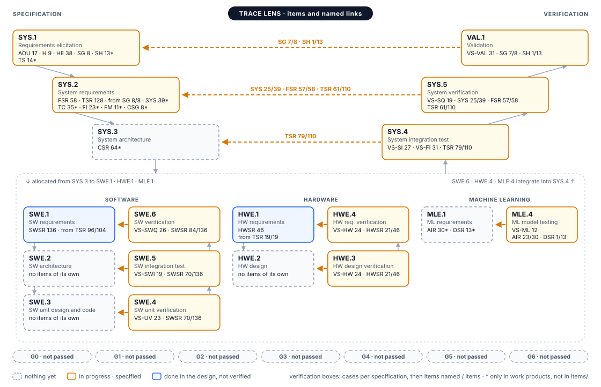
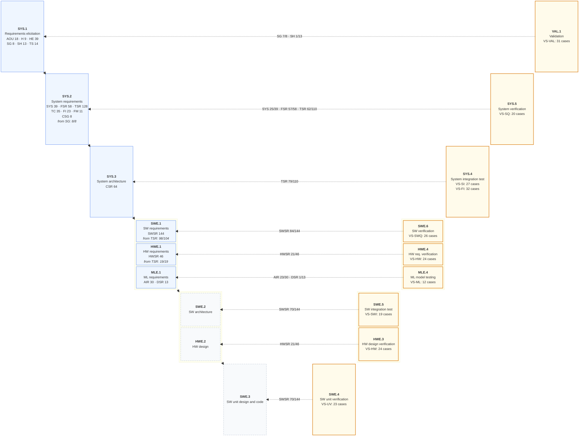
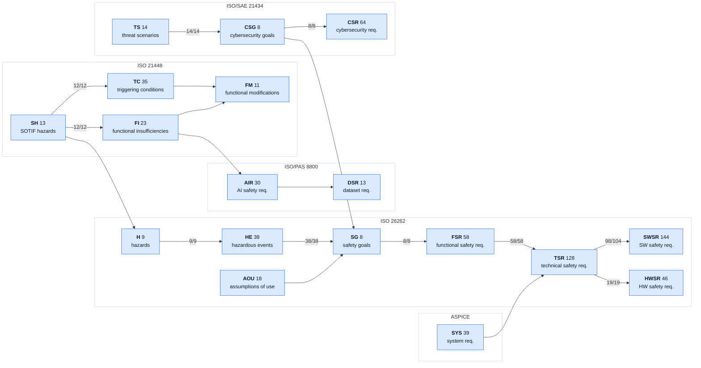

# ASPICE-Aligned Traceability Map (WP-T-01)

<!-- Generated by assurance/trace/tools/trace_map.py. Do not edit by hand; run the script. CI fails if this file is stale. -->

| Field | Value |
|---|---|
| Work product | Part of WP-T-01 Requirements and traceability data: generated view |
| Standard reference | ASPICE 4.0 SYS.1–SYS.5, SWE.1–SWE.6, HWE.1–HWE.4, MLE.1, MLE.4 and VAL.1 (traceability and consistency BPs); ISO 26262-8:2018 §6.4.3; ISO 21448:2022; ISO/PAS 8800:2024; ISO/SAE 21434:2021 |
| Status | Generated. Shows what the trace data and the specifications contain, not a verification result |
| Sources | [`items/*.yaml`](../items/), the requirement tables of the defining work products and the test specifications listed in §2; generator [`tools/trace_map.py`](../tools/trace_map.py) |

## 1. The V-model

Specification on the left, verification on the right. Each verification process sits opposite the process whose work products it verifies (ASPICE 4.0): the system trunk (SYS.1–SYS.3, SYS.4, SYS.5 and VAL.1) steps inward, then one dashed bracket holds the software, hardware and machine-learning arms side by side. Each specification box lists the items its process holds (`*`: kinds defined in the work products but not yet in the trace data) and, where the trace data has the link, "from SG 7/7": the parents with at least one child. Each verification box lists the cases of its test specifications, then the items of the paired level they name. Arrows down the left and up the right follow decomposition and integration; dashed arrows across the V are verification links, labelled with the same counts in the trunk. The work products of each process are listed in §2.

*Figure 1.* The system V of [`tools/vmodel.py`](../tools/vmodel.py), trace lens, drawn from the same data as the tables below; the same component draws the status and per-goal Vs of the README and the safety case snapshot. Source: [`fig-1-aspice-v-model.svg`](fig-1-aspice-v-model.svg); the Mermaid version follows as a text alternative.

Mermaid version of Figure 1

One colour rule for every V: blue when every item of the level is in the trace data, or every item of the paired level is named by a case (done in the design, not verified); amber when some are; red when none is; dashed grey when the level holds nothing yet. Green is kept for approved work products and passed verification; nothing here is either. The gate band shows the gate records of WP-M-00 §2 (none held yet).

A named item is a **specified** link, not a passed test. 0 of 733 traced items carry status `verified`. [`links/verification.yaml`](../links/verification.yaml) links 103 existing tests to 36 requirements (WP-W-06 §4.1, §4.9) and records no result; the code and tests carry no `@req` tags yet (WP-P-06 §6; checks K7–K10 in the [README](../README.md) §6 are not implemented).

## 2. Process to work product and items

| Process | Name | Work products | Items or test cases |
|---|---|---|---|
| **SYS.1** | Requirements elicitation | WP-C-01, WP-C-02, WP-C-03, WP-C-05, WP-C-09 | AOU (18, trace data), H (9, trace data), HE (39, trace data), SG (8, trace data), SH (13, trace data), TS (14, trace data) |
| **SYS.2** | System requirements analysis | WP-S-01, WP-C-04, WP-S-02, WP-C-07, WP-C-10 | SYS (39, trace data), FSR (58, trace data), TSR (128, trace data), TC (35, trace data), FI (23, trace data), FM (11, trace data), CSG (8, trace data) |
| **SYS.3** | System architectural design | WP-S-03, WP-S-05, WP-S-07 | CSR (64, trace data) |
| **SWE.1** | SW requirements analysis | WP-W-02 | SWSR (144, trace data) |
| **HWE.1** | HW requirements analysis | WP-H-01 | HWSR (46, trace data) |
| **MLE.1** | ML requirements analysis | WP-C-11 | AIR (30, trace data), DSR (13, trace data) |
| **SWE.2** | SW architectural design | WP-W-03 | — |
| **HWE.2** | HW design | WP-H-02 | — |
| **SWE.3** | SW detailed design and unit construction | WP-W-05 | — |
| **VAL.1** | Validation | WP-V-01 | VS-VAL (31 cases) |
| **SYS.5** | System verification | WP-S-09 | VS-SQ (20 cases) |
| **SYS.4** | System integration and integration verification | WP-S-08, WP-V-05 | VS-SI (27 cases), VS-FI (32 cases) |
| **SWE.6** | SW verification | WP-W-08 | VS-SWQ (26 cases) |
| **HWE.4** | Verification against HW requirements | WP-H-06 | VS-HW (24 cases) |
| **MLE.4** | ML model testing | WP-W-10 | VS-ML (12 cases) |
| **SWE.5** | SW component verification and integration verification | WP-W-07 | VS-SWI (19 cases) |
| **HWE.3** | Verification against HW design | WP-H-06 | VS-HW (24 cases) |
| **SWE.4** | SW unit verification | WP-W-06 | VS-UV (23 cases) |

## 3. Traceability per standard

One lane per standard. Solid boxes and arrows are in the trace data, labelled with the parents that have at least one child; dashed ones exist only in the work-product tables and are not linked yet.

| Standard | Kinds | In trace data | Defined in documents only |
|---|---|---|---|
| ISO 26262 | H, HE, SG, AOU, FSR, TSR, SWSR, HWSR | H 9, HE 39, SG 8, AOU 18, FSR 58, TSR 128, SWSR 144, HWSR 46 | — |
| ISO 21448 | SH, TC, FI, FM | SH 13, TC 35, FI 23, FM 11 | — |
| ISO/PAS 8800 | AIR, DSR | AIR 30, DSR 13 | — |
| ISO/SAE 21434 | TS, CSG, CSR | TS 14, CSG 8, CSR 64 | — |
| ASPICE | SYS | SYS 39 | — |

## 4. Derivation coverage (left side of the V)

Parents with at least one child in the trace data (WP-T-01 checks K4, K12).

| Link | Covered | Status | Without a child |
|---|---|---|---|
| hazard -> hazardous event | 9/9 | complete | — |
| hazardous event -> safety goal | 38/38 | complete | — |
| safety goal -> FSR | 8/8 | complete | — |
| FSR -> TSR | 58/58 | complete | — |
| TSR -> SWSR (SW-allocated TSRs) | 98/104 | partial | TSR-628, TSR-630, TSR-631, TSR-632, TSR-633, TSR-712 |
| TSR -> HWSR (HW-allocated TSRs) | 19/19 | complete | — |
| SOTIF hazard -> functional insufficiency | 12/12 | complete | — |
| SOTIF hazard -> triggering condition | 12/12 | complete | — |
| threat scenario -> cybersecurity goal | 14/14 | complete | — |
| cybersecurity goal -> cybersecurity requirement | 8/8 | complete | — |

SOTIF modifications whose stated scope (WP-C-07 §2, *Addresses*) differs from the SOTIF hazards of the WP-C-06 §5 rows that name them, for review; a modification can address a hazard directly, so this is not an error: FM-01 (also SH-03); FM-03 (not SH-01); FM-04 (also SH-02); FM-08 (not SH-02); FM-09 (also SH-04; not SH-02, SH-03); FM-10 (also SH-01). *Also* lists hazards only WP-C-07 names, *not* those only the §5 rows give.

## 5. Verification coverage (across the V)

Items named by at least one case of the paired test specification. A case names an item by its ID, by a range (`TSR-101…105`), by `FSR-01.xx…07.xx`, or by a bare number in a column headed with the kind (`SWSRs`). Bare ranges include only IDs without a letter suffix. TSRs allocated to operation (`OPS`, WP-S-06) are left out.

| Pair | Test specification | Kind | Named | Status | Not named |
|---|---|---|---|---|---|
| SYS.1 ↔ VAL.1 | VS-VAL | SG | 7/8 | partial | SG-08 |
| SYS.1 ↔ VAL.1 | VS-VAL | SH | 1/13 | partial | SH-01, SH-02, SH-03, SH-04, SH-05, SH-06, SH-07, SH-08, SH-09, SH-10, SH-11, SH-13 |
| SYS.2 ↔ SYS.5 | VS-SQ | SYS | 25/39 | partial | SYS-005, SYS-006, SYS-027, SYS-043, SYS-061, SYS-083, SYS-100, SYS-101, SYS-102, SYS-121, SYS-142, SYS-143, SYS-144, SYS-145 |
| SYS.2 ↔ SYS.5 | VS-SQ | FSR | 57/58 | partial | FSR-08.01 |
| SYS.2 ↔ SYS.5 | VS-SQ | TSR | 62/110 | partial | TSR-409, TSR-410, TSR-411, TSR-412, TSR-413, TSR-501, TSR-502, TSR-503, TSR-504, TSR-505, TSR-506, TSR-507, TSR-508, TSR-509, TSR-511, TSR-512, TSR-513, TSR-514, TSR-515, TSR-517, TSR-518, TSR-519, TSR-619, TSR-620, TSR-621, TSR-622, TSR-623, TSR-624, TSR-625, TSR-626, TSR-627, TSR-628, TSR-630, TSR-631, TSR-632, TSR-633, TSR-634, TSR-635, TSR-701, TSR-702 … (+8) |
| SYS.3 ↔ SYS.4 | VS-SI, VS-FI | TSR | 79/110 | partial | TSR-515, TSR-517, TSR-519, TSR-605, TSR-607, TSR-608, TSR-611, TSR-612, TSR-614, TSR-618, TSR-621, TSR-622, TSR-623, TSR-624, TSR-625, TSR-626, TSR-627, TSR-628, TSR-629, TSR-630, TSR-631, TSR-632, TSR-633, TSR-634, TSR-635, TSR-703, TSR-708, TSR-709, TSR-711, TSR-712, TSR-713 |
| SWE.1 ↔ SWE.6 | VS-SWQ | SWSR | 84/144 | partial | SWSR-102a, SWSR-201a, SWSR-303h, SWSR-307h, SWSR-308h, SWSR-409h, SWSR-410h, SWSR-414h, SWSR-503c, SWSR-504a, SWSR-505a, SWSR-507, SWSR-507a, SWSR-508a, SWSR-514h, SWSR-516a, SWSR-516b, SWSR-601, SWSR-601a, SWSR-602, SWSR-603, SWSR-604, SWSR-605, SWSR-605a, SWSR-606, SWSR-607, SWSR-608, SWSR-609, SWSR-610, SWSR-611, SWSR-612, SWSR-613, SWSR-614, SWSR-615, SWSR-616, SWSR-617, SWSR-618, SWSR-619, SWSR-620, SWSR-621 … (+20) |
| HWE.1 ↔ HWE.4 | VS-HW | HWSR | 21/46 | partial | HWSR-401, HWSR-501a, HWSR-501b, HWSR-501d, HWSR-502c, HWSR-503a, HWSR-503b, HWSR-503c, HWSR-504a, HWSR-505a, HWSR-506b, HWSR-506e, HWSR-508b, HWSR-508c, HWSR-509a, HWSR-510a, HWSR-516, HWSR-516a, HWSR-516b, HWSR-517, HWSR-519, HWSR-701a, HWSR-703, HWSR-711, HWSR-711a |
| MLE.1 ↔ MLE.4 | VS-ML | AIR | 23/30 | partial | AIR-21, AIR-23, AIR-26, AIR-27, AIR-28, AIR-29, AIR-30 |
| MLE.1 ↔ MLE.4 | VS-ML | DSR | 1/13 | partial | DSR-01, DSR-02, DSR-03, DSR-05, DSR-06, DSR-07, DSR-08, DSR-09, DSR-10, DSR-11, DSR-12, DSR-13 |
| SWE.2 ↔ SWE.5 | VS-SWI | SWSR | 70/144 | partial | SWSR-101a, SWSR-102a, SWSR-103a, SWSR-108a, SWSR-201a, SWSR-303h, SWSR-304a, SWSR-308h, SWSR-309, SWSR-411, SWSR-501b, SWSR-502c, SWSR-503, SWSR-503b, SWSR-503c, SWSR-504, SWSR-504a, SWSR-505, SWSR-505a, SWSR-506, SWSR-506b, SWSR-507, SWSR-507a, SWSR-508, SWSR-508a, SWSR-509, SWSR-511, SWSR-512a, SWSR-514, SWSR-515, SWSR-516a, SWSR-516b, SWSR-601a, SWSR-602, SWSR-603, SWSR-604, SWSR-605, SWSR-605a, SWSR-607, SWSR-608 … (+34) |
| HWE.2 ↔ HWE.3 | VS-HW | HWSR | 21/46 | partial | HWSR-401, HWSR-501a, HWSR-501b, HWSR-501d, HWSR-502c, HWSR-503a, HWSR-503b, HWSR-503c, HWSR-504a, HWSR-505a, HWSR-506b, HWSR-506e, HWSR-508b, HWSR-508c, HWSR-509a, HWSR-510a, HWSR-516, HWSR-516a, HWSR-516b, HWSR-517, HWSR-519, HWSR-701a, HWSR-703, HWSR-711, HWSR-711a |
| SWE.3 ↔ SWE.4 | VS-UV | SWSR | 70/144 | partial | SWSR-109, SWSR-109a, SWSR-206, SWSR-303h, SWSR-307h, SWSR-308h, SWSR-309, SWSR-408, SWSR-409h, SWSR-410h, SWSR-414h, SWSR-504, SWSR-504a, SWSR-505, SWSR-505a, SWSR-506, SWSR-506a, SWSR-506b, SWSR-507, SWSR-507a, SWSR-508, SWSR-508a, SWSR-509, SWSR-514h, SWSR-515, SWSR-517, SWSR-519, SWSR-601, SWSR-601a, SWSR-602, SWSR-603, SWSR-604, SWSR-605, SWSR-605a, SWSR-606, SWSR-607, SWSR-608, SWSR-609, SWSR-610, SWSR-611 … (+34) |

## 6. Test cases naming unknown IDs

None.

## 7. Not yet traced

- **Kinds outside the trace data:** none; every kind of §3 is in `items/`.
- **Allocation to elements** (SYS.3, SWE.2, HWE.2): `allocated_to` holds work-product cells; element IDs need `elements.yaml` (WP-P-06 OI-4).
- **Code and test results:** no `@req` tags yet, so the SWE.3 → code link is absent; `links/verification.yaml` links 103 tests to requirements but no test → result link exists (WP-P-06 §5.3, §6; check K7).
