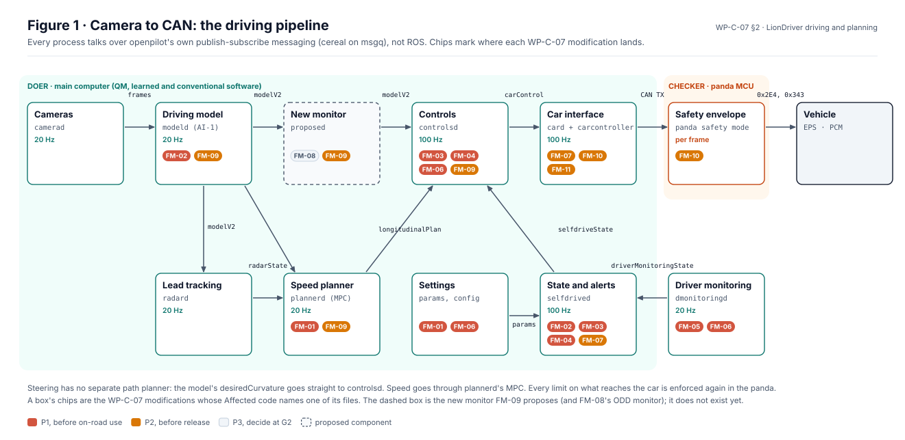
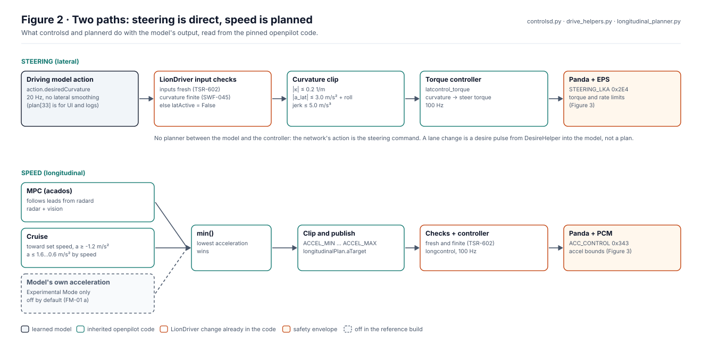
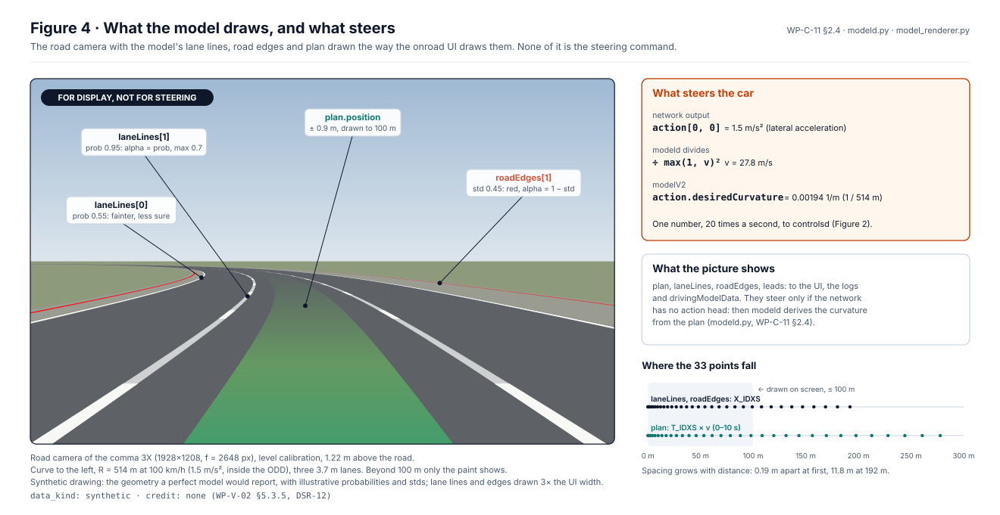
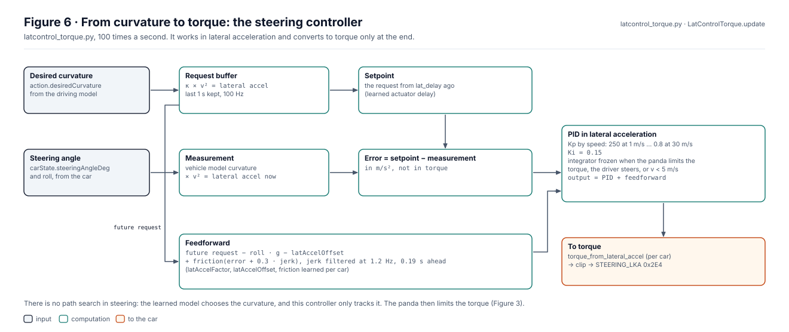
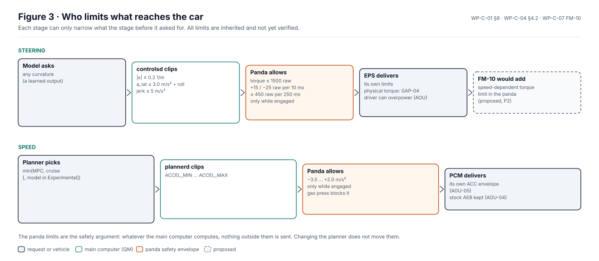
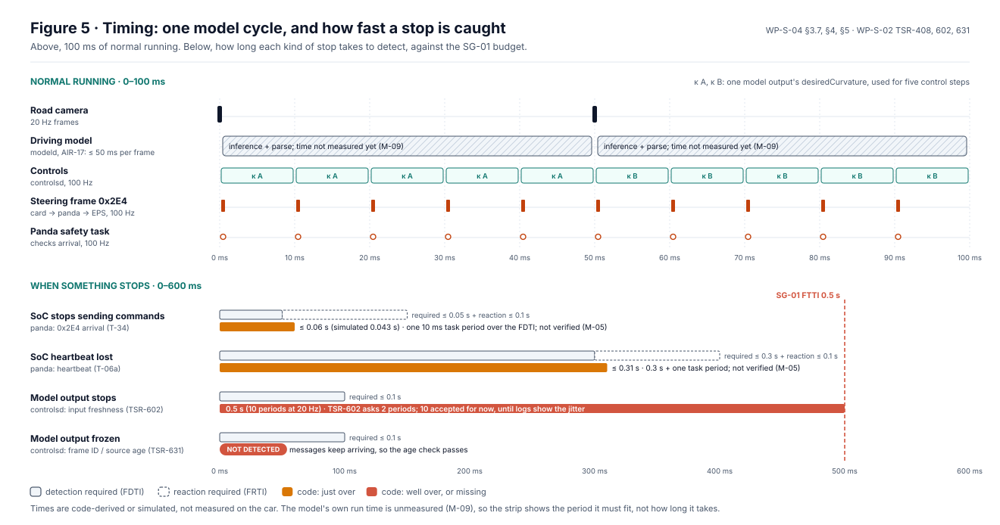

# Driving and path planning

This page explains how the LionDriver stack turns camera frames into steering and speed commands, where the safety
limits sit, and where the planned safety and SOTIF modifications land. It describes the code as pinned; the
analyses it summarises are in [WP-C-01](../../assurance/02-concept/WP-C-01-item-definition.md) (item and actuation
envelope), [WP-C-11](../../assurance/02-concept/WP-C-11-ai-system-definition-and-safety-requirements.md) (the driving
model and its outputs), [WP-S-04](../../assurance/03-system/WP-S-04-timing-ftti-budget.md) (timing) and
[WP-C-07](../../assurance/02-concept/WP-C-07-sotif-functional-modifications.md) (functional modifications). Where this
page and those documents disagree, they are right and this page is stale. Two companion pages go deeper: [speed planning](speed-planning.md)
and [perception models](perception-models.md).

## 1. The pipeline at a glance

  

*Figure 1.* Each box is a process; each arrow is a message on openpilot's publish-subscribe bus. Chips name the
WP-C-07 modifications whose Affected code cell names one of the box's files, coloured by priority. Generated by
[`figures/fig_driving.py`](figures/fig_driving.py) from WP-C-07; CI fails if it is stale or if a modification lands on
no box.

The stack is openpilot's, unchanged in structure:

| Process | Does | Rate | Publishes |
|---|---|---|---|
| `modeld` | Runs the driving model (AI-1) on two camera frames; outputs the steering action, a speed action, a 33-point plan, lane lines, road edges and leads | 20 Hz | `modelV2` |
| `radard` | Associates stock radar tracks with the model's vision leads | 20 Hz, on `modelV2` | `radarState` |
| `plannerd` | Speed planning: MPC, cruise target and arbitration | 20 Hz, on `modelV2` | `longitudinalPlan` |
| `controlsd` | Turns the steering action and the speed plan into actuator targets | 100 Hz | `carControl` |
| `card` | Car interface; `carcontroller` packs CAN frames | 100 Hz | CAN to the panda |
| `selfdrived` | Engagement state machine, events, alerts | 100 Hz | `selfdriveState` |
| panda safety mode | Checks every frame against the envelope before it reaches the car | per frame | `0x2E4` steering, `0x343` acceleration |

## 2. Steering: no planner, the model's action is the command

  

*Figure 2.* The constants are read from `drive_helpers.py` and `longitudinal_planner.py`, and the arbitration from the
code that builds it; the generator fails if either changes form. Generated by
[`figures/fig_driving.py`](figures/fig_driving.py); CI fails if it is stale.

There is no lateral path planner. The driving model outputs `action.desiredCurvature` directly, and `controlsd` uses it
as the steering target ([WP-C-11 §2.4](../../assurance/02-concept/WP-C-11-ai-system-definition-and-safety-requirements.md)).
On the way it passes:

1. **LionDriver's input checks**, already in the code: stale inputs (TSR-602) or a non-finite curvature (SWF-045) set
   `latActive` false for that step.
2. **The curvature clip** in `drive_helpers.py`: curvature, lateral acceleration (roll-compensated) and lateral jerk.
3. **The torque controller** (`latcontrol_torque.py`), which turns curvature into a steering torque request.

The model's 33-point `plan`, lane lines and road edges go to the UI, the logs and `drivingModelData`. `modeld` derives
the curvature from the plan only if the network has no action head (`modeld.py`); WP-C-11 treats the action as the
direct lateral command. A lane change is driver-initiated: the turn signal makes `DesireHelper` send a desire pulse
into the model, and the model's action changes; there is no separate manoeuvre plan.

  

*Figure 4.* What the driver sees is not what steers. The camera, its height, the sample grids, the UI's widths,
colours and draw distance, and the action formula are read from the openpilot code; the road and the probabilities
are illustrative. Synthetic drawing, no evidence credit
([WP-V-02 §5.3.5](../../assurance/06-validation/WP-V-02-sotif-vv-strategy.md), DSR-12). Generated by
[`figures/fig_driving.py`](figures/fig_driving.py); CI fails if it is stale.

This matters for the safety analysis. A plan that looks right on screen does not show that the steering command is
right, and a plausibility monitor (FM-09) has to compare the action against the geometry the model reports, not
assume they agree.

  

*Figure 6.* The steering algorithm, `LatControlTorque.update`. Constants and the structure are read from
`latcontrol_torque.py`. Generated by [`figures/fig_driving.py`](figures/fig_driving.py); CI fails if it is stale.

The only steering "algorithm" in the item, beyond the learned model, is this tracking controller. It works in
lateral acceleration: the model's curvature times speed squared is the request, the steering angle through a vehicle
model gives what the car is doing now, and a PID with a speed-scheduled gain closes the gap. A feedforward of the
request, corrected for road roll and a learned per-car offset and friction, does most of the work. The learned
actuator delay decides which past request is compared with the present. Only the last step converts to torque, using
the car's learned torque-to-acceleration map.

## 3. Speed: an MPC, a cruise target and min()

`plannerd` runs a model-predictive controller (acados, `long_mpc.py`) that follows the leads `radard` reports, next to
a cruise target toward the set speed. The lower of the two accelerations wins. In Experimental Mode the model's own
acceleration joins as a third candidate; since 2026-10-14 the reference build defaults to Chill, so it is off unless the
owner turns it on (FM-01 (a), decision DQ-001). Whether Experimental Mode is in the ODD is open (WP-C-01 OI-8). The
result is clipped to `ACCEL_MIN … ACCEL_MAX`, checked for freshness and finiteness in `controlsd`, and sent as
`ACC_CONTROL`. The [speed planning](speed-planning.md) page covers the MPC in detail.

## 4. Who limits what reaches the car

  

*Figure 3.* The panda limits come from the [WP-C-01 §8](../../assurance/02-concept/WP-C-01-item-definition.md) table,
parsed by the same code that draws its Figure 8-1. Every limit is inherited and not yet verified. Generated by
[`figures/fig_driving.py`](figures/fig_driving.py); CI fails if it is stale.

The main computer, model and planner included, is the QM "doer". The panda safety mode is the "checker": whatever the
main computer asks for, it sends nothing outside the envelope, and only while engaged
([architecture](architecture.md#the-doer-and-the-checker)). The safety argument rests on the checker, so a change to
the planner does not move the envelope, and a change to the envelope is a change to the safety argument.

## 5. Timing

  

*Figure 5.* The budgets and times are hand-listed from [WP-S-04](../../assurance/03-system/WP-S-04-timing-ftti-budget.md)
§3.7, §4 and §5, [WP-S-02](../../assurance/03-system/WP-S-02-technical-safety-requirements.md) and the trace items;
each carries the exact text it was read from, and CI fails when one is gone or the figure is stale. Generated by
[`figures/fig_driving.py`](figures/fig_driving.py).

The model runs once per camera frame, every 50 ms, and `controlsd` runs every 10 ms, so each steering target is used
for five control steps. How long the model takes inside its 50 ms is not measured yet (WP-S-04 M-09, WP-C-11 AIR-17).

When something stops, the panda catches it close to its budget: missing commands in at most 0.06 s (T-34) and a lost
heartbeat in at most 0.31 s (T-06a), each one 10 ms task period over. The host-side checks are where the gaps are.
`controlsd` stops steering on a stale model output after 10 periods (0.5 s), where TSR-602 asks for 2 (0.1 s); the
lead accepted that until reference logs show the input jitter. A model output that keeps arriving but stops changing
is not detected at all (TSR-631, not implemented). Both are host-side checks, inside the main computer, so closing
them is a change to `controlsd` and needs no new middleware.

## 6. When something goes wrong

  

*Figure 7.* Each row cites its requirement or work product; the source texts are checked by
[`figures/fig_driving.py`](figures/fig_driving.py), and CI fails when one is gone.

This is a Level 2 item, so in almost every case the reaction ends with the driver: a warning, a take-over request,
or the panda simply refusing to pass commands. Emergency braking beyond −3.5 m/s² belongs to the car's own
pre-collision system, which LionDriver preserves and stands down for (TSR-713), and evasive steering is not provided
(WP-C-02).

The exception is a driver who does not respond. Then nobody else can finish the reaction, so the item has to bring
the car to a safe stop on its own: keep the lane, slow to a standstill within the envelope, hold it there and lock out
re-engagement. That minimum-risk manoeuvre is required (TSR-633; the lead's decision DQ-365 A, 2026-10-16). 5 s after
the terminal alert, `selfdrived` latches it (`selfdrive/selfdrived/minimum_risk.py`) until the driver takes over by
braking or cancelling: the planner's set speed stays at zero, so the car slows to a stop while keeping its lane, the
car controller keeps requesting standstill hold and never resumes, and the alert keeps sounding even if driver
monitoring restarts. The lockout of re-engagement runs from the driver's takeover. It is implemented and unit-tested,
not yet verified on the car; how long the PCM holds the car at standstill is an assumption (AOU-16) that needs a
vehicle test, and there is no announcement before the manoeuvre starts (TSR-624).

## 7. Changing the planner for safety and SOTIF

The planned modifications are ordinary changes to the processes in Figure 1. Each goes through a change request and an
impact analysis ([WP-P-02](../../assurance/07-supporting/WP-P-02-change-management.md),
[WP-M-12](../../assurance/01-management/WP-M-12-impact-analysis.md)). Several are already in the code (the Chill
default, the freshness and finiteness checks in `controlsd`). The ones that touch driving and planning:

| Where | Modification | What it changes |
|---|---|---|
| `plannerd`, settings | FM-01 Experimental Mode off | Removes the model's acceleration from the `min()` |
| `controlsd`, `selfdrived` | FM-03 no actuation on stale inputs | Take-over request instead of 3 s of actuation on failed inputs |
| `controlsd`, `selfdrived` | FM-04 non-finite commands | Immediate disable instead of a silent clamp |
| `controlsd`, settings | FM-06 lock out manoeuvre modes | `lateralManeuverPlan` can no longer replace the model's curvature |
| card, `selfdrived` | FM-07 ODD speed bound | Warning and soft disable above 110 km/h |
| new monitor | FM-08 road-type ODD restriction | No-entry or take-over off the highway (feasibility at G2) |
| new monitor, `modeld`, `controlsd`, `plannerd` | FM-09 plausibility and uncertainty monitor | Checks curvature against dynamics and the model's own geometry and uncertainty |
| panda, card | FM-10 speed-dependent lateral authority | Tighter torque limit at speed, in the envelope |

The new monitor of FM-09 is a QM process between `modeld` and `controlsd`. It subscribes to `modelV2` like any other
process and either passes the action on or raises an event. Nothing in that design needs new middleware.

## 8. Messaging, and why we stay off ROS 2

All processes talk over cereal (Cap'n Proto schemas) on msgq, openpilot's shared-memory publish-subscribe bus. The
modifications above are written in that bus's terms. We do not plan to add ROS 2:

- **The evidence is built on this bus.** WP-C-11, the WP-S-04 timing budget and the FTTI analysis trace message names,
  rates and freshness checks on cereal. Replacing or bridging it would reopen all of them.
- **It would not strengthen the argument.** ROS 2 would sit on the doer side, which the checker already bounds.
- **It adds software to qualify and secure:** a DDS stack under
  [WP-P-08](../../assurance/07-supporting/WP-P-08-software-component-qualification.md) and new network endpoints in
  the [TARA](../../assurance/02-concept/WP-C-09-tara.md).
- **Simulation does not need it.** The plant in [`assurance/sim`](../../assurance/sim/README.md) runs the real panda
  safety code, and `openpilot/tools/sim` drives the full stack in MetaDrive. A CARLA bridge, the usual reason to
  reach for ROS 2, was assessed and deferred to G3 ([WP-V-02 §5.4](../../assurance/06-validation/WP-V-02-sotif-vv-strategy.md), DQ-261).

If a later simulator needs ROS 2, it belongs in offline test tooling as a bridge outside the vehicle build, with its
own entry in the tool classification ([WP-P-07](../../assurance/07-supporting/WP-P-07-tool-classification-qualification.md)).

## 9. How the planner is tested

| Method | Tool | Shows |
|---|---|---|
| Process replay | `selfdrive/test/process_replay` | `controlsd`, `plannerd`, `radard`, `selfdrived` give the same output on recorded inputs |
| Planner manoeuvres | `selfdrive/test/longitudinal_maneuvers` | Speed planner response to lead and stop scenarios on a point-mass plant |
| Closed-loop plant | [`assurance/sim/plant`](../../assurance/sim/README.md) | Lateral faults against the real panda code and a driver model; the [hazard scenes](../../assurance/sim/blender) draw them |
| Closed-loop stack | `openpilot/tools/sim` (MetaDrive) | The full stack steering a rendered road; no traffic yet |

The full method list, with what each gets credit for, is [WP-V-02 §5.1](../../assurance/06-validation/WP-V-02-sotif-vv-strategy.md).
