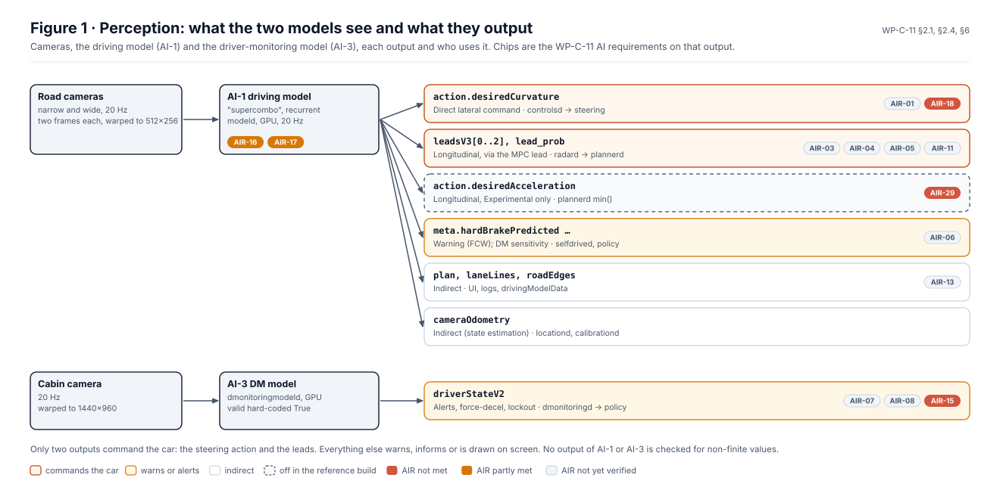
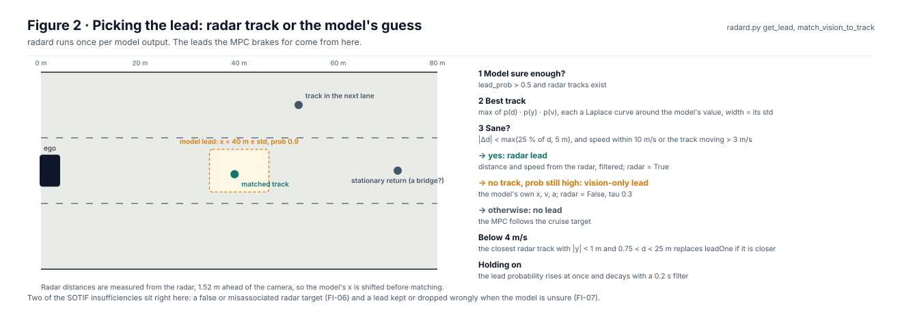
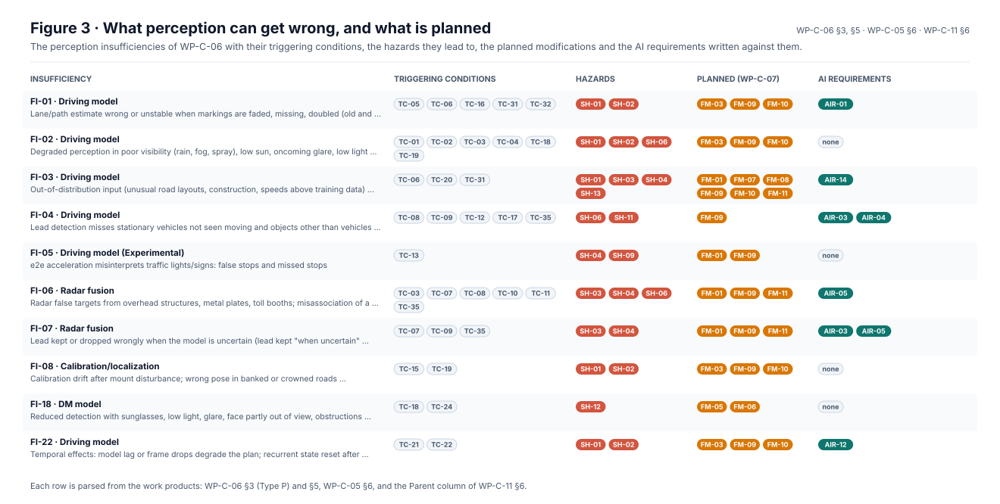
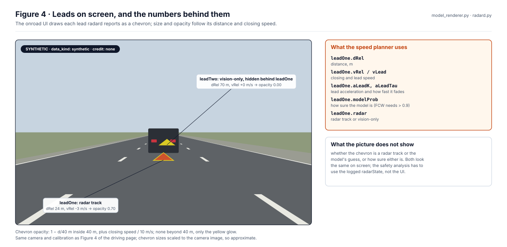
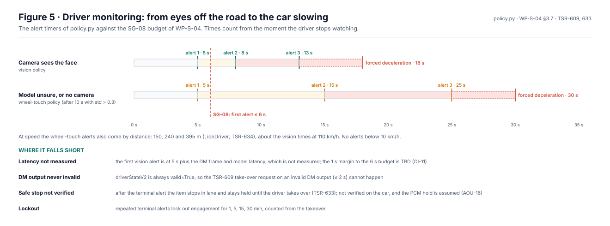

# Perception models

This page explains what the two learned models in the stack see, what they output, who uses each output, and what can
go wrong. The driving model (AI-1) turns the road cameras into a steering action, leads and a picture of the road; the
driver-monitoring model (AI-3) turns the cabin camera into an estimate of the driver's attention. The analyses behind
it are in [WP-C-11](../../assurance/02-concept/WP-C-11-ai-system-definition-and-safety-requirements.md) (the AI system and
its requirements), [WP-C-06](../../assurance/02-concept/WP-C-06-sotif-insufficiencies-triggering-conditions.md)
(insufficiencies and triggering conditions) and [WP-S-04](../../assurance/03-system/WP-S-04-timing-ftti-budget.md)
(timing); where this page and they disagree, they are right.

All figures are generated by [`figures/fig_perception.py`](figures/fig_perception.py). Constants are read from the
openpilot code; tables are parsed from the work products; other numbers carry the exact text they come from. CI fails
if a source changes form or a figure is stale.

## 1. What the models see and output

  

*Figure 1.* Outputs and their effect from [WP-C-11 §2.4](../../assurance/02-concept/WP-C-11-ai-system-definition-and-safety-requirements.md);
the AIR chips and their colours are parsed from the §6 status cells.

Only two outputs command the car: the steering action and the leads. The rest warn (`hardBrakePredicted` raises a
forward collision warning), inform (the plan, lane lines and road edges on screen) or feed state estimation. None of
the AI requirements is verified yet. Several are recorded as not met: no output is checked for non-finite values on
the on-device model, the driver-monitoring output is always marked valid, and the steering action is not compared
with the plan the model publishes (AIR-18).

## 2. Picking the lead

  

*Figure 2.* From `get_lead` and `match_vision_to_track` in `radard.py`.

`radard` matches the model's lead to the stock radar's tracks. It takes the track most consistent with the model's
distance, lateral position and speed, weighted by the model's own uncertainty, and keeps it only if it is close enough.
With no match but a confident model, the lead is the model's own estimate. Below 4 m/s a close radar track can take
over. This is where false radar targets and misassociation (FI-06), and leads kept or dropped wrongly (FI-07), enter.

## 3. What can go wrong, and what is planned

  

*Figure 3.* Every row is parsed: WP-C-06 §3 (Type P) and §5, WP-C-05 §6, and the Parent column of WP-C-11 §6.

The most-cited modification is FM-09, the plausibility and uncertainty monitor, which would sit between the driving
model and the controls. Rows with no AI requirement (FI-02 poor visibility, FI-05, FI-08 calibration, FI-18 driver
monitoring) are where the requirement set is thinnest.

## 4. Leads on screen

  

*Figure 4.* Chevron rules from the onroad UI (`model_renderer.py`); the camera from the driving page's Figure 4.
Synthetic drawing, no evidence credit ([WP-V-02 §5.3.5](../../assurance/06-validation/WP-V-02-sotif-vv-strategy.md),
DSR-12).

The screen does not say whether a chevron is a radar track or the model's guess, or how sure either is. Analysis has to
use the logged `radarState`.

## 5. Driver monitoring timing

  

*Figure 5.* Timers and thresholds from `policy.py`; the SG-08 budget from WP-S-04 §3.7; statuses from the trace items.

The first vision alert comes 5 s after the eyes leave the road, inside the preliminary 6 s budget of SG-08, with a
margin that depends on the camera and model latency, which is not measured. When the model is unsure for 10 s, the
policy falls back to wheel touch, whose alerts come later. The gaps are recorded: the driver-monitoring output is never
invalid (TSR-609), and after the terminal alert the item slows the car but does not bring it to a safe stop (TSR-633).

## 6. How the models are tested

| Method | Tool | Shows |
|---|---|---|
| Model replay | `selfdrive/test/process_replay/model_replay.py` | Output changes between model versions on recorded segments |
| Requirements-based evaluation | to be built ([WP-W-10](../../assurance/05-software/WP-W-10-ml-engineering.md)) | AIR metrics per input-space stratum on LionDriver data |
| Closed course and public road | [WP-V-02 §5.1](../../assurance/06-validation/WP-V-02-sotif-vv-strategy.md) M8, M9 | Real sensors in controlled and real scenarios |
