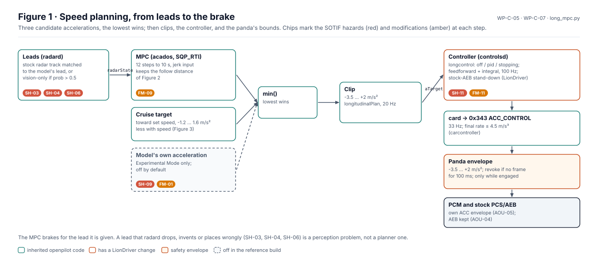
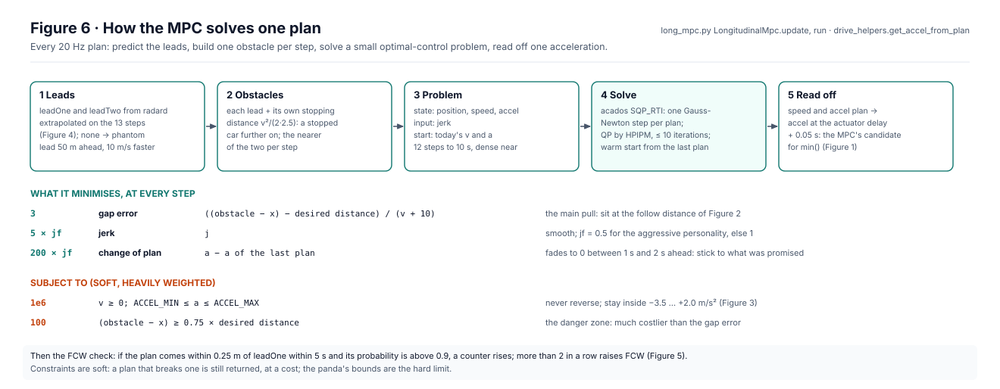
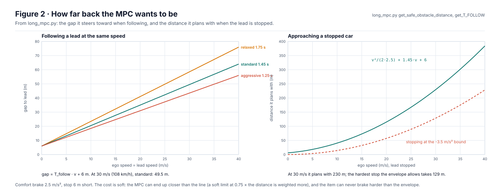
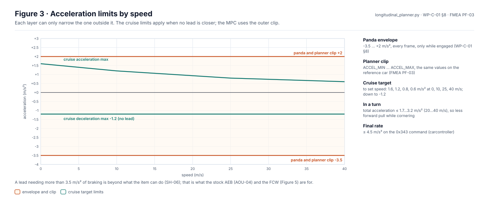
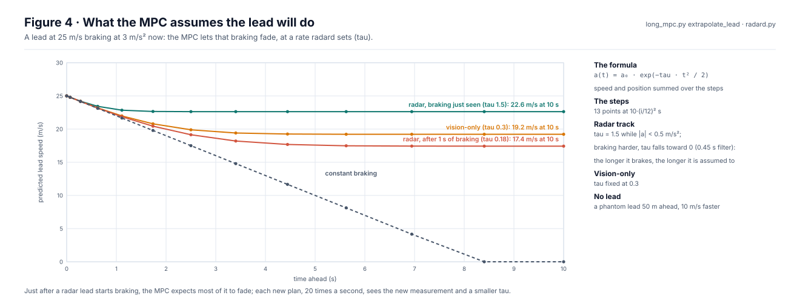
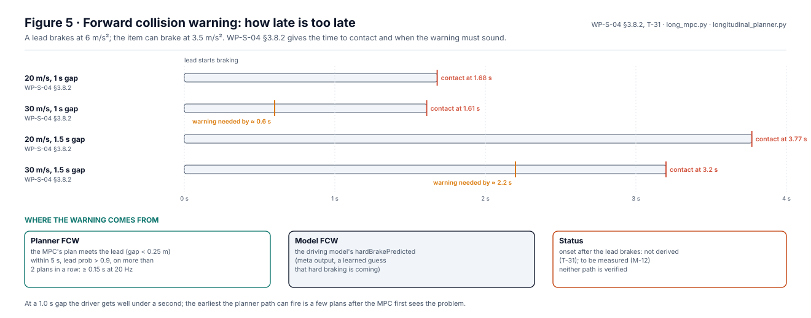

# Speed planning

This page explains how the LionDriver stack plans speed: where the leads come from, what the model-predictive
controller (MPC) tries to do, which limits bound it, and how late a forward collision warning can come. Steering has no
planner of its own (see [driving and path planning](driving-and-planning.md)); speed is the one planned path in the
stack. The analyses behind it are in [WP-C-05](../../assurance/02-concept/WP-C-05-sotif-hazard-identification.md),
[WP-C-07](../../assurance/02-concept/WP-C-07-sotif-functional-modifications.md) and
[WP-S-04](../../assurance/03-system/WP-S-04-timing-ftti-budget.md); where this page and they disagree, they are right.

All figures are generated by [`figures/fig_speed.py`](figures/fig_speed.py). Constants are read from the openpilot
code; numbers from work products carry the exact text they come from. CI fails if a source changes form or a figure is
stale.

## 1. From leads to the brake

  

*Figure 1.* The speed path, with the SOTIF hazards (red) and planned modifications (amber) where they arise.

`plannerd` runs once per model output (20 Hz). It computes three candidate accelerations: the MPC's, which follows the
lead `radard` reports; a cruise target toward the set speed; and, in Experimental Mode only, the driving model's own
acceleration. The lowest wins, is clipped to the platform bounds, and goes to `controlsd`, whose `longcontrol` turns it
into the `ACC_CONTROL` command. The panda checks every frame against its envelope, and the PCM applies its own.

## 2. How the MPC solves a plan

  

*Figure 6.* The algorithm of `LongitudinalMpc.update` and `run`. Weights, solver settings and the structure are read
from `long_mpc.py` and `drive_helpers.py`.

The speed planner is a model-predictive controller: every 50 ms it plans the next 10 s and uses only the first part.
It predicts both leads, turns each into an equivalent stopped obstacle further ahead, and solves a small
optimal-control problem from the car's present speed and acceleration, with jerk as the control. The cost pulls the
gap toward the follow distance of Figure 2 and keeps the ride smooth and the plan consistent with the last one; the
constraints are soft but heavily weighted. The solver does one real-time iteration per plan, warm-started from the
previous one, so the plan improves over successive cycles rather than being solved from scratch each time.

## 3. How far back the MPC wants to be

  

*Figure 2.* From `get_safe_obstacle_distance` and `get_T_FOLLOW` in `long_mpc.py`.

The MPC plans 12 steps over 10 s with jerk as its input. Its main cost pulls the gap toward a desired distance:
the ego's comfortable stopping distance (2.5 m/s²) plus a time gap set by the driving personality plus 6 m, minus the
lead's own stopping distance. Following a lead at the same speed, the two stopping distances cancel and the gap is the
time gap times speed plus 6 m. The cost is soft; a second, heavier soft limit sits at 0.75 of the desired distance.

## 4. Acceleration limits

  

*Figure 3.* The envelope bounds are those of [WP-C-01 §8](../../assurance/02-concept/WP-C-01-item-definition.md); the
SoC clip, which lives in opendbc, is taken from the FMEA item definition (PF-03), which states it for the reference car.

The cruise target is gentle: at most 1.6 m/s² from a standstill, falling with speed, and at most −1.2 m/s² of braking
when there is no lead. Following a lead, the MPC may use the full clip. A lead that needs more than 3.5 m/s² of braking
is beyond what the item can do (SH-06); the stock AEB (AOU-04) and the forward collision warning are what remain.

## 5. What the MPC assumes the lead will do

  

*Figure 4.* From `extrapolate_lead` in `long_mpc.py` and the `aLeadTau` filter in `radard.py`, computed on the MPC's
own time steps.

The MPC does not assume a braking lead keeps braking. It lets the lead's acceleration fade as exp(−tau·t²/2). For a
radar track, tau is 1.5 while the lead's acceleration is small and falls toward 0 once it brakes harder than
0.5 m/s², so the longer a lead brakes, the longer the MPC expects it to. A vision-only lead has a fixed tau of 0.3.
Right after a lead starts braking, the plan is optimistic; it catches up over the next plans.

## 6. Forward collision warning

  

*Figure 5.* The cases are those of [WP-S-04 §3.8.2](../../assurance/03-system/WP-S-04-timing-ftti-budget.md); the planner
FCW condition is read from `long_mpc.py` and `longitudinal_planner.py`.

There are two warning paths. The planner raises FCW when, on more than two plans in a row, the MPC's own plan meets
the lead within 5 s while the model is more than 90 % sure of it. The model raises it from its learned
`hardBrakePredicted` output. How long after the lead's braking either fires is not derived yet (T-31) and is to be
measured (M-12). At a 1.0 s gap, the warning has to come within about 0.6 s to be useful.

## 7. Changing the speed planner for safety and SOTIF

| Hazard (WP-C-05) | Where it arises | Planned (WP-C-07) |
|---|---|---|
| SH-03 unintended acceleration: lead lost or misassociated | `radard`, auto-resume, the model's acceleration | FM-01, FM-11 |
| SH-04 phantom braking | radar false targets, the model's false stops | FM-01, FM-09 |
| SH-06 insufficient deceleration | stationary objects, cut-ins, the 3.5 m/s² bound | FM-09 |
| SH-09 traffic-control non-compliance | the model's acceleration (Experimental) | FM-01 |
| SH-11 no reaction to a VRU | no VRU handling | ODD restriction to highways |

Most of these are perception problems: the MPC brakes correctly for the lead it is given. The
[perception page](perception-models.md) covers where the leads come from and what can go wrong there. Each change goes
through a change request and an impact analysis, like any other.

## 8. How the speed planner is tested

| Method | Tool | Shows |
|---|---|---|
| Planner manoeuvres | `selfdrive/test/longitudinal_maneuvers` | Approaching stopped cars, following a braking lead, cut-ins, resume from a stop, on a point-mass plant; a crash is a gap under 0.4 m |
| Process replay | `selfdrive/test/process_replay` | `plannerd` and `radard` give the same output on recorded inputs |
| Closed course | the reference vehicle, soft targets | Real braking, real sensors ([WP-V-02 §5.1](../../assurance/06-validation/WP-V-02-sotif-vv-strategy.md) M8) |
