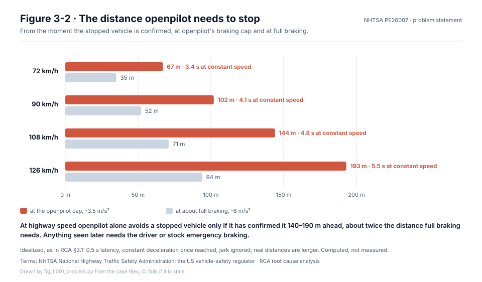

# FI-2026-001 — Problem statement: NHTSA PE26007

| | |
|---|---|
| Case | [FI-2026-001](REPORT.md) · Class A (fatalities; regulatory defect investigation) |
| Primary source | NHTSA Office of Defects Investigation, resume of Preliminary Evaluation PE26007, opened 2026-09-21: [`evidence/INOA-PE26007-17274.pdf`](evidence/INOA-PE26007-17274.pdf) (2 pages, SHA-256 `e8eac190…62da6c`; full hash in [REPORT §1](REPORT.md#1-header)) |
| Read with | [Report](REPORT.md) (facts, applicability, containment) · [Root cause analysis](RCA.md) · [Corrective actions](CORRECTIVE-ACTIONS.md) |
| Revision | A, 2026-11-18 |

> **In one paragraph.** The US vehicle-safety regulator is investigating five crashes in which cars fitted with comma
> devices drove into a stopped or slow vehicle in their own lane. Three people died and eleven more were injured.
> NHTSA confirmed the system was on or engaged in several of them, and its first look suggests the system "may not have
> adequately detected or responded to the in-lane vehicles". LionDriver runs the same openpilot perception, planner,
> warning and driver-monitoring code, and NHTSA has said it will look at forks for "the shared components between
> openpilot and the fork". The problem is therefore ours. Three independent layers should stop this crash: openpilot's
> own braking, the driver, and the car's stock emergency braking. Our root cause analysis found a weakness in each, and
> one shared by two of them. A Preliminary Evaluation is not a finding of defect, and no crash has yet been
> reconstructed.

## 1. What happened

On 21 September 2026 NHTSA's Office of Defects Investigation opened Preliminary Evaluation **PE26007**, "Crashes
involving comma.ai driving automation products". It was prompted by crash reports filed under Standing General Order
2021-01, an owner complaint and outreach from police. It covers the comma three, comma 3X and comma four devices and the
openpilot software: about 30,000 units.

ODI's summary describes one pattern. In each of five crashes, a vehicle with a comma device "reportedly struck stopped or
slowly moving vehicles within the same travel lane". The devices are sold to consumers, installed by them "in 15
minutes" by the company's account, and give "sustained automated control of speed and vehicle heading". The company's
own website says the driver must be "alert, pay attention, and be ready to take over at all times".

| What ODI counts | Number | Source |
|---|---|---|
| Crashes | 5 | ODI resume p. 1, failure report summary |
| Crashes with injuries | 4 | idem |
| People injured, not killed | 11 | ODI resume p. 2 ("eleven (11) other individuals"), some seriously |
| Fatal crashes | 2 | ODI resume p. 1 |
| People killed | 3 | ODI resume pp. 1–2 |
| Devices in scope | about 30,000 | ODI resume p. 1, "Population: 30,000 (Estimated)" |

The five crashes are Standing General Order reports 30351-15888, 30351-14668, 30351-11961, 30351-1807 and 62-14853.
The press has named one of them: a 2022 Toyota RAV4, reportedly running the FrogPilot fork, struck a stopped emergency
vehicle in Louisiana in February 2026 and two rear-seat passengers died. That detail is **not** in the resume and stays
"Reported" in [REPORT §2](REPORT.md#2-event-description).

## 2. The pattern

*Figure 2-1.* The first two scenes are the pattern in NHTSA's words; the third is the late reveal the root cause
analysis examines as one possible way in. Drawn by [`figures/fig_fi001_problem.py`](figures/fig_fi001_problem.py) from
REPORT §2 and RCA §2; CI fails if it is stale. The scenes explain the pattern; they are not a reconstruction of any
crash.

## 3. The problem, stated precisely

**With openpilot engaged on public roads, the vehicle can strike a stopped or slow vehicle in its own lane: openpilot does
not brake enough in time, the driver does not take over in time, and stock emergency braking, where present, does not
prevent the collision.**

The *is / is not* below draws the edge of the problem. It keeps the work on what the evidence shows, and names what
would widen it.

| | Is | Is not, or not known to be |
|---|---|---|
| **What** | Collision with a vehicle that is stopped or much slower, in the ego lane, ahead | A cut-in, a crossing vehicle, a pedestrian, a lane departure. None is cited by ODI |
| **Which systems** | comma three, comma 3X, comma four running openpilot; forks through the components they share with openpilot | A single car model. ODI names no make; only the press links one crash to a Toyota |
| **System state** | Powered on or engaged in "multiple" of the five crashes | Engaged in all five: not confirmed |
| **Where** | Public roads in the US, where the SGO reports come from | Any one road type. Not stated |
| **When** | Crashes reported before 2026-09-21; one press-reported in February 2026 | A date range from ODI. Not stated |
| **How big** | 5 crashes, 3 killed, 11 injured, about 30,000 devices | A rate. No exposure (distance driven) is given |
| **Cause** | ODI's preliminary view: the system "may not have adequately detected or responded" | A finding of defect. A Preliminary Evaluation is not one |

## 4. Why this can happen

A crash into a vehicle in the lane needs **every** protection layer to fail. The root cause analysis read the inherited
code at LionDriver's baseline and found a weakness in each layer. It does not claim that any of them acted in a given
crash; that needs the crash data.

![Figure 3-1: three protection layers that the hazard passes through, each with a hole. Layer 1, openpilot longitudinal control, meant to detect the in-lane obstacle and brake in time: at speed stopped objects need the camera, radar alone is trusted only below 4 m/s, braking is capped at -3.5 m/s², and it has no emergency braking of its own. Layer 2, the driver, meant to monitor the road and take over: 5 s eyes-off before the first alert, a warning tied to the same perception as layer 1, and over-trust. Layer 3, stock AEB and PCS, meant to brake as an independent last resort: alpha longitudinal silences the radar ECU and sends PCS_OFF = 1, while on camera-ACC cars such as our Corolla PCS stays on.](figures/fig-fi001-3-1-barriers.svg)

*Figure 3-1.* The three layers and their weaknesses, with the one common cause. Drawn from RCA §3 and §4 by
[`figures/fig_fi001_problem.py`](figures/fig_fi001_problem.py); a weakness reworded in the RCA fails the build.

| Layer | What it should do | Why it may not | Status of the finding |
|---|---|---|---|
| **Layer 1 — openpilot** | See the vehicle ahead and brake in time | At speed, a stopped object must be seen by the camera: radar is used alone only below 4 m/s, to avoid braking for bridges and signs. Braking is capped at -3.5 m/s², about half of full braking | Read in code at the baseline; the radar gate confirmed in simulation (CA-002) |
| **Layer 2 — the driver** | Watch the road and take over | Driver monitoring allows 5 s eyes-off before its first alert. The forward collision warning comes from the same perception that missed the vehicle, so it is late exactly when layer 1 is late. Long good drives breed over-trust | Read in code; over-trust is supported, not measured |
| **Layer 3 — stock AEB / PCS** | Brake on its own as a last resort | On radar-ACC Toyotas with openpilot's alpha longitudinal on, openpilot silences the car's radar and tells the car its pre-collision system is off. On camera-ACC cars, which includes our reference Corolla, the stock system stays on | Read in code; the effect on the car still to be measured (CA-001, CA-010) |

The cap in layer 1 turns into distance. From the moment openpilot is sure of the stopped vehicle, it needs about
**144 m** to stop from 108 km/h and **193 m** from 126 km/h, roughly twice what full braking needs:

*Figure 3-2.* Idealized distances from RCA §3.1 (0.5 s latency, constant deceleration, jerk ignored), computed and not
measured. Drawn by [`figures/fig_fi001_problem.py`](figures/fig_fi001_problem.py). At highway speed, openpilot on its own
must confirm a stopped vehicle **140–190 m** ahead; anything it confirms later is left to the driver and to stock emergency
braking. A stopped vehicle revealed 60 m ahead by a lead car changing lane (Figure 2-1, third scene) is far inside that range.

## 5. Why it is LionDriver's problem

- **Same code.** The driving model, lead selection (`radard`), longitudinal planner, forward collision warning, driver
  monitoring and the Toyota port are inherited unchanged at LionDriver's baseline ([REPORT §4](REPORT.md#4-applicability-to-liondriver)).
- **Same family of car.** Our reference vehicle is a Toyota TSS2 Corolla. It is camera-ACC, so layer 3 stays in place
  on it; the RAV4 the press names is radar-ACC.
- **Same road.** Stopped and slow vehicles in the lane, queues, crashes and emergency scenes, are part of any highway
  operating domain.
- **Named by the regulator.** ODI will evaluate a fork involved in a crash by "the shared components between openpilot
  and the fork". LionDriver is such a fork.

## 6. What is in place, and what is open

| What | Where it stands |
|---|---|
| **Containment C-1:** no public-road test with openpilot longitudinal control above 40 km/h until the stopped-vehicle suite passes, or C-2 applies | In force since 2026-10-10 |
| **Containment C-2:** above 40 km/h only with a trained safety driver, no secondary task, a hand near the brake and a route without emergency scenes | In force since 2026-10-10 |
| **Containment C-3, CA-001:** openpilot never disables stock PCS/AEB in an assured configuration | Enforced in software; the panda layer and the vehicle check are open |
| **CA-002:** stopped and slow in-lane vehicle scenario suite | Phase 1 done in simulation with ideal perception; phase 2 open |
| **CA-004:** stationary-target performance requirement and braking-authority study | Study complete; decision pending approval |
| **CA-003, CA-005, CA-006:** perception on emergency vehicles, an independent forward-collision monitor, hazard-timed driver monitoring | Proposed |
| **FA-01:** retrieve the ODI resume | **Done** with this page (2026-11-18) |
| **FA-02:** retrieve the five SGO reports and add what they say to REPORT §2 | Open |

The full list, with root causes and verification, is in [CORRECTIVE-ACTIONS.md](CORRECTIVE-ACTIONS.md).

## 7. What we do not know yet

Each of these would change the analysis, and none is in the resume:

- Which vehicle, software version and fork was in each of the five crashes, and which system controlled speed.
- Speeds, closing speeds, when the vehicle ahead could first be seen, and when any warning came.
- What the driver was doing in the seconds before impact, and what driver monitoring recorded.
- Whether stock emergency braking was active, and whether it fired.
- Light, weather, and whether the vehicle ahead was fully or partly in the lane, or revealed by a lead car changing lane.

## 8. Sources

| Source | What it gives | Held |
|---|---|---|
| NHTSA ODI, Opening Resume PE26007, 2026-09-21 | Every fact marked Verified on this page and in REPORT §2 | [`evidence/INOA-PE26007-17274.pdf`](evidence/INOA-PE26007-17274.pdf) |
| NHTSA Standing General Order crash reports 30351-15888, 30351-14668, 30351-11961, 30351-1807, 62-14853 | The five crashes | Not yet retrieved (FA-02) |
| Press coverage, September 2026 | The RAV4 crash details; the data NHTSA will request | Links in [REPORT §1](REPORT.md#1-header) |
| LionDriver root cause analysis | The layers, the weaknesses and the distances | [RCA.md](RCA.md) |

The resume is a US government record, reproduced unaltered. Quotations on this page are from it unless marked.

## Revision history

| Rev | Date | Change |
|---|---|---|
| A | 2026-11-18 | First issue, on receipt of the ODI resume (FA-01). |
