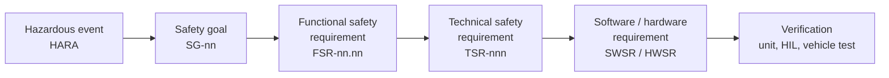

# Deriving and writing safety requirements

How a safety requirement gets from a hazard to a test in LionDriver, and how to write one that a reviewer, a tester
and a formal tool all read the same way. This page explains and links. The requirements themselves, their ASILs and
their status live in the records it points to; nothing here is a requirement.

## 1. Where a requirement sits

Every safety requirement has a parent above it and a test below it. A requirement without either is an orphan,
and the trace checks report it.

| Level | What it says | Owned by |
|---|---|---|
| Safety goal | What must not happen, with its ASIL, FTTI and safe state | [WP-C-03 HARA](../assurance/02-concept/WP-C-03-hara.md) |
| FSR | What the item must do to meet the goal, without saying how | [WP-C-04 FSC](../assurance/02-concept/WP-C-04-functional-safety-concept.md) |
| TSR | How the system does it: which element, which signal, which number | [WP-S-02 TSC](../assurance/03-system/WP-S-02-technical-safety-requirements.md) |
| SWSR / HWSR | What one software unit or hardware part must do | [WP-W-02](../assurance/05-software/WP-W-02-software-safety-requirements.md), [WP-H-01](../assurance/04-hardware/WP-H-01-hardware-safety-requirements.md) |
| Verification | The test that shows it, and its result | [Trace map](../assurance/trace/README.md) |

## 2. Deriving requirements: six routes, one requirement

No single analysis finds every requirement. LionDriver runs several on the same safety goal, compares what they
produce, and only then trusts the result. Five routes **derive** requirements; the sixth, traceability, **confirms**
that the chain is complete and derives nothing.

| # | Route | Shape | Strongest at | Watch out for | In this repository |
|---|---|---|---|---|---|
| 1 | Fault tree (FTA) | Top-down from the violated goal | Finding combinations of faults; quantifying | Gives logic, not behaviour | [WP-A-04](../assurance/08-analyses/WP-A-04-system-fta-fmea.md), [cut sets](../assurance/08-analyses/fta/cut-sets.md) |
| 2 | FMEA | Bottom-up from each part's failure modes | Single-point failures and the controls they need | Weak on interactions | [System, SW and HW FMEAs](../assurance/08-analyses/fmea/fmea-plan.md) |
| 3 | STPA | The control loop | Software, timing and feedback hazards | Needs a control model | [WP-A-05](../assurance/08-analyses/WP-A-05-stpa.md) |
| 4 | Guidewords | A fixed word set (NO, MORE, LESS, LATE…) on every function | Systematic completeness | Laborious | [HARA guideword scenes](../assurance/02-concept/hara/README.md) |
| 5 | Scenarios | The operating envelope and the timing budget | Making a time limit measurable | Finds no new failure modes | [FSC FTTI scenes](../assurance/02-concept/fsc/README.md), [WP-S-04](../assurance/03-system/WP-S-04-timing-ftti-budget.md), [simulation](../assurance/sim/README.md) |
| 6 | Traceability | Synthesis | Completeness, allocation, change impact | Derives nothing itself | [Trace map](../assurance/trace/README.md) |

Two checks run on top, and neither earns evidence credit:

- **Executable fault model.** [fmdtools](../assurance/models/fmdtools/README.md) injects every combination of up to
  four faults and compares the result with the hand-written tree.
- **Formalisation.** [FRET](../assurance/models/README.md) rewrites a requirement in a structured language. An
  ambiguity that a reader skims past becomes a field that will not fill.

### Worked example: the SoC-independent siren

Safety goal SG-02: no loss of lateral control without a take-over warning within 1 s. The specimen is
[FSR-02.05](../assurance/02-concept/WP-C-04-functional-safety-concept.md), the warning that does not depend on the
openpilot computer, and its technical requirement
[TSR-516](../assurance/03-system/WP-S-02-technical-safety-requirements.md), the panda siren. Each route reaches it
from a different side:

| Route | How it lands on the siren |
|---|---|
| FTA | In the SG-02 tree, every cause of lost steering is ANDed with a failed warning. The siren is the branch that does not depend on the computer that failed. |
| FMEA | The row for "openpilot computer stalls" has the siren in its *needed control* column, because the computer cannot warn about its own stall. |
| STPA | The unsafe control action "warning not provided when the panda revokes steering" becomes a constraint, then the requirement. |
| Guidewords | NO and LATE applied to "warn the driver" give the trigger list and the time bound. |
| Scenarios | The plant runs ([silent stall](../assurance/sim/results/silent-stall.md), [engaged mismatch](../assurance/sim/results/engaged-mismatch.md)) show what the 0.5 s buys: the driver corrects about a second earlier. |
| Trace | SG-02 → FSR-02.05 → TSR-516 → SWSR-516 → panda tests and a HIL case. |

The executable model and FRET then checked it from two more sides. The model shows the siren covering ten sets of
the SG-02 tree within the 1 s budget. FRET found that the text set no minimum length or loudness for the siren
(see section 3).

## 3. Writing a safety requirement

### The anatomy

A well-formed safety requirement has six parts. Each maps to a field of FRET's structured language, so the same
breakdown serves a reviewer, a tester and the formal check.

| Part | Asks | FRET field | TSR-307(a) |
|---|---|---|---|
| **Trigger** | When does it apply? | scope and condition | when the SoC heartbeat has reported "not engaged" continuously for 0.3 s while authority is granted |
| **Agent** | Who acts? | component | the envelope (panda safety code) |
| **Modal** | Is it required? | *shall* | shall |
| **Action** | What does it do? | response | revoke |
| **Object** | To what? | response | authority |
| **Constraint** | How fast, how much, how long? | timing | within the same safety-task tick once the 0.3 s is reached |

Every requirement also carries attributes that are not part of the sentence: its **ASIL**, its **parent** (FSR or
safety goal), its **allocation** (software, hardware, or both, and which element), and its **verification method**.
The [TSC table](../assurance/03-system/WP-S-02-technical-safety-requirements.md) has a column for each.

### Rules

1. **One requirement, one *shall*.** Split "detect and warn" into two if they can fail separately.
2. **Every trigger is a state the code can check.** "While engaged" names a signal; "when appropriate" does not.
3. **Every constraint has a number, a unit and a clock.** Say from what event the time runs: fault onset, detection,
   or the first frame.
4. **Say how long a condition must hold.** "Reports X" and "has reported X continuously for t" are different
   requirements.
5. **Bound the output too.** A warning needs a minimum duration and a level, not only a start time.
6. **Write what the safe direction allows.** If moving toward zero is safe, do not forbid it.
7. **One reading only.** If two engineers could implement it differently and both pass, it is not finished.

### Before and after: what formalising TSR-103, TSR-307 and TSR-516 found

The FRET pilot rewrote six panda requirements and compared each with the code. The fixes were text-only, made by the
requirements owner (WP-S-02 v0.53):

| Rule | Before | After |
|---|---|---|
| 4: how long it must hold | TSR-307(a): revoke when the heartbeat reports "not engaged" | ...has reported "not engaged" **continuously for 0.3 s**; an "engaged" heartbeat restarts the count |
| 5: bound the output | TSR-516: sound a warning within 0.5 s | ...**for at least 3 s**, or as long as its condition holds, **at a level audible over the cabin noise** (set by WP-S-04 M-05) |
| 3: one clock | TSR-516: within 0.5 s of detection, and for an EPS fault a persistence of up to 0.7 s | for an EPS fault, the 0.7 s clause **replaces** the 0.5 s bound, so the two can no longer contradict each other |
| 6: safe direction | TSR-103: reject a torque *decrease* larger than Δ_down | any change **toward zero is accepted**; only a rise, or a crossing of zero, beyond the limit is rejected |
| 3: one clock | TSR-516(c): siren when cruise is still on *more than* 0.5 s later | ...still on **0.5 s (within one 10 ms task period)** later, matching what the code does |

Details are in the FRET findings (FF-01 to FF-06) and the
[WP-S-02 version history](../assurance/03-system/WP-S-02-technical-safety-requirements.md).

## 4. Checklist before a requirement goes to review

- It names its parent and at least one verification.
- All six parts are present, and the constraint has a number, a unit and a clock.
- At least two derivation routes reach it, or the record says why one is enough.
- Its ASIL is no lower than the ASIL its parent allocates to it.
- Allocation is explicit: software, hardware or both, and which element.
- It can be read only one way: try writing it in FRETish.
- The trace check passes with it in place.
