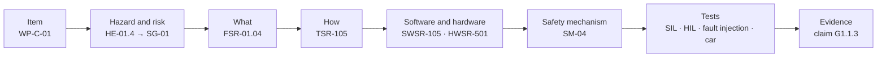

# From hazard to test

How LionDriver gets from "what could go wrong" to "here is the test that shows it doesn't", for someone who has
never seen it done. One real chain is followed the whole way: the safety goal that the car must not steer unless the
driver asked it to. This page explains and links. The records are the work products it points to; nothing here is a
requirement, a test result or evidence.

Every figure is drawn at each wiki sync by [`tools/wiki/h2t_animations.py`](../tools/wiki/h2t_animations.py). Each
phrase it quotes or summarises is checked against its work product, the test statuses come from the case records,
and the code excerpts are checked against opendbc and panda. When a record changes, the build fails instead of
showing old text.

## 0a. The item: what we are making safe

Everything starts with a boundary. Inside it are the parts LionDriver is responsible for
([WP-C-01](../assurance/02-concept/WP-C-01-item-definition.md)). Outside are the car, the driver and the road, which
the item relies on but does not control. What it relies on is written down as **assumptions of use** (AOU), and
each one has to be verified, for example that the EPS lets a normal driver overpower the steering torque.

## 0b. What could go wrong, and how bad? (HARA)

The hazard analysis ([WP-C-03](../assurance/02-concept/WP-C-03-hara.md)) takes each driving situation and asks
what the item could do wrong in it. Each answer is rated for **severity** (how badly people could be hurt),
**exposure** (how often the situation occurs) and **controllability** (how many drivers could still avoid harm).
The three together give the **ASIL**, from A (lowest) to D (highest), or QM when no safety requirement is needed.
The worst hazardous events become **safety goals**: what must never happen.

## 1. The what and the how

A **functional safety requirement** (FSR, [WP-C-04](../assurance/02-concept/WP-C-04-functional-safety-concept.md))
says *what* the item must do to keep the goal true, without design. A **technical safety requirement** (TSR,
[WP-S-02](../assurance/03-system/WP-S-02-technical-safety-requirements.md)) says *how* this system does it: which
element, which signal, how fast. Change the design and the TSRs change; the FSR stays. How to write either one is in
[Deriving and writing safety requirements](Deriving-and-writing-safety-requirements.md).

## 2. Allocation: who owns each requirement

Each TSR is allocated to an element of the architecture and broken down into **software** requirements
([WP-W-02](../assurance/05-software/WP-W-02-software-safety-requirements.md)) and **hardware** requirements
([WP-H-01](../assurance/04-hardware/WP-H-01-hardware-safety-requirements.md)). Here the software owns the check, and
the hardware owns the guarantee that the check keeps running. How hardware failures are counted, and how the QM parts are kept from disturbing the
safety parts, is in [Hardware safety and interference](Hardware-safety-and-interference.md).

## 3. How the engineers meet them

Every line of code and every setting points back to the requirement it meets, and every requirement points forward
to its code and its tests. A line with no requirement, or a requirement with no line, is a finding. Known gaps are
recorded, not hidden: TSR-105 is marked partial because a steer-request bit with zero torque is still accepted.

## 4. The safety mechanism at work

A **safety mechanism** keeps a safety goal true when something else fails. The gate (SM-04,
[WP-S-03](../assurance/03-system/WP-S-03-technical-safety-concept-architecture.md)) catches a bad command from the
openpilot computer; the watchdog catches the gate itself stopping. This figure is an illustration, not a test result.

## 5. Testing it: more than one way

Testing that the code does what the requirement says is only the start. LionDriver also tests on the real chip,
injects faults to check that the mechanisms react in time
([WP-V-05](../assurance/06-validation/WP-V-05-fault-injection.md)), and tests in the car with real drivers whether
the controllability ratings hold ([WP-C-08](../assurance/02-concept/WP-C-08-driver-hmi-misuse-analysis.md)). The fault
tree ([Building a fault tree](Building-a-fault-tree.md)) says which faults are worth injecting. The results become
evidence for the safety case, and count only once they are reviewed:
[What is a safety case?](What-is-a-safety-case.md)
