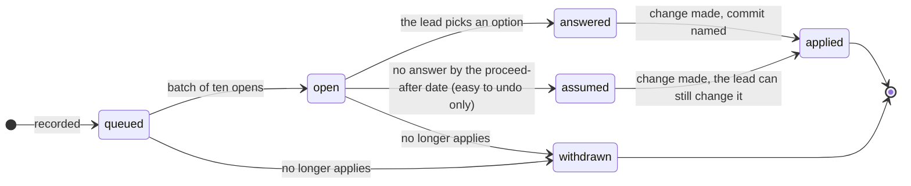

# How decisions are made

The project lead is the safety authority and often reviews from a phone. The process keeps the questions put to
them few, and each one quick to answer. The rules are in the
[decision register README](../assurance/01-management/decisions/README.md); this page is the short version.

## Only the lead decides

- Risk acceptance
- ASIL and hazard scope
- Vehicle behaviour defaults and ODD limits
- Money, hardware, the assessor
- Roles and independence
- Gate go or no-go

## Everything else

A reversible technical choice is made by the engineering side, recorded as *assumed* with the recommended option,
and the lead can change it later. A task is not a decision: it stays in the work product that owns it.

When the register was seeded on 2026-10-14 from a sweep of every open item in `assurance/`, 676 rows were found.
433 were tasks and stayed in their documents. The rest were merged where several documents asked the same
question, and each entry's sources list them all.

## What a question looks like

Every entry in [`register.yaml`](../assurance/01-management/decisions/register.yaml) stands on its own. No bare
IDs. A question carries:

- the question in plain words;
- two or three lines on what is at stake;
- two to four options, the recommendation first, each with what it does and costs;
- how hard it is to undo (`easy`, `revisit`, `hard`), what it blocks, and which gate it belongs to;
- the sources: every document that raised it;
- one picture when it shows the difference between the options.

## Lifecycle of a question

| Status | Meaning |
|---|---|
| `queued` | Recorded but not asked yet. May name questions to settle first. |
| `open` | Asked; in the current batch of about ten. |
| `answered` | The lead picked an option, on the inbox page or in chat. |
| `assumed` | No answer by the proceed-after date; the recommended option was taken. Allowed only when easy to undo. The lead can still change it. |
| `applied` | The change is made. The entry names the commit and where the decision is recorded. |
| `withdrawn` | The question no longer applies; a note says why. |

A `hard` question is never assumed and never applied without an answer from the lead. A `revisit` question
waits for an answer too, but can be reopened at the gate it names. Once applied, the decision is recorded
where the project keeps that kind of decision:
[WP-M-07 §5](../assurance/01-management/WP-M-07-risk-management.md) for strategic decisions, otherwise the work
product that owns the item. The register entry points there.

## The rhythm

1. **Sort before asking.** Only what the lead alone can decide reaches the register as a question.
2. **Batches of ten.** About ten questions are open at a time, those that unblock the most. The rest wait as
   queued, written ahead so the next batch is ready.
3. **Answer on the inbox page or in chat.** The inbox page is generated from the register by
   [`build_inbox.py`](../assurance/01-management/decisions/build_inbox.py); its answers are copied back into the
   register at the start of the next session.
4. **Explanations first.** Requests to explain a question are answered before anything new is asked.
5. **Apply and record.** The change is made, the entry points to the commit, and the next ten open.

[`check_decisions.py`](../assurance/01-management/decisions/check_decisions.py) checks the register against these
rules in the assurance workflow on every pull request.
