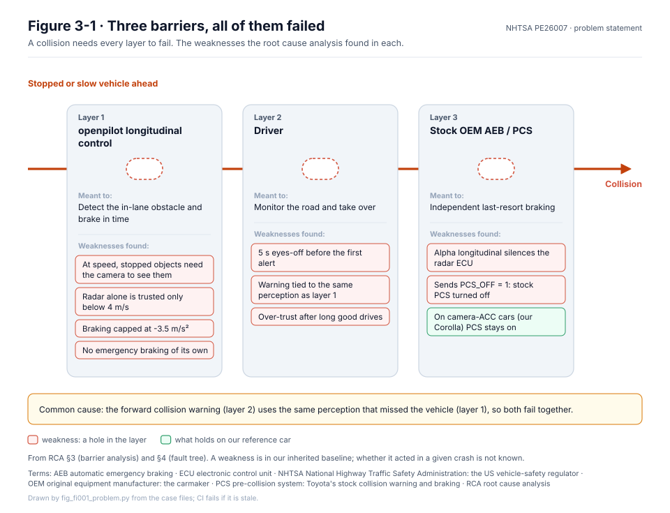

# Problem statement: why LionDriver exists

On 21 September 2026 the US vehicle-safety regulator, NHTSA, opened an investigation into crashes of cars driven by
openpilot on comma devices. Eighteen days later, on 9 October, LionDriver made its first commit. This page is the
problem LionDriver was started to work on. It explains and links; the facts and the analysis live in field case
[FI-2026-001](../docs/safety/field-monitoring/cases/FI-2026-001-nhtsa-pe26007/PROBLEM-STATEMENT.md), where they are
reviewed.

> [!IMPORTANT]
> A Preliminary Evaluation is not a finding of defect. No crash in it has been reconstructed, and nothing on this page
> says why any one crash happened.

## What happened

NHTSA's Office of Defects Investigation opened **Preliminary Evaluation PE26007**, "Crashes involving comma.ai driving
automation products". It covers the comma three, 3X and four devices and the openpilot software, about 30,000 units.
In five crashes, a car with a comma device "reportedly struck stopped or slowly moving vehicles within the same
travel lane". **Three people died and eleven more were injured.** ODI confirmed the system was on or engaged in several
of the crashes, and its first look suggests it "may not have adequately detected or responded to the in-lane
vehicles".

The resume is held unaltered in the repository:
[`INOA-PE26007-17274.pdf`](../docs/safety/field-monitoring/cases/FI-2026-001-nhtsa-pe26007/evidence/INOA-PE26007-17274.pdf).
Every fact in this section is quoted from it, and the case report marks each one as verified against it.

*The crash pattern: the first two scenes in NHTSA's words, the third a late reveal the root cause analysis examines.
From the FI-2026-001 problem statement, drawn by
[`fig_fi001_problem.py`](../docs/safety/field-monitoring/cases/FI-2026-001-nhtsa-pe26007/figures/fig_fi001_problem.py).*

## Why it is LionDriver's problem

LionDriver keeps openpilot's driving stack: the same perception, the same planner, the same collision warning and the
same driver monitoring. NHTSA has said that when a fork is involved in a crash it will look at "the shared components
between openpilot and the fork". LionDriver is such a fork. The case report sets out what is shared, file by file:
[applicability](../docs/safety/field-monitoring/cases/FI-2026-001-nhtsa-pe26007/REPORT.md#4-applicability-to-liondriver).

## The gap

A crash into a vehicle stopped in the lane needs three independent protections to fail together: openpilot's own
braking, the driver, and the car's stock emergency braking. The root cause analysis read the code LionDriver inherits
and found a weakness in each. One of them, the collision warning, depends on the same perception as openpilot's
braking, so the two can fail together.

*The three layers and their weaknesses, from the root cause analysis
([RCA §3](../docs/safety/field-monitoring/cases/FI-2026-001-nhtsa-pe26007/RCA.md#3-protection-layer-barrier-analysis)).*

Underneath is a gap of method, not just of code. Stopped vehicles in the lane were a **documented** upstream
limitation, so the user was told about them and nothing was engineered against them. No requirement set how far ahead
a stopped vehicle must be detected, or how hard the car must brake for one. Driver-monitoring timings were tuned to
avoid nuisance alerts, not set from how fast the hazard develops.

*What openpilot's braking cap costs in distance, idealized and computed, not measured
([RCA §3.1](../docs/safety/field-monitoring/cases/FI-2026-001-nhtsa-pe26007/RCA.md#31-braking-authority-arithmetic-verified-computed)).*

## What LionDriver does about it

LionDriver puts the engineering record around the code that openpilot does not have. The pages in this wiki walk
through each part:

| The gap | What LionDriver does | Read |
|---|---|---|
| A hazard handled only by telling the user | Analyse the hazard and set a safety goal for it, with requirements and tests that can fail | [From hazard to test](From-hazard-to-test.md) |
| The system can be right in its own terms and still not be safe enough | Look for the conditions in which it is not, such as a stopped vehicle revealed late, and validate against them | [SOTIF and ISO 26262](SOTIF-and-ISO-26262.md) |
| No argument that the protections are enough | A safety case published as it is built, with its evidence and its counter-evidence | [What is a safety case?](What-is-a-safety-case.md) |
| Crashes found by the regulator first | Field monitoring from intake to root cause to corrective action | [After release](After-release.md), [Reporting a safety concern](Reporting-a-safety-concern.md) |

What is in place for this case, and what is still open, is listed on the
[problem statement](../docs/safety/field-monitoring/cases/FI-2026-001-nhtsa-pe26007/PROBLEM-STATEMENT.md#6-what-is-in-place-and-what-is-open).
The corrective actions, with their root causes and verification, are in
[`CORRECTIVE-ACTIONS.md`](../docs/safety/field-monitoring/cases/FI-2026-001-nhtsa-pe26007/CORRECTIVE-ACTIONS.md).

## Read further

- [FI-2026-001 problem statement](../docs/safety/field-monitoring/cases/FI-2026-001-nhtsa-pe26007/PROBLEM-STATEMENT.md):
  the full page, with the is / is-not table and what is still unknown.
- [Case report](../docs/safety/field-monitoring/cases/FI-2026-001-nhtsa-pe26007/REPORT.md): facts, applicability and
  containment.
- [Root cause analysis](../docs/safety/field-monitoring/cases/FI-2026-001-nhtsa-pe26007/RCA.md): barriers, fault
  tree, unsafe control actions, 5-Why.
