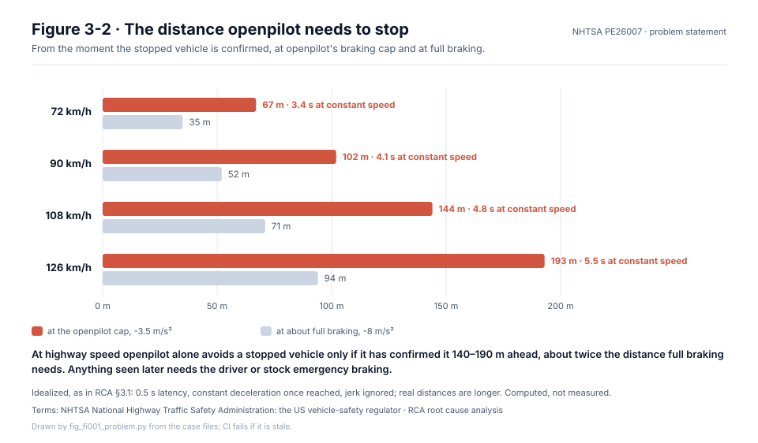

# Why LionDriver exists

> **"Why are you doing this? Why did you start LionDriver?"**
>
> Because on 21 September 2026 the US vehicle-safety regulator opened an investigation into five crashes in which
> cars driven by openpilot ran into a stopped or slow vehicle in their own lane. Three people died. Eleven more were
> injured. openpilot is capable software that thousands of people use every day, but it does not come with an
> engineered, written-down and checked argument that it is safe enough in this situation; its own documentation lists
> stopped vehicles in the lane as a limitation and leaves them to the driver. LionDriver started eighteen days later to
> build that argument in the open: what can go wrong, what should stop it, and the evidence for whether it does.

This page is the long answer. It shows the regulator's report as it was issued, states the problem it describes,
and shows how the rest of this wiki answers it. The facts belong to field case
[FI-2026-001](../docs/safety/field-monitoring/cases/FI-2026-001-nhtsa-pe26007/PROBLEM-STATEMENT.md), where they are
reviewed. This page explains and links.

## The report that started it

This is the opening resume of NHTSA Preliminary Evaluation **PE26007**, issued by the Office of Defects Investigation
on 21 September 2026. It is shown as issued, page for page. The original PDF is
[in the repository](../docs/safety/field-monitoring/cases/FI-2026-001-nhtsa-pe26007/evidence/INOA-PE26007-17274.pdf).

![NHTSA ODI resume for PE26007, page 1 of 2. Investigation PE26007, opened 09/21/2026, prompted by SGO 2021-01 reports, a VOQ and police outreach; subject: crashes involving comma.ai driving automation products. Manufacturer comma.ai; products comma three, comma 3X, comma four, openpilot; population 30,000 (estimated). Problem description: crashes involving stopped or slow moving in-lane vehicles. Failure report summary, totals: 5 incidents, 5 crashes, 4 injury incidents, 14 injuries, 2 fatality incidents, 3 fatalities. Action: open this Preliminary Evaluation. The summary begins: ODI received notice of five crashes in which vehicles with comma devices installed reportedly struck stopped or slowly moving vehicles within the same travel lane.](../docs/safety/field-monitoring/cases/FI-2026-001-nhtsa-pe26007/evidence/INOA-PE26007-17274-page-1.png)

![NHTSA ODI resume for PE26007, page 2 of 2. The summary continues: preliminary data suggests the comma system may not have adequately detected or responded to the in-lane vehicles; two crashes resulted in three fatalities and four crashes caused injuries to eleven other individuals. It describes the devices as after-market accessories sold to consumers for self-installation that provide sustained automated control of speed and heading, quotes the company's claims, and says ODI will investigate crashes involving slower or stopped vehicles or hazards in lane, verify system status, evaluate performance and safeguards, and, where a fork is involved, consider the components it shares with openpilot. It lists five SGO report IDs: 30351-15888, 30351-14668, 30351-11961, 30351-1807 and 62-14853.](../docs/safety/field-monitoring/cases/FI-2026-001-nhtsa-pe26007/evidence/INOA-PE26007-17274-page-2.png)

*NHTSA, ODI Resume PE26007, 21 September 2026, pages 1 and 2, rendered unaltered from the PDF.*

### What it says, in plain words

- **The pattern.** In five crashes, a car with a comma device "reportedly struck stopped or slowly moving vehicles
  within the same travel lane". It was not a cut-in, a crossing car or a pedestrian.
- **The cost.** Two of the crashes killed three people. Four of them injured eleven others, some seriously.
- **The system was on.** NHTSA confirmed the system was "powered on or engaged in multiple crashes", and its early
  look suggests it "may not have adequately detected or responded to the in-lane vehicles".
- **The scope.** About 30,000 comma three, 3X and four devices, and the openpilot software.
- **Forks are in it.** Where a crash involves a fork of openpilot, NHTSA will "consider the shared components between
  openpilot and the fork". LionDriver is a fork.
- **What it is not.** A Preliminary Evaluation is the first step of an investigation. It is not a finding of a defect,
  and no crash in it has been reconstructed yet.

## The problem statement

**With openpilot engaged on public roads, a car can hit a stopped or slow vehicle in its own lane. openpilot does not
brake enough in time, the driver does not take over in time, and the car's own emergency braking, where it is fitted,
does not prevent the crash.**

That is the problem LionDriver works on. The
[full problem statement](../docs/safety/field-monitoring/cases/FI-2026-001-nhtsa-pe26007/PROBLEM-STATEMENT.md) draws
its edges with an is / is-not table and lists what is still unknown.

*The crash pattern: the first two scenes in NHTSA's words, the third a late reveal the root cause analysis examines.
Drawn by [`fig_fi001_problem.py`](../docs/safety/field-monitoring/cases/FI-2026-001-nhtsa-pe26007/figures/fig_fi001_problem.py).*

## Why the software alone does not answer it

A crash into a vehicle stopped in the lane needs three independent protections to fail together: openpilot's own
braking, the driver, and the car's stock emergency braking. LionDriver's root cause analysis read the code it inherits
and found a weakness in each. One of them, the collision warning, depends on the same perception as openpilot's
braking, so the two can fail together.

*The three layers and their weaknesses
([RCA §3](../docs/safety/field-monitoring/cases/FI-2026-001-nhtsa-pe26007/RCA.md#3-protection-layer-barrier-analysis)).*

The deeper gap is one of method. Stopped vehicles in the lane were a **documented** upstream limitation: users were
told about them, but nothing was engineered against them. No requirement set how far ahead a stopped vehicle must be
detected, or how hard the car must brake for one. Driver-monitoring timings were tuned to avoid nuisance alerts, not
set from how fast the hazard develops.

*What openpilot's braking cap costs in distance: idealized and computed, not measured
([RCA §3.1](../docs/safety/field-monitoring/cases/FI-2026-001-nhtsa-pe26007/RCA.md#31-braking-authority-arithmetic-verified-computed)).*

## What LionDriver does about it

LionDriver keeps openpilot's code and puts the engineering record around it that openpilot does not have:

| The gap | What LionDriver does | Read |
|---|---|---|
| A hazard handled only by telling the user | Analyse the hazard, set a safety goal for it, and write requirements and tests that can fail | [From hazard to test](From-hazard-to-test.md) |
| The system can work as designed and still not be safe enough | Look for the conditions in which it is not safe enough, such as a stopped vehicle revealed late, and validate against them | [SOTIF and ISO 26262](SOTIF-and-ISO-26262.md) |
| No argument that the protections are enough | Publish a safety case as it is built, with its evidence and its counter-evidence | [What is a safety case?](What-is-a-safety-case.md) |
| The regulator finds the crashes first | Monitor the field, from intake to root cause to corrective action | [After release](After-release.md), [Reporting a safety concern](Reporting-a-safety-concern.md) |

The [problem statement](../docs/safety/field-monitoring/cases/FI-2026-001-nhtsa-pe26007/PROBLEM-STATEMENT.md#6-what-is-in-place-and-what-is-open)
lists what is in place for this case and what is still open.

## Questions people ask

**Is LionDriver safer than openpilot?**
LionDriver doesn't claim to be. It builds the record that would show whether a change makes the car safer, and it
publishes what that record says, including the counter-evidence. See
[Reading the Living Safety Case](Reading-the-Living-Safety-Case.md).

**Is this about blaming comma or openpilot?**
No. The resume describes an investigation, not a verdict, and LionDriver runs the same code. The point is that a
system this capable needs an engineered safety argument, and that argument can be built in the open on top of
openpilot.

**Why a fork, and not a change to openpilot?**
The record is large, its rules are strict, and it moves at its own pace: hazard analysis, requirements, reviews and
evidence. A fork lets it be built around the code without slowing upstream down. What it finds can still go back
upstream.

**Has LionDriver reproduced the crashes?**
Not yet. The crash data is not public, and the five SGO reports have not been retrieved yet; that is action FA-02 in
the [corrective actions](../docs/safety/field-monitoring/cases/FI-2026-001-nhtsa-pe26007/CORRECTIVE-ACTIONS.md). The
analysis so far reads the code; it does not say why any one crash happened.

## Read further

- [FI-2026-001 problem statement](../docs/safety/field-monitoring/cases/FI-2026-001-nhtsa-pe26007/PROBLEM-STATEMENT.md):
  the full page, with the is / is-not table and the unknowns.
- [Case report](../docs/safety/field-monitoring/cases/FI-2026-001-nhtsa-pe26007/REPORT.md): every fact, marked
  verified or reported, and the containment in force.
- [Root cause analysis](../docs/safety/field-monitoring/cases/FI-2026-001-nhtsa-pe26007/RCA.md): barriers, fault tree,
  unsafe control actions, 5-Why.
