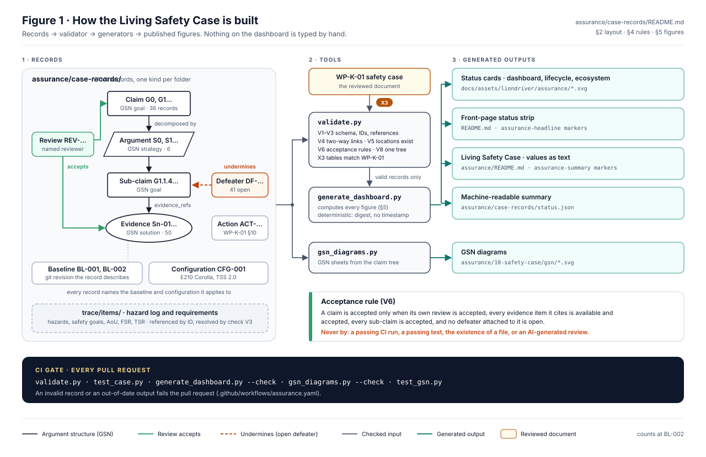

# Reading the Living Safety Case

The safety argument is published while it is being built. This page explains the figures on the dashboard and
what they do and do not promise. New to safety cases? Start with [What is a safety case?](What-is-a-safety-case.md). The dashboard itself, with every value also given as text, is in the
[README](../README.md#living-safety-case) and in [`assurance/README.md`](../assurance/README.md#living-safety-case).

## The headline, figure by figure

The README carries a one-line headline generated from the records. Read left to right:

| Figure | What it means |
|---|---|
| **Lifecycle stage** (for example *Development*) | Where the project is. Nothing is released; every work product is a draft until reviewed. |
| **Baseline** (`BL-nnn` at a commit) | The frozen state of the record the figures are computed against, and the commit it was taken at. |
| **Claims**, with how many have accepted evidence | Statements the case argues. "0 with accepted evidence" means no claim has passed confirmation review yet. |
| **Evidence items**, with how many are accepted | Tests, analyses and reviews that are recorded. Recorded is not accepted. |
| **Open defeaters** | Known reasons the argument might not hold. Published on purpose. |
| **Records digest** | A hash of every record. It changes whenever any record changes, so two readers can confirm they saw the same state. |

## Why zero accepted is honest

Evidence becomes *accepted* only after a confirmation review by someone independent of the author
([WP-P-05](../assurance/07-supporting/WP-P-05-verification-review-procedure.md)). No work product has had one
yet, so the count is zero. A project that showed accepted evidence before any review had happened would be the
one to distrust.

## What the dashboard guarantees

- Every figure is generated from the records under [`assurance/case-records/`](../assurance/case-records/README.md) by
  [`generate_dashboard.py`](../assurance/case-records/tools/generate_dashboard.py), never typed by hand.
- The [assurance workflow](../.github/workflows/assurance.yaml) validates the records and regenerates the
  dashboard on every pull request, and fails if the committed dashboard is out of date or the records are
  inconsistent.
- The records digest in the headline identifies the exact state the figures describe.

## How the records fit together

*Figure 1 of the [case records README](../assurance/case-records/README.md).*

1. **Hazards and safety goals**, from the [HARA](../assurance/02-concept/WP-C-03-hara.md). Each goal carries an
   ASIL.
2. **Claims**: the argument that each goal is met, broken into statements that can be evidenced. The argument
   structure is drawn as GSN diagrams from the records.
3. **Evidence**, linked to claims. Each item carries a review state and, once reviewed, who reviewed it and when.
4. **Defeaters**, attached to claims. The [gap assessment](../assurance/00-assessment/gap-assessment.md) is their
   main source.
5. **Baselines and reviews**: named states of the whole, and the confirmation reviews recorded against them.

The record formats are described in [`assurance/case-records/README.md`](../assurance/case-records/README.md) and enforced by
[`validate.py`](../assurance/case-records/tools/validate.py).

## Verifying a snapshot

Each [snapshot release](https://github.com/jherrodthomas/LionDriver/releases/tag/snapshot-latest) carries the
safety case as a PDF at a named baseline, with a manifest of hashes and a build attestation. The release page has
the exact steps to verify a copy against the repository. A numbered controlled copy for a named recipient is
issued by the [controlled copy workflow](../.github/workflows/safety-case-controlled-copy.yaml) and recorded in
the distribution record.

- [Read the safety case, WP-K-01](../assurance/10-safety-case/WP-K-01-safety-case.md)
- [Known gaps](../assurance/00-assessment/gap-assessment.md)
- [Latest snapshot release](https://github.com/jherrodthomas/LionDriver/releases/tag/snapshot-latest)

> Assurance status represents recorded engineering evidence and review state. It does not constitute
> certification or approval for unsupervised operation.
