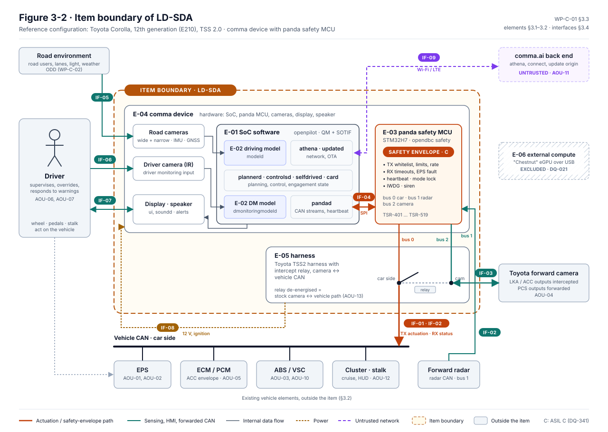
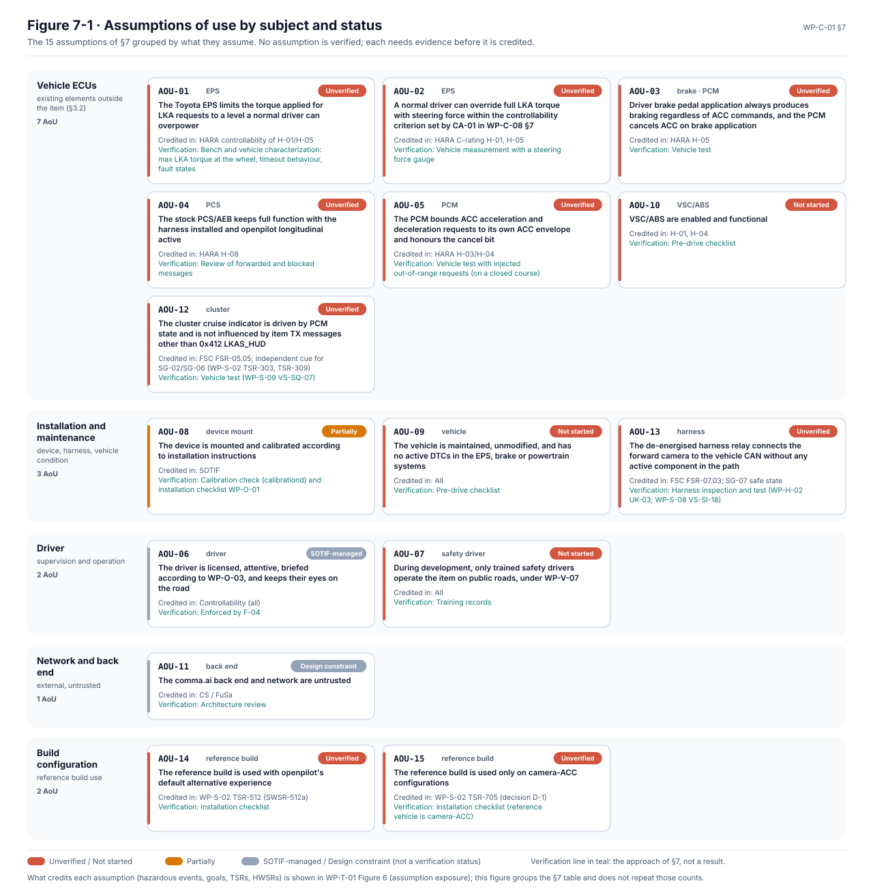

# Reference vehicle

The first configuration the assurance work analyses is a Toyota Corolla. It is a starting point, not a limit:
LionDriver keeps every upstream car port, and further vehicles join through a documented impact analysis. This
page says what the reference configuration is, why it was chosen, and how a second one is added.

> **Vehicle compatibility does not imply independent safety assurance.** A car that openpilot supports has not,
> by that fact, been analysed, verified or reviewed by LionDriver, and no vehicle is approved for unsupervised
> operation.

## CFG-001 at a glance

The engineering facts live in the [vehicle register](../docs/liondriver/vehicles/README.md), generated from
[`vehicles.yaml`](../docs/liondriver/vehicles/vehicles.yaml), and the safety-case record is
[`cfg-001-toyota-corolla-e210.yaml`](../assurance/case-records/configurations/cfg-001-toyota-corolla-e210.yaml). This
table repeats the headline facts; the register is authoritative and marks values still awaiting their source.

| Attribute | Value |
|---|---|
| Vehicle | Toyota Corolla sedan, US market, 12th generation (E210), pre-facelift |
| Model years | 2020 to 2022 |
| Toyota model code | ZRE212 |
| Powertrain | 2ZR-FAE 1.8 L petrol, CVT |
| Driver assistance | Toyota Safety Sense 2.0 |
| openpilot platform | `TOYOTA_COROLLA_TSS2`, safety mode `toyota` |
| Device and harness | comma 3X or comma four with the integrated panda, Toyota A connector |
| Classification | LionDriver Evaluated; evaluation in progress, no accepted claims |

**Not covered by this configuration:** 2023 and later model years (the facelift with Toyota Safety Sense 3.0,
not supported by openpilot), the 2.0 L trims and the manual transmission, the Corolla Hybrid, Hatchback, Cross
and GR Corolla, Lexus UX and other platform siblings, and markets other than the US.

The scope boundary is the ECU firmware set: a car is covered only if its ECU firmware is in the set recorded
for the configuration. That set is still being recorded.

## What the reference configuration fixes

The [assurance strategy](../assurance/01-management/WP-M-01-assurance-strategy.md#3-what-liondriver-will-claim)
makes the reference configuration the only scope the claims apply to. The Corolla was chosen because it exercises
the whole function under analysis: on this car openpilot provides both lane centring and longitudinal control by
default, while the vehicle's own EPS torque limits and pre-collision braking stay active as independent barriers
the safety argument relies on ([WP-M-01 §3.1](../assurance/01-management/WP-M-01-assurance-strategy.md#31-reference-configuration-the-only-scope-claims-apply-to)).
The configuration pins more than the car:

| Element | Reference configuration |
|---|---|
| Vehicle | Toyota Corolla E210, Toyota Safety Sense 2.0, US market, petrol. The whole generation with those qualifiers, not one model year or trim |
| Device | One identified comma device hardware revision, with the Toyota harness |
| Software | A tagged LionDriver release that pins openpilot, opendbc, panda, the libraries and the model weights by commit |
| Function | Supervised SAE Level 2: lane centring plus openpilot longitudinal control with stop-and-go. On this car openpilot longitudinal runs by default |
| Operating domain | Defined in [WP-C-02](../assurance/02-concept/WP-C-02-odd-and-intended-functionality.md) |
| User | A licensed, attentive driver briefed according to [WP-O-03](../assurance/09-production-operation/WP-O-03-user-information-safety-warnings.md). During development, trained safety drivers only |

The vehicle's own electronics, the EPS, the engine controller, the brake actuator, the stock radar and camera,
are outside the item. What the analysis assumes about them, for example that the EPS limits steering torque and
faults safely and that stock pre-collision braking stays available, is written down as an assumption of use
(`AOU-`), linked from the configuration record, and has to be verified on the vehicle. The
[item definition, WP-C-01](../assurance/02-concept/WP-C-01-item-definition.md) draws the boundary.

*Figure 3-2 of WP-C-01, generated from the item model and checked by CI.*

[How LionDriver works](How-LionDriver-works.md) shows how the device connects to this car and steers it.

*Figure 7-1 of WP-C-01. Dense by design: the [full-size figure](../assurance/02-concept/figures/fig-c01-7-1-aou-map.svg) is easier to read than the embed.*

## The three classifications

| Classification | Meaning | How a configuration gets there |
|---|---|---|
| **Upstream Compatible** | Supported by the inherited openpilot integration | Listed in [CARS.md](../docs/CARS.md) at the pinned upstream version |
| **LionDriver Evaluated** | Undergoing or completed documented engineering evaluation | A configuration record in `assurance/case-records/configurations/` with an item definition and an impact analysis against the platform assumptions |
| **Assurance Supported** | Defined configuration with accepted evidence for specific safety claims | At least one claim for that configuration accepted through a recorded review; the validator refuses the classification otherwise |

The counts on the README's ecosystem card are generated from those sources, so they cannot drift from the
records. See [vehicle compatibility](../docs/liondriver/compatibility.md).

## Adding a second vehicle

1. Copy the Corolla record to a new `CFG-nnn` with `classification: liondriver-evaluated` and
   `evaluation_state: in-progress`.
2. Add the vehicle facts to [`vehicles.yaml`](../docs/liondriver/vehicles/vehicles.yaml) under the same ID
   (codename, model years, model code, powertrain, firmware set, exclusions) and regenerate the register with
   `python3 tools/vehicles/vehicle_register.py`.
3. Record the configuration baseline: car platform, brand safety mode and parameters, each with its source in
   the pinned upstream code.
4. Record how the car protects its messages (checksum, counter, CAN or CAN FD) against the table in
   [CAN, CAN FD and end-to-end protection](CAN-CAN-FD-and-end-to-end-protection.md#8-other-cars-protect-their-messages-better).
5. Write the [impact analysis](../assurance/01-management/WP-M-12-impact-analysis.md): which assumptions of use
   hold for this vehicle, which differ, and what evidence each needs.
6. Run the validator and the dashboard generator, then open a pull request.

Upstream car-port changes arrive through submodule updates under the
[upstream management process](../assurance/01-management/WP-M-11-upstream-and-supplier-management.md); they
are not edited in this repository.
