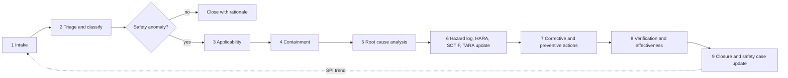

# Reporting a safety concern

Three routes, depending on what you found. If you are unsure which one applies, report anyway and say so; the
safety manager will route it.

| What you found | Where it goes | Why |
|---|---|---|
| A security vulnerability | **Privately**, through [GitHub private vulnerability reporting](https://github.com/jherrodthomas/LionDriver/security/advisories/new). Never a public issue, pull request or discussion. | Security issues can affect vehicle safety, and public disclosure before a fix puts drivers at risk. [SECURITY.md](../SECURITY.md) has the full policy. |
| A field incident, a near miss, or a suspected hazard | A GitHub issue with the `field-issue` label, or a copy of the [field issue report template](../docs/safety/field-monitoring/templates/FIELD-ISSUE-REPORT.md) | It enters the [field monitoring process](../docs/safety/field-monitoring/PROCESS.md) and the register. |
| A bug, a question, or a doubt about an analysis | An ordinary [issue](https://github.com/jherrodthomas/LionDriver/issues) | Everything else. |

## What to include in a field issue

- Source links, if the signal comes from a regulator, upstream, a fork, the press or the community.
- Vehicle, software version or fork, and the device.
- The scenario and the outcome. Keep facts separate from claims; the template has a column for each.
- Driver-monitoring state and any alerts, if known.

If you are unsure, report anyway. A near miss in a scenario that can kill is a Class A issue even when nothing
happened this time.

## What happens next

The signal follows one path whether it comes from a regulator, upstream openpilot, a fork, the community or the
project's own test drives:

*The flowchart of [LD-SAF-PRC-001 §5](../docs/safety/field-monitoring/PROCESS.md), written here as Mermaid so it is reviewed as text.*

Triage happens within two business days. The severity class is based on the worst credible outcome, not the
outcome observed:

| Class | Criteria, any one | Containment decision due | Root cause analysis starts |
|---|---|---|---|
| **A, critical** | Fatality or life-threatening injury credible; regulatory defect investigation or recall; loss of a safety mechanism; cyber exploit with physical effect | 24 hours | 3 days |
| **B, major** | Severe or moderate injury credible; unexpected actuation; safety goal violated with no harm; driver-monitoring or driver-alert failure | 5 days | 10 days |
| **C, minor** | No credible injury; degraded comfort or availability; warning without hazard; documentation error | | Next planning cycle |
| **D, not a safety anomaly** | Feature request; not reproducible and not plausible; out of scope with evidence | | Closed with a rationale |

Each issue also gets a root cause category: systematic fault, random hardware fault, performance limitation,
ML insufficiency, foreseeable misuse, configuration fault, cybersecurity event, or process escape. Class A and
B issues cannot close without a review by someone other than the analyst. The process is
[LD-SAF-PRC-001](../docs/safety/field-monitoring/PROCESS.md); every issue and every monitoring sweep is in the
[register](../docs/safety/field-monitoring/REGISTER.md), and the hazards found go to the
[hazard log](../docs/safety/field-monitoring/HAZARD-LOG.md).

## A worked example: FI-2026-001

In September 2026 NHTSA opened a preliminary evaluation, PE26007, into comma devices and openpilot after five
crashes in which equipped vehicles struck stopped or slow vehicles in their own lane. The project recorded it as
[FI-2026-001](../docs/safety/field-monitoring/cases/FI-2026-001-nhtsa-pe26007/REPORT.md), Class A, applicable
to LionDriver because it runs the same stack. The root cause analysis is complete at the code level and waits
on field logs and a reproduction. Two lessons already feed the analyses:

- A limitation that is only documented is not a control. Stationary in-lane vehicles were a known upstream
  limitation handled solely by user information. Every Class A limitation needs an engineered control or an
  operating-domain restriction.
- An "alpha" toggle can remove an independent OEM safety barrier. Configuration options need safety impact
  analysis just like code changes.

## Rules for anyone testing

Test only on equipment you own. Never test on public roads or in a moving vehicle outside a closed course. Do
not access other people's devices, data or accounts, and do not attack comma.ai or other third-party
infrastructure. These rules are from [SECURITY.md](../SECURITY.md) and apply to safety testing too.
