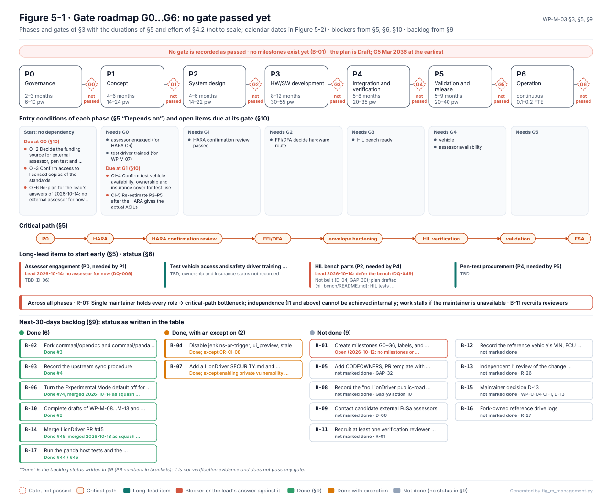

# Roadmap and status

Four phases. Status is taken from what exists in the repository: "draft" means the work product is written but
not reviewed, and nothing is called complete before its review. This table mirrors the
[roadmap in the README](../README.md#roadmap); a status changes here only when the owning work product changes
its document-control header.

| Phase | State |
|---|---|
| 1 · Foundation | Active |
| 2 · Safety engineering | Active |
| 3 · Implementation and verification | Planned |
| 4 · Expanded assurance | Planned |

## Where each phase stands

| Phase | Work | Status |
|---|---|---|
| **1 · Foundation** | Project governance and [safety plan](../assurance/01-management/WP-M-02-safety-plan.md) | Draft |
| | [Upstream baseline gap assessment](../assurance/00-assessment/gap-assessment.md) | Draft |
| | [Assurance data model](../assurance/case-records/README.md) and [traceability data](../assurance/trace/README.md) | Draft; hazards, goals, assumptions and safety case recorded, requirements not yet |
| **2 · Safety engineering** | [Hazard analysis](../assurance/02-concept/WP-C-03-hara.md) and [functional safety concept](../assurance/02-concept/WP-C-04-functional-safety-concept.md) | Draft |
| | [SOTIF analysis](../assurance/02-concept/WP-C-06-sotif-insufficiencies-triggering-conditions.md), [cybersecurity analysis](../assurance/02-concept/WP-C-09-tara.md), [AI safety requirements](../assurance/02-concept/WP-C-11-ai-system-definition-and-safety-requirements.md) | Draft |
| | Architecture analysis: [technical safety concept](../assurance/03-system/WP-S-03-technical-safety-concept-architecture.md), [FTA and FMEA](../assurance/08-analyses/WP-A-04-system-fta-fmea.md), [dependent failure analysis](../assurance/08-analyses/WP-A-03-dependent-failure-analysis.md), [STPA](../assurance/08-analyses/WP-A-05-stpa.md) | Draft |
| | [Field monitoring, safety anomaly and root cause process](../docs/safety/field-monitoring/README.md); first case FI-2026-001 (NHTSA PE26007) | Draft |
| **3 · Implementation and verification** | Safety mechanisms from the [technical safety requirements](../assurance/03-system/WP-S-02-technical-safety-requirements.md) | Planned |
| | [ISO 26262-6 software lifecycle](../assurance/01-management/WP-M-14-iso26262-6-implementation-specification.md) (Clauses 5 to 11) | Specified; starts after the Part 2 to 4 work products and supporting processes are approved |
| | Automated verification of the inherited safety code: unit tests, coverage gate, MISRA, mutation | Running in [CI](../.github/workflows/safety.yaml); not yet reviewed as evidence |
| | Regression testing, simulation, fault injection, evidence generation | Specified, not executed |
| **4 · Expanded assurance** | More evaluated configurations, independent review, living safety-case maturity, continuous assurance, community contributions | Planned |

## What the next gate needs

*Figure 5-1 of [WP-M-03 project plan](../assurance/01-management/WP-M-03-project-plan.md), generated by `fig_m_management.py` and checked by CI.*

Phase 3 starts when the Part 2 to 4 work products and the supporting processes have passed confirmation review
([WP-P-05](../assurance/07-supporting/WP-P-05-verification-review-procedure.md)). Until then every claim in the
safety case stays at zero accepted evidence by design: evidence is recorded first and accepted only after
independent review. The gates themselves are defined in the
[project plan](../assurance/01-management/WP-M-03-project-plan.md), and the questions that still wait on the
project lead are in the [decision register](How-decisions-are-made.md).

## Sources

- [README, Roadmap](../README.md#roadmap)
- [WP-M-00 work product register](../assurance/01-management/WP-M-00-work-product-register.md): every work product, its revision and status
- [WP-M-03 project plan](../assurance/01-management/WP-M-03-project-plan.md): phases and gates
