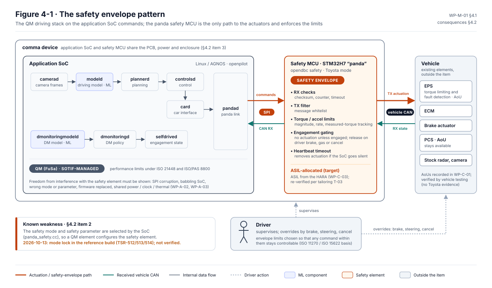

# Standards at a glance

LionDriver follows standards-informed development: its work products are structured after these standards and
cite their clauses. **No compliance is claimed**, because no assessment has been performed. The
[assurance strategy, WP-M-01](../assurance/01-management/WP-M-01-assurance-strategy.md) explains how each
standard is tailored to an open-source, supervised Level 2 system.

## The five, and the question each answers

| Standard | The question | Main work products |
|---|---|---|
| **ISO 26262**, functional safety | What if something breaks? | [HARA, WP-C-03](../assurance/02-concept/WP-C-03-hara.md) · [functional safety concept, WP-C-04](../assurance/02-concept/WP-C-04-functional-safety-concept.md) · [technical safety concept, WP-S-03](../assurance/03-system/WP-S-03-technical-safety-concept-architecture.md) · hardware and software requirements |
| **ISO 21448**, SOTIF | What if nothing breaks but the system still gets it wrong? | [SOTIF hazards, WP-C-05](../assurance/02-concept/WP-C-05-sotif-hazard-identification.md) · [insufficiencies and triggering conditions, WP-C-06](../assurance/02-concept/WP-C-06-sotif-insufficiencies-triggering-conditions.md) · [validation strategy, WP-V-02](../assurance/06-validation/WP-V-02-sotif-vv-strategy.md) · explained on [SOTIF and ISO 26262](SOTIF-and-ISO-26262.md) |
| **ISO/SAE 21434**, cybersecurity | What if someone attacks it? | [TARA, WP-C-09](../assurance/02-concept/WP-C-09-tara.md) · [cybersecurity goals and concept, WP-C-10](../assurance/02-concept/WP-C-10-cybersecurity-goals-and-concept.md) · [cybersecurity case, WP-K-03](../assurance/10-safety-case/WP-K-03-cybersecurity-case.md) · explained on [Cybersecurity and ISO/SAE 21434](Cybersecurity-and-ISO-21434.md) |
| **ISO/PAS 8800**, AI safety | How far can a learned component be trusted? | [AI system definition and requirements, WP-C-11](../assurance/02-concept/WP-C-11-ai-system-definition-and-safety-requirements.md) · [ML engineering, WP-W-10](../assurance/05-software/WP-W-10-ml-engineering.md) · explained on [AI safety and ISO/PAS 8800](AI-safety-and-ISO-PAS-8800.md) |
| **UL 4600**, safety case | Is the whole argument convincing? | [Safety case, WP-K-01](../assurance/10-safety-case/WP-K-01-safety-case.md) · [machine-readable records](../assurance/case-records/README.md) |

## Supporting practices

| Practice | Where it is applied |
|---|---|
| Automotive SPICE | [Capability baseline, WP-M-13](../assurance/01-management/WP-M-13-aspice-capability-baseline.md): a self-assessment, not a formal assessment. Target CL2 for the system, software, support and management processes, CL1 for machine learning and hardware |
| Systems engineering and requirements management | [System requirements, WP-S-01](../assurance/03-system/WP-S-01-system-requirements.md) · [traceability procedure, WP-P-06](../assurance/07-supporting/WP-P-06-requirements-management-traceability.md) · [trace data](../assurance/trace/README.md) |
| Safety analysis | [ASIL decomposition](../assurance/08-analyses/WP-A-01-asil-decomposition.md) ([explained](ASIL-decomposition.md)) · [freedom from interference](../assurance/08-analyses/WP-A-02-coexistence-freedom-from-interference.md) · [dependent failures](../assurance/08-analyses/WP-A-03-dependent-failure-analysis.md) · [FTA and FMEA](../assurance/08-analyses/WP-A-04-system-fta-fmea.md) · [STPA](../assurance/08-analyses/WP-A-05-stpa.md) |
| Simulation, SIL and HIL | [Embedded software testing, WP-W-08](../assurance/05-software/WP-W-08-embedded-software-testing.md) · [SOTIF verification and validation, WP-V-02](../assurance/06-validation/WP-V-02-sotif-vv-strategy.md) |
| Fault injection | [WP-V-05](../assurance/06-validation/WP-V-05-fault-injection.md) |
| Independent review | [Confirmation measures plan, WP-M-06](../assurance/01-management/WP-M-06-confirmation-measures-plan.md) · [verification review procedure, WP-P-05](../assurance/07-supporting/WP-P-05-verification-review-procedure.md) |
| IEC 61508 | Referenced for the supplier safety documentation of the safety microcontroller ([component qualification, WP-H-07](../assurance/04-hardware/WP-H-07-hardware-component-qualification.md)) |

## How they fit together

One shared **hazard log**, in the HARA with SOTIF and TARA cross-references, and one **requirements database**,
in [`assurance/trace/`](../assurance/trace/README.md), hold the five standards together
([Integrated standards: one system, not five](Integrated-standards.md) explains how):

| Topic | Primary standard | Interface |
|---|---|---|
| Hazards from malfunctions | ISO 26262-3 HARA | Shares the hazard list and situation catalogue with the SOTIF hazard identification, so there is one hazard log |
| Hazards from insufficiencies and misuse | ISO 21448 | Uses the same hazardous events; severity and controllability reuse the HARA ratings |
| ML models | ISO/PAS 8800, ASPICE MLE | Model errors feed in as SOTIF functional insufficiencies; data and model lifecycle in WP-W-10 |
| Cyber attacks that cause safety hazards | ISO/SAE 21434 TARA | Damage scenarios link to HARA hazards; cybersecurity goals that protect safety goals are traced both ways |
| Process capability | Automotive SPICE | The ISO 26262 work products double as ASPICE information items; each register entry carries its process ID; explained on [ASPICE: is the process capable?](ASPICE-process-capability.md) |

## The central argument: the safety envelope

The learned driving stack proposes; a small deterministic layer on the panda microcontroller checks before
anything reaches the car. Most of the tailoring follows from concentrating ASIL effort there.

*Figure 4-1 of [WP-M-01 assurance strategy](../assurance/01-management/WP-M-01-assurance-strategy.md), pinned to §4.1 and §4.2 so CI detects when it may be stale.*

## Tailoring decisions worth knowing

ISO 26262 assumes an OEM or supplier developing a series-production item. LionDriver is an open-source aftermarket
retrofit built from inherited software on commercial hardware. The strategy records thirteen tailoring decisions,
each needing confirmation by an independent assessor. The ones that shape the project most:

- **The item boundary** is the comma device, the harness and the LionDriver software as installed. Vehicle ECUs
  are outside the item, with assumptions of use, because LionDriver cannot change them or obtain evidence for
  them.
- **The safety envelope is re-verified to the ASIL from the HARA.** Requirements, architecture and unit design
  are back-filled from the existing code, then fully verified. The learned driving stack is handled as QM plus
  SOTIF.
- **Proven in use is not claimed** for any element. The openpilot fleet history is supporting evidence only.
- **Independence.** The author of a work product never reviews it. With a single maintainer, confirmation reviews
  of the HARA, the safety plan and the safety case, and the functional safety assessment, need an external
  assessor.
- **Regulatory.** US market, where no type approval applies to an aftermarket retrofit. NHTSA's Standing General
  Order crash reporting is the model for field monitoring.

The full table is in [WP-M-01 §5](../assurance/01-management/WP-M-01-assurance-strategy.md#5-tailoring). Which
clauses each assurance folder answers to is in
[`assurance/README.md`](../assurance/README.md#layout).
